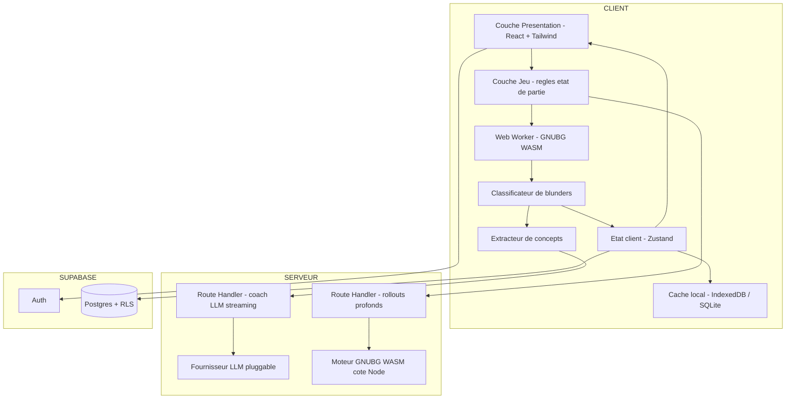
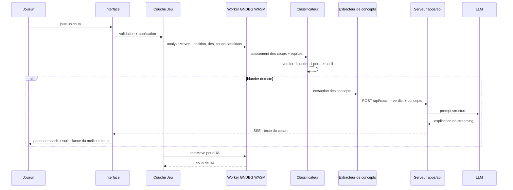

multi j# ARCHITECTURE — Backgammon Coach IA

> Application web de Backgammon avec coach IA temps réel, construite pour être portée sur mobile via Capacitor.
> **Statut : document de conception — aucun code d'implémentation.**

---

## 1. Vision et objectifs

Une application de Backgammon où le joueur joue contre une IA de niveau mondial (GNU Backgammon) et reçoit, **en temps réel**, des explications pédagogiques sur ses erreurs :

- **Blunders de pions** : coups joués dont la perte d'équité dépasse un seuil configurable.
- **Blunders de videau** : décisions de double/prendre/passer incorrectes (double manqué, take/pass erroné).

Principes directeurs :

| Principe | Signification |
|---|---|
| **Vérité moteur** | GNUBG est l'autorité absolue sur la force d'un coup. Le LLM n'évalue jamais, il n'explique que. |
| **Interprétation structurée** | Un extracteur de concepts transforme la position en données typées (pip counts, blots, primes, ancres…) avant toute explication. |
| **Pédagogie, pas jugement** | Le coach explique *pourquoi* le coup est mauvais et *quoi* retenir, avec un vocabulaire adapté au niveau du joueur. |
| **Local-first, cloud-ready** | Le jeu et l'analyse rapide fonctionnent offline ; le cloud ajoute comptes, historique, rollouts profonds et coach LLM. |
| **Risques tranchés tôt** | Les décisions structurelles à haut risque (Capacitor, moteur WASM) sont validées dès la phase 1, pas à la fin. |

### Cibles

- **Web** : Next.js (App Router) déployé sur plateforme Node (Vercel/Netlify ou auto-hébergé).
- **Mobile** : même base de code compilée via **Capacitor** (iOS/Android) — le moteur et le jeu tournent dans la webview, les services serveur sont appelés à distance.

---

## 2. Stack technique

| Domaine | Choix | Justification |
|---|---|---|
| Framework | **Next.js 15+ (App Router)** — monorepo à deux apps : `game` en export statique, `api` serveur | Offline total côté jeu (bundlable Capacitor) + Route Handlers (rollouts, LLM) déployées séparément. |
| Langage | **TypeScript strict** | Sûreté sur les types de position, d'analyse et de concepts. |
| Style | **Tailwind CSS** | Rapidité UI, thèmes de plateau, responsive mobile-first. |
| Moteur de jeu | **GNU Backgammon compilé en WebAssembly** (port Emscripten, ex. dérivé de `gnubg-web` / `bg-engine`) | Réseaux de neurones officiels de GNUBG, exécution dans un Web Worker côté client. |
| Moteur serveur | **Même binaire WASM exécuté côté Node** (par défaut) ; repli : addon natif ou service Python `gnubg-nn` | Un seul artefact moteur à maintenir ; montée en gamme si les rollouts WASM s'avèrent trop lents. |
| Coach IA | **LLM via fournisseur pluggable** (interface OpenAI-compatible : OpenAI, Anthropic, Ollama en dev) | Pas de dépendance à un unique fournisseur ; clé API jamais exposée côté client. |
| Persistance | **Supabase** (Postgres + Auth + RLS) | Comptes, historique de parties, analyses, profils de progression. |
| Mobile | **Capacitor 6+** | Réutilisation du code web ; accès natif (haptique, stockage SQLite). |
| État client | **Zustand** (ou équivalent léger) | État de partie et de coach sans boilerplate. |
| Tests | **Vitest** (unitaire) + corpus de positions de référence | Le moteur de règles et l'extracteur de concepts doivent être exhaustivement testés. |
| Monorepo | **pnpm workspaces** | Partage des packages purs entre `game` et `api`, builds indépendants. |

---

## 3. Architecture globale



**Répartition des responsabilités** (CLIENT = `apps/game` en export statique, SERVEUR = `apps/api` déployée séparément) :

- **Côté client (offline-capable)** : règles du jeu, génération des coups légaux, adversaire IA, évaluation rapide (0-ply / 1-ply), détection de blunders, extraction de concepts, affichage.
- **Côté serveur** : explications LLM (streaming SSE), rollouts profonds (2-ply+ / rollouts complets), analyse post-partie.
- **Supabase** : identité, historique, statistiques de progression, résultats d'analyses profondes.

---

## 4. Structure de dossiers prévue

**Monorepo pnpm workspaces à deux applications** — condition structurante pour l'offline Capacitor (voir §7) :

```
backgammon/
├── ARCHITECTURE.md
├── pnpm-workspace.yaml
├── apps/
│   ├── game/                    # Next.js en EXPORT STATIQUE — shell de jeu bundlable Capacitor
│   │   ├── next.config.ts       # output: export — aucun code serveur dans cette app
│   │   ├── src/
│   │   │   ├── app/             # écrans de jeu, review, profil (client components)
│   │   │   ├── components/      # plateau, dés, videau, panneau coach, stats
│   │   │   │   ├── board/
│   │   │   │   ├── coach/
│   │   │   │   └── ui/
│   │   │   ├── workers/         # gnubg.worker.ts — WASM, sérialisation JSON, file de requêtes
│   │   │   └── lib/             # coach-client (SSE), ai, db (sync offline)
│   │   └── public/engine/       # artefacts WASM : engine.js, engine.wasm, données NN/bearoff
│   └── api/                     # Next.js serveur — déployée séparément
│       └── src/app/api/
│           ├── coach/route.ts   # explications LLM (SSE)
│           └── analyze/route.ts # rollouts profonds
├── packages/
│   ├── game-core/               # règles, coups légaux, état de partie/match (TS pur)
│   ├── engine-contract/         # types de requête/réponse moteur + client worker
│   ├── analysis/                # classificateur d'erreurs, seuils, verdicts
│   ├── concepts/                # extracteur de concepts stratégiques
│   └── shared-types/            # Position, MoveAnalysis, PositionConcepts…
├── capacitor/                   # shell natif (config, plugins, builds iOS/Android)
├── supabase/
│   └── migrations/              # schéma SQL + politiques RLS
└── tests/                       # tests unitaires + corpus de positions de référence
```

**Règles d'or** :

- `packages/game-core` et `packages/concepts` sont du TypeScript **pur, déterministe et sans I/O** — testables isolément, consommés par les deux apps.
- `apps/game` ne contient **aucune Route Handler ni Server Component** : elle doit pouvoir être buildée en statique et bundlée dans Capacitor sans modification.
- `apps/api` est la seule détentrice des secrets (clé LLM) et du moteur serveur.
- L'URL de l'API est une **configuration d'exécution** (variable d'environnement), jamais une constante compilée dans `apps/game`.

---

## 5. Modules détaillés

### 5.1 Couche Jeu — `packages/game-core`

Responsable de la **mécanique pure**, sans aucune dépendance au moteur ou au réseau :

- Représentation du plateau (tableau 2×25 + bar + off, aligné sur le format GNUBG pour éviter toute conversion lossy).
- Génération exhaustive des coups légaux pour un jet de dés (y compris doubles, coups forcés, règle de jeu maximal).
- Machine à états de la partie : lancer, déplacer, videau (double/prendre/pass), fin de partie, gammons/backgammons.
- État de match : score, cible (match play) ou argent (money play, Jacoby/beaver optionnels).
- Sérialisation : position ID GNUBG (compatible avec l'API du moteur) + format de sauvegarde propre (JSON versionné).

### 5.2 Couche Moteur — `packages/engine-contract` + worker WASM

Le cœur technique. GNUBG (réseaux de neurones + tables de bearoff) est compilé en WASM via Emscripten et exposé via une **API JSON minimale** :

| Opération | Entrée | Sortie |
|---|---|---|
| `evaluate` | position ID, côté, contexte videau/score | équités cubeless/cubeful, probabilités win/gammon/backgammon |
| `analyzeMoves` | position, dés, liste de coups candidats | classement des coups avec équité par coup, perte d'équité vs meilleur |
| `analyzeCube` | position, score, côté | no-double/double/take/pass avec équités et cubeful equity |
| `bestMove` | position, dés | meilleur coup (adversaire IA) |

Contraintes de conception :

- Le worker charge le WASM + les fichiers de données (poids NN, tables bearoff) **une seule fois** et reste résident.
- **File de requêtes** dans le worker : l'analyse du coup du joueur est prioritaire sur les pré-calculs (ex. anticiper la réponse de l'IA).
- Le client moteur est **fournisseur-agnostique** : même interface pour le WASM local et le moteur serveur — permet de basculer un appel vers `/api/analyze` si le client est faible ou si l'utilisateur demande plus de profondeur.
- Réglages de profondeur : 0-ply (instantané, détection temps réel), 1-ply (par défaut coach), 2-ply+ (à la demande, serveur).
- **Plan B moteur** : si le port WASM retenu s'avère instable ou abandonné, l'interface `engine-contract` absorbe le remplacement par `bgweb-api` (port Go de GNUBG, dispose aussi d'un build WASM) sans toucher au reste de l'application.

### 5.3 Classificateur d'erreurs — `packages/analysis`

Traduit les équités brutes du moteur en **verdicts pédagogiques**, en EMG (Equivalent Money Game, normalisé match play) :

| Verdict | Seuil de perte d'équité (défaut, configurable) |
|---|---|
| Excellent / optimal | ≤ 0.010 |
| Bon | ≤ 0.020 |
| Erreur | > 0.020 |
| **Blunder** | > 0.080 |
| Howler | > 0.250 |
| Joker / anti-joker (chance) | gain/perte de chance > 0.300 sur un jet |

- S'applique **symétriquement** aux décisions de pions et de videau (double manqué, take/pass erroné).
- Produit un objet `MoveVerdict` typé : verdict, perte d'équité, meilleur coup, alternatives classées, contexte (score, videau).
- Les seuils sont des préférences utilisateur (profil coach : débutant → seuils plus laxistes et explications plus détaillées).

### 5.4 Extracteur de concepts — `packages/concepts`

Le pont entre les nombres et le langage. Fonction pure : `Position + contexte → PositionConcepts` (JSON typé) :

- **Comptes de pips** (race, différence, course de wastage).
- **Classification de position** : race / contact / prime / backgame / bearoff.
- **Blots** : nombre, exposition, shots directs/indirects, nombre de frappes.
- **Points clés** : ancres, points faits, primes (longueur), barrière intérieure, board strength.
- **Menaces** : attaques probables, prime adverse, course de bearoff.
- **Contexte videau** : score du match, MWC/équité de match, zone de double (take point approximatif), pip count pour décisions de course.
- **Concepts pédagogiques associés** : chaque concept est taggé avec l'**idée stratégique** correspondante (ex. « conserver l'ancre avancé », « construire la prime 5-point », « casser le contact en avance de course ») — c'est ce vocabulaire que le LLM réutilise.

**Garantie anti-hallucination** : le LLM ne reçoit **jamais** le plateau brut seul. Il reçoit exclusivement : verdict du classificateur + classement du moteur + concepts extraits. Le prompt lui interdit d'inventer des faits non présents dans ces données.

### 5.5 Coach LLM — client `apps/game` + route `apps/api`

- **Route Handler serveur** (la clé API reste côté serveur) avec **streaming SSE** vers le client.
- Entrée du prompt : `MoveVerdict` + `PositionConcepts` + niveau du joueur + préférences (langue, verbosité).
- Sortie structurée attendue du LLM : verdict reformulé, explication de l'erreur, plan correct (le meilleur coup et pourquoi), concept stratégique à retenir, éventuellement un conseil de mémorisation.
- **Fournisseur pluggable** derrière une interface commune : OpenAI, Anthropic, ou tout endpoint OpenAI-compatible (Ollama en développement local).
- Cache d'explications (hash position+coup+contexte) pour éviter les appels redondants.
- **Deux modes de déclenchement** (préférence utilisateur) :
  - *Automatique* — explication streamée dès chaque blunder, expérience la plus riche (défaut sur Wi-Fi/desktop) ;
  - *À la demande* — badge discret sur le coup erroné, l'utilisateur tape pour révéler l'explication (défaut sur connexion mobile mesurée) — **variante économique** qui divise le coût LLM par le nombre de blunders non consultés.
- Mode dégradé : si le LLM est indisponible (offline mobile), le coach affiche l'explication **règle-basée** générée localement à partir des concepts (templates), avec mention explicite.

### 5.6 Adversaire IA — `apps/game/src/lib/ai`

- Orchestre le worker : `bestMove` pour les pions, `analyzeCube` pour le videau.
- Niveaux : facile (0-ply + bruit aléatoire), intermédiaire (0-ply), expert (1-ply), maître (2-ply via serveur si disponible).
- L'IA joue ses coups avec un délai d'animation configurable ; ses propres décisions peuvent aussi être analysées pour la review post-partie.

### 5.7 Persistance — `apps/game/src/lib/db` + Supabase

- **Auth** : email/mot de passe + OAuth (Google/Apple — important pour mobile).
- **Mode invité** : jeu complet offline, données en local (IndexedDB web / SQLite via Capacitor), migration transparente vers le compte à la connexion.
- **Sync** : file d'attente offline-first ; les parties terminées et leurs analyses sont poussées à la reconnexion.
- Schéma logique (détail dans les migrations) :

| Table | Contenu |
|---|---|
| `profiles` | niveau déclaré, préférences coach, seuils personnalisés |
| `games` | parties : mode, score cible, résultat, error rate total |
| `moves` | coups : position ID, coup joué, verdict, perte d'équité, concepts JSONB |
| `coach_explanations` | explications LLM (cache + historique pédagogique) |
| `user_stats` | agrégats : error rate par partie, fréquence des concepts mal maîtrisés, progression |

- **RLS** obligatoire sur toutes les tables (données strictement par utilisateur).
- Le **profil de progression** exploite `moves` + `user_stats` : identifier les concepts stratégiques récurrents en échec (ex. « l'utilisateur blunder 3× plus souvent sur les décisions de videau en score désavantageux ») et les remonter au coach pour personnaliser les explications.

### 5.8 Multijoueur Temps Réel & WebSocket — Supabase Realtime

- **Modes de jeu** :
  - *Matchmaking public Elo* : file d'attente atomique avec fenêtre d'élargissement dynamique ($\pm 100$, $\pm 250$, $\pm 450$ Elo) et calcul officiel WBF/FIDE.
  - *Salons privés par code d'invitation* : génération de code mnémotechnique (`BG-XXXX`), partage direct et invitation d'un pair.
- **Canaux Supabase Realtime (`room:{roomId}`)** :
  - *Broadcast (< 30ms)* : streaming direct des jets de dés, déplacements, propositions de videau et emotes sans latence disque.
  - *Presence* : suivi d'activité liveness, détection immédiate de déconnexion et compte à rebours de grâce de 45 secondes pour reconnexion fluide.
  - *Postgres Changes (CDC)* : écoute des tables `game_rooms` et `room_actions` pour reprise d'état après rechargement de page ou mise en veille mobile.
- **Séquençage strict & Anti-désynchronisation** :
  - Chaque coup possède un `sequence_number` monotone.
  - La classe `RoomSequenceManager` élimine les doublons, met en tampon les paquets désordonnés et émet des requêtes `resync_request` en cas de perte de paquets.
- Schéma SQL détaillé dans `supabase/migrations/20261016020000_multiplayer_realtime_schema.sql` et spécification complète dans `docs/MULTIPLAYER_REALTIME_SPEC.md`.

---

## 6. Flux nominal — analyse temps réel



**Points de vigilance** : l'analyse du coup joueur est lancée dès la validation du coup (pas après le coup de l'IA) ; le streaming SSE rend l'explication perçue comme instantanée ; si l'évaluation 1-ply dépasse ~300 ms sur mobile, repli automatique sur 0-ply pour la détection, avec approfondissement asynchrone.

## 6bis. Flux — analyse profonde post-partie

1. Fin de partie → la partie complète (positions + coups) est envoyée à `/api/analyze`.
2. Le serveur exécute l'analyse GNUBG à profondeur supérieure (2-ply + rollouts sur les décisions serrées).
3. Les verdicts corrigés sont stockés dans Supabase et comparés aux verdicts temps réel (mesure de la fiabilité du mode rapide).
4. Écran de **review** : navigation coup par coup, filtres par type d'erreur, courbe d'équité, récapitulatif des concepts à travailler.

---

## 7. Stratégie Capacitor — arbitrage tranché dès la phase 1

**Décision structurante (appliquée dès le scaffold, pas différée à la fin)** : monorepo à deux déploiements.

- `apps/game` est buildée en **export statique** (`output: 'export'`) et bundlée dans la webview Capacitor → le jeu, l'IA et la détection de blunders fonctionnent **100% offline** après le premier lancement.
- `apps/api` est déployée séparément (Vercel/Netlify/conteneur) et appelée à distance pour `/api/coach` et `/api/analyze`.
- **Ce qui tourne dans la webview (offline)** : UI, règles, moteur WASM, classificateur, concepts, coach règle-basée de secours, stockage SQLite local.
- **Ce qui nécessite le réseau** : `/api/coach` (LLM), `/api/analyze` (rollouts), sync Supabase.
- Plugins Capacitor prévus : SQLite (persistance locale), Preferences (settings), Haptics (feedback sur blunder), Share (export de parties).
- **Validation précoce obligatoire (phase 1)** : scaffold Capacitor + build statique chargé dans la webview d'un **device réel**, avant de construire la moindre fonctionnalité — le risque structurel le plus élevé est éliminé dès le départ.
- Conséquence architecturale : **toute la logique client doit être agnostique du réseau** — jamais d'appel serveur bloquant dans le chemin de jeu.

---

## 8. Considérations transverses

### 8.1 Licence GPL

GNUBG est sous **GPLv2/v3**. Le WASM est une œuvre dérivée :

- Isoler strictement le moteur dans le worker + `public/engine/` (frontière JSON claire).
- Publier le source de la couche moteur (patchs Emscripten, API `web_api`) conformément à la GPL.
- Le reste de l'application (UI, coach, concepts) communique par messages typés et peut rester sous licence propriétaire — **à faire valider juridiquement avant toute commercialisation** ; pour un projet d'apprentissage, sans conséquence.

### 8.2 Performance et poids de téléchargement

- WASM + données moteur chargés en lazy-load après le premier rendu UI (écran de chargement thématique).
- **Gestion du poids (réseau mobile)** : compression Brotli des artefacts ; tables bearoff téléchargées **en second temps** (le jeu est jouable avec les seuls poids NN) ; écran de premier lancement affichant la progression réelle ; cache longue durée (service worker / en-têtes HTTP) pour ne télécharger qu'une seule fois.
- Web Worker obligatoire : aucune évaluation sur le thread principal.
- Budgets indicatifs : évaluation 0-ply < 50 ms desktop / < 150 ms mobile ; 1-ply < 300 ms ; détection de blunder perçue < 500 ms après le coup.
- Cache LLM + réutilisation des évaluations entre coups candidats identiques.

### 8.3 Sécurité

- Clés LLM uniquement en variables d'environnement serveur (`apps/api`).
- RLS Supabase sur toutes les tables ; validation Zod des payloads d'API.
- Rate limiting sur `/api/coach` (coût LLM) avec quota par utilisateur authentifié.

### 8.4 Accessibilité et i18n

- UI en français (v1), architecture i18n prête (messages externalisés).
- Plateau jouable au clavier, contrastes AA, tailles tactiles ≥ 44 px (cible mobile).

### 8.5 Registre des risques et mitigations

| Risque | Gravité | Mitigation inscrite dans l'architecture |
|---|---|---|
| Friction Next.js ↔ Capacitor | Élevée | Monorepo à deux apps, export statique validé sur device réel dès la phase 1 (§7, §9) |
| Abandon du port WASM retenu | Moyenne | Plan B `bgweb-api` derrière l'interface `engine-contract` (§5.2, §10) |
| Contamination licence GPL | Moyenne | Isolation worker + publication du source moteur (§8.1) ; validation juridique avant commercialisation |
| Coût LLM par coup | Modérée | Cache, quota, mode « à la demande » (§5.5), coach règle-basée en repli |
| Poids du premier téléchargement | Modérée | Lazy-load, Brotli, tables bearoff différées, cache longue durée (§8.2) |
| Perf 1-ply sur mobile bas de gamme | Modérée | Repli automatique 0-ply + approfondissement asynchrone (§6) |

---

## 9. Phases de réalisation

| Phase | Contenu | Critère de sortie |
|---|---|---|
| **1. Noyau de jeu + scaffold mobile** | Monorepo pnpm, `packages/game-core` complet, plateau interactif, tests de non-régression, **scaffold Capacitor avec build statique validé sur device réel** | Partie jouable solo hot-seat dans la webview Capacitor, toutes règles correctes |
| **2. Moteur WASM** | Build Emscripten, worker, API JSON, adversaire IA, chargement différé des données | IA joue des coups GNUBG, évaluations < budget perf |
| **3. Analyse temps réel** | Classificateur + seuils + surbrillance du meilleur coup | Détection de blunder fiable sur corpus de positions de référence |
| **4. Concepts + Coach** | Extracteur, `/api/coach` SSE, panneau coach, modes de déclenchement, mode dégradé | Explications conformes aux données (zéro fait inventé sur échantillon test) |
| **5. Supabase** | Auth, schéma, RLS, sync offline, historique | Invité → compte avec migration des données locales |
| **6. Review & progression** | Analyse post-partie serveur, écran review, profil de progression | Rapport de fin de partie avec concepts à travailler |
| **7. Mobile Capacitor** | Plugins natifs (SQLite, haptique), builds store iOS/Android | Partie complète jouable offline sur device |

---

## 10. Décisions ouvertes (à trancher en mode Code)

1. **Base du port WASM** : fork de `bg-engine` (API JSON minimale, GPLv3) vs portage maison depuis `gnubg-web`. **Plan B identifié** : `bgweb-api` (Go, plus mature, build WASM disponible) si le fork s'avère instable ou abandonné — l'interface `packages/engine-contract` absorbe le changement sans impact sur le reste.
2. **Moteur serveur** : réutilisation du même WASM côté Node (par défaut — un seul binaire à maintenir) vs addon Node natif (`gnubg-hints`) vs microservice Python (`gnubg-nn`) si les rollouts s'avèrent trop lents en WASM.
3. **Fournisseur LLM par défaut en production** et modèle de coût (quota gratuit vs abonnement) — le mode coach « à la demande » (§5.5) sert d'option économique par défaut.
4. **Hébergement de `apps/api`** : Vercel/Netlify vs conteneur auto-hébergé — impacte les timeouts des rollouts longs (les fonctions serverless ont une durée d'exécution limitée).
