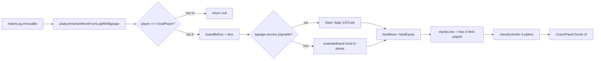
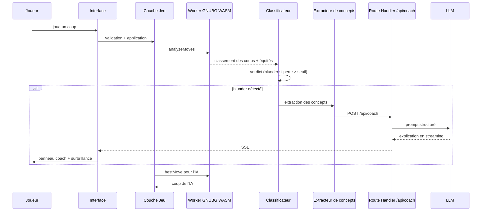

# ARCHITECTURE — Backgammon Coach IA

> Application web de Backgammon avec coach IA temps réel, portée sur mobile via Capacitor.
> **Statut : document reflétant la structure réelle du code (audit 2026-10).**

> 📚 **Carte d'orientation** : [`PROJECT_MAP.md`](PROJECT_MAP.md) permet de comprendre
> le projet en 1 minute et d'ajouter une fonction en 2 minutes. **Lire en premier.**

> ⚠️ **Charte de scalabilité & Doctrine Atomique obligatoires** : toute nouvelle création de code DOIT
> respecter les 5 Lois Fondamentales définies dans [`SCALABILITY.md`](SCALABILITY.md) :
> 1. "1 Bouton / 1 Événement = 1 Micro-Programme Isolé" (`src/actions/`)
> 2. Machine à États Finis Unique (`gamePhase`)
> 3. Immuabilité Absolue & Source de Vérité par la Log (`matchLog`)
> 4. Analyse Log-Driven Exclusivement Réservée au Joueur Connecté
> 5. Composants Visuels 100 % Muets ("Dumb UI")
> Aucune fonctionnalité ne peut être ajoutée sans s'y conformer.

---

## 1. Vision et objectifs

Une application de Backgammon où le joueur joue contre une IA de niveau mondial (Open Sage sur Google Cloud Run) et reçoit, **en temps réel**, des explications pédagogiques sur ses erreurs :

- **Blunders de pions** : coups joués dont la perte d'équité dépasse un seuil configurable.
- **Blunders de videau** : décisions de double/prendre/passer incorrectes.

Principes directeurs :

| Principe | Signification |
|---|---|
| **Vérité moteur** | Open Sage (bgsage) est l'autorité absolue sur la force d'un coup et du videau. Le LLM n'évalue jamais, il n'explique que. |
| **Interprétation structurée** | Un extracteur de concepts transforme la position en données typées avant toute explication. |
| **Pédagogie, pas jugement** | Le coach explique *pourquoi* le coup est mauvais et *quoi* retenir. |
| **Local-first, cloud-ready** | Le jeu et l'analyse rapide fonctionnent offline ; le cloud ajoute comptes, historique, rollouts profonds et coach LLM. |

### Cibles

- **Web** : Next.js (App Router) déployé sur plateforme Node (Vercel/Netlify).
- **Mobile** : même base de code compilée via **Capacitor** (iOS/Android).

---

## 2. Stack technique (réelle)

| Domaine | Choix |
|---|---|
| Framework | **Next.js 15 (App Router)** — projet unique à la racine |
| Langage | **TypeScript strict** |
| Style | **Tailwind CSS 3** |
| Moteur de jeu | **Open Sage (bgsage-service sur Google Cloud Run) + repli local tri-phase TypeScript** (point d'entrée unifié côté client) |
| Moteur serveur | **Open Sage** (`bgsage-service/`) : FastAPI + moteur neuronal `bgsage` (PR 0.23, 4 niveaux de bot + videau Double/Take/Pass) |
| Moteur serveur (legacy) | **Backend Python** (`backend-engine/`) : FastAPI + client GNUBG (rollouts profonds uniquement) |
| Coach IA | **LLM pluggable** (interface OpenAI-compatible) |
| Persistance | **Supabase** (Postgres + Auth + RLS) |
| Mobile | **Capacitor 8** |
| Tests | **Vitest** (unitaire) + **Playwright** (e2e) |

---

## 3. Structure réelle du projet

```
backgammon/
├── ARCHITECTURE.md
├── package.json                 # Next.js 15 + React 19 + Tailwind 3
├── next.config.mjs
├── tailwind.config.ts
├── src/
│   ├── app/                     # App Router : pages + Route Handlers
│   │   ├── page.tsx             # Écran principal de jeu
│   │   ├── home/page.tsx        # Écran d'accueil (menu principal + onboarding)
│   │   ├── drills/page.tsx      # Exercices (blunders)
│   │   ├── puzzles/page.tsx     # Puzzles quotidiens
│   │   ├── progression/page.tsx # Progression
│   │   └── api/                 # Route Handlers serveur
│   │       ├── coach/           # Explications LLM (SSE)
│   │       │   └── review/      # Cours explicatif de fin de partie (SSE)
│   │       ├── evaluate/        # Évaluation de position
│   │       ├── rollout/         # Rollouts profonds
│   │       └── health/          # Health check
│   ├── components/              # Composants React
│   │   ├── board/               # Plateau (Board.tsx, dés, videau)
│   │   ├── coach/               # Panneau coach
│   │   ├── hud/                 # HUD de match, difficulté
│   │   ├── multiplayer/         # Modales multijoueur
│   │   ├── rating/              # Review de partie, courbes, cours IA (GameReviewCourse)
│   │   ├── stats/               # Dashboard progression, erreurs récurrentes (RecurringErrorsCard)
│   │   ├── onboarding/          # Onboarding léger (3 écrans)
│   │   ├── auth/                # Authentification
│   │   ├── common/              # ErrorBoundary, i18n, annonces
│   │   ├── toast/               # Notifications
│   │   └── providers/           # AppProviders
│   ├── engine/                  # Moteur de règles pur (backgammonEngine.ts)
│   ├── features/                # Logique métier par domaine
│   │   ├── coach/               # Extracteur, classificateur, prompts
│   │   ├── drills/              # Moteur d'exercices
│   │   ├── multiplayer/         # Validation, Elo, matchmaking, rooms
│   │   ├── puzzles/             # Puzzles
│   │   ├── rating/              # Analyse de partie, PR
│   │   ├── openings/            # Base d'ouvertures
│   │   ├── export/              # XGID/SGF, partage
│   │   └── knowledge/           # Base de connaissances
│   ├── hooks/                   # useBackgammonGame, useMultiplayerGame, useBoardTheme…
│   ├── lib/                     # Services : supabase, i18n, offline, monitoring…
│   ├── workers/                 # gnubg.worker.ts (WASM)
│   └── utils/                   # Utilitaires
├── bgsage-service/              # Microservice Open Sage (FastAPI + moteur neuronal bgsage)
│   ├── app/                     # main.py, models.py, xgid.py, notation.py
│   ├── tests/                   # Tests pytest (test_xgid.py, test_api.py)
│   ├── Dockerfile               # python:3.11-slim + build-essential/cmake/git
│   ├── requirements.txt         # fastapi, uvicorn, pydantic, bgsage
│   └── requirements-dev.txt     # + pytest, httpx
├── backend-engine/              # Backend Python legacy (FastAPI + GNUBG, rollouts profonds)
│   ├── app/                     # main.py, models.py, parsers.py, gnubg_client.py…
│   ├── tests/                   # Tests Python
│   ├── Dockerfile
│   └── requirements.txt
├── supabase/
│   └── migrations/              # Schéma SQL + RLS (dont recurring_errors)
├── docs/                        # Documentation détaillée
├── e2e/                         # Tests Playwright
├── ios/                         # Projet Capacitor iOS
├── android/                     # Projet Capacitor Android
└── scripts/                     # Scripts de build mobile
```

---

## 4. Répartition des responsabilités

- **Côté client (offline-capable)** : règles du jeu, génération des coups légaux, adversaire IA, évaluation rapide de repli (tri-phase TypeScript + table Bear-Off 54 264 états + Keith Count), extraction de concepts, affichage.
- **Côté serveur (Route Handlers Next.js)** : explications LLM (SSE), rollouts profonds, évaluation.
- **`bgsage-service/` (Open Sage)** : moteur neuronal de précision professionnelle (PR 0.23), 3 niveaux de bot (1-ply/2-ply/3-ply), game plans, décision cube. Source d'équités du coach IA.
- **Backend Python (`backend-engine/`, legacy)** : moteur GNUBG serveur (rollouts lourds, pool de workers) — conservé uniquement pour les rollouts profonds asynchrones.
- **Supabase** : identité, historique, statistiques, multijoueur temps réel.

---

## 4bis. Pipeline d'analyse Coach (Log-Driven)

> L'analyse du Coach est **purement fonctionnelle et déterministe** : elle ne lit jamais
> l'état visuel React, uniquement le journal immuable du match (`matchLog`).

### Flux de données



### Convention d'encodage du plateau (SANS miroir)

Le plateau `board` est un tableau de **26 entiers** en **indices absolus** (1 à 24), sans
aucun miroir ni inversion :

| Indice | Signification |
|---|---|
| `board[1..24]` | Flèches 1 à 24 (indices absolus, identiques à l'affichage) |
| `board[X_BAR]` (25) | Barre de X (Blanc) — valeur positive |
| `board[O_BAR]` (0) | Barre de O (Noir) — valeur négative |
| `board[X_OFF]` / `board[O_OFF]` | Pions sortis (bear-off) |

- **Valeurs positives** = pions X (Blanc, avance de 24 → 1).
- **Valeurs négatives** = pions O (Noir, avance de 1 → 24).
- **`pipCount`** : X = `Σ v·p`, O = `Σ (-v)·(25-p)` — symétrique et correct.
- **`evaluateBoard`** gère la perspective via `state.turn` (le joueur actif), sans miroir.
- **`analyzeBoardMoves`** inverse l'équité (`playerEquity = -oppEval.cubefulEquity`).

> **Sanity check** : [`analyzeBoardMoves`](src/lib/engine/evaluator.ts:687) logue en dev
> `BOARD ANALYSÉ POUR <turn> <board>` + le pip count, et vérifie que le meilleur coup
> part bien d'une flèche contenant un pion du joueur actif (`board[from]` du bon signe).

### Modules impliqués

| Module | Rôle |
|---|---|
| [`src/actions/types.ts`](src/actions/types.ts:25) | `MatchLogEntry` immuable (source de vérité) |
| [`src/features/coach/logAnalyzer.ts`](src/features/coach/logAnalyzer.ts:1) | `analyzeHumanMoveFromLogWithBgsage` (hybride) + `classifyVerdict` (4 paliers) |
| [`src/lib/engine/bgsageClient.ts`](src/lib/engine/bgsageClient.ts:1) | Client HTTP vers le `bgsage-service` (Open Sage) |
| [`src/features/coach/analyzeHumanLogAction.ts`](src/features/coach/analyzeHumanLogAction.ts:43) | Micro-programme log-driven (LOI 4) |
| [`src/hooks/useCoach.ts`](src/hooks/useCoach.ts:148) | Orchestration : lit `matchLog`, déclenche l'analyse hybride, met à jour l'état |
| [`src/lib/engine/evaluator.ts`](src/lib/engine/evaluator.ts:687) | `analyzeBoardMoves` (évaluateur local de repli) |

### Verdicts (4 paliers)

| Perte d'équité | Verdict |
|---|---|
| ≤ 0.010 | `Optimal ✅` |
| ≤ 0.020 | `Bon 👍` |
| > 0.020 | `Imprécision ⚠️` |
| > 0.080 | `Blunder ❌` |

### Ciblage exclusif du joueur connecté

- `if (logEntry.player !== localPlayer) return null;` — l'IA (`O`) n'est **jamais** analysée.
- Le PR est calculé sur `matchLog.filter(entry => entry.player === localPlayer)`.

---

## 5. Modules détaillés

### 5.1 Moteur de règles — `src/engine/backgammonEngine.ts`

Module **100 % pur**, sans dépendance React/Node/navigateur :

- Représentation du plateau : tableau de 26 entiers (`board[0]` = barre X, `board[1..24]` = flèches, `board[25]` = barre O ; positif = X, négatif = O).
- Génération exhaustive des coups légaux (`generateLegalMoves`, `computeLegalTargets`).
- Machine à états de partie, videau, bear-off, gammons/backgammons.
- Sérialisation XGID, pip count, borne-off count.

### 5.2 Moteur Open Sage (bgsage-service/) & Client src/lib/engine/bgsageClient.ts
- **Moteur neuronal Open Sage (bgsage sur Google Cloud Run)** :
  - **Service FastAPI (bgsage-service/)** : déployé sur Google Cloud Run (https://bgsage-service-468274233732.europe-west1.run.app), exposant /api/evaluate, /api/evaluate-board, /api/selfplay, /api/health.
  - **Client TypeScript (src/lib/engine/bgsageClient.ts)** : pilote les coups de pions des bots (selectBotMoveWithBgsage), les décisions de videau (evaluateBotCubeWithBgsage) et le Coach IA (evaluateWithBgsage).
  - **Retrait de WildBG WASM** : WildBG a été retiré au profit exclusif d'Open Sage.
- **Client Fallback Hors-Ligne** : src/lib/engine/evaluator.ts exposant l'évaluation tri-phase instantanée hors-ligne.
- **Doc de référence** : DOCS_ENGINE.md et bgsage-service/README.md.

### 5.3 Classificateur d'erreurs — `src/features/coach/moveClassifier.ts`

Traduit les équités brutes en verdicts pédagogiques (EMG) :

| Verdict | Seuil de perte d'équité |
|---|---|
| Excellent / optimal | ≤ 0.010 |
| Bon | ≤ 0.020 |
| Erreur | > 0.020 |
| **Blunder** | > 0.080 |
| Howler | > 0.250 |

### 5.4 Extracteur de concepts — `src/features/coach/featureExtractor.ts`

Fonction pure `Position + contexte → PositionConcepts` : pip counts, classification (race/contact/prime/backgame/bearoff), blots, points clés, menaces, contexte videau.

### 5.5 Coach LLM — `src/app/api/coach/route.ts`

- Route Handler serveur (clé API côté serveur) avec streaming SSE.
- Fournisseur pluggable (OpenAI, Anthropic, Ollama).
- Cache d'explications (`src/features/coach/explanationCache.ts`).
- Mode dégradé : explication règle-basée locale (`generateRuleBasedExplanation`).

### 5.5bis Cours explicatif de fin de partie — `src/app/api/coach/review/route.ts`

- Route Handler serveur (streaming SSE) qui reçoit le bilan complet d'une partie (`CompleteGameAnalysis`).
- Génère un cours pédagogique structuré (titre, résumé, forces, faiblesses, leçons, prochaines étapes).
- Prompts dans [`src/features/coach/gameReviewPrompts.ts`](src/features/coach/gameReviewPrompts.ts:1) + repli local déterministe.
- Affiché dans l'onglet « 🎓 Cours IA » de [`GameReviewModal`](src/components/rating/GameReviewModal.tsx:20) via [`GameReviewCourse`](src/components/rating/GameReviewCourse.tsx:1).

### 5.6 Adversaire IA — src/hooks/useBackgammonGame.ts & src/lib/engine/bgsageClient.ts

4 niveaux propulsés par **Open Sage** (bgsage-service sur Google Cloud Run) :
- **Grandmaster** : Open Sage 3-ply (0.00 PR vs 3-ply)
- **Expert** : Open Sage 2-ply (~2.22 PR)
- **Intermédiaire** : Open Sage 1-ply (~4.89 PR)
- **Débutant** : Open Sage 1-ply + bruit gaussien ±0.14 Eq (~15.07 PR)
- **Videau (Cube)** : Prise en charge complète (OFFER_DOUBLE, TAKE_DOUBLE, PASS_DOUBLE) via evaluateBotCubeWithBgsage.

### 5.7 Persistance — `src/lib/supabase/` + `src/lib/offline/`

- Auth email/mot de passe + OAuth.
- Mode invité : données locales (IndexedDB / SQLite Capacitor).
- Sync offline-first (`src/lib/offline/syncQueue.ts`).

### 5.7bis Erreurs récurrentes — `src/lib/supabase/db.ts` + table `recurring_errors`

- Table `recurring_errors` (migration [`20261020000000_recurring_errors.sql`](supabase/migrations/20261020000000_recurring_errors.sql:1)) : agrège les erreurs par `(user_id, concept_id)`.
- RPC [`upsert_recurring_error()`](supabase/migrations/20261020000000_recurring_errors.sql:88) : upsert atomique (compteur + perte cumulée).
- Déclenché depuis [`recordBlunderToBankIfApplicable()`](src/components/coach/CoachPanel.tsx:248) quand un blunder a un `conceptId`.
- Affiché dans [`RecurringErrorsCard`](src/components/stats/RecurringErrorsCard.tsx:1) (tableau de progression).

### 5.8 Multijoueur temps réel — `src/features/multiplayer/` + Supabase Realtime

- Matchmaking Elo, salons privés par code.
- Canaux Realtime : broadcast, presence, Postgres Changes.
- Séquençage strict anti-désynchronisation.

---

## 6. Flux nominal — analyse temps réel



---

## 7. Stratégie Capacitor

- Le projet Next.js est buildé en **export statique** et bundlé dans la webview Capacitor.
- **Offline** : UI, règles, moteur WASM, classificateur, concepts, coach règle-basée, SQLite local.
- **Réseau** : `/api/coach` (LLM), `/api/analyze` (rollouts), sync Supabase.
- Plugins : SQLite, Preferences, Haptics, Share.

---

## 8. Considérations transverses

### 8.1 Licence GPL

GNUBG est sous GPLv2/v3. Le WASM est une œuvre dérivée : isoler le moteur dans le worker + `public/engine/`, publier le source de la couche moteur.

### 8.2 Performance

- WASM + données chargés en lazy-load.
- Web Worker obligatoire (aucune évaluation sur le thread principal).
- Budgets : 0-ply < 50 ms desktop / < 150 ms mobile ; 1-ply < 300 ms.

### 8.3 Sécurité

- Clés LLM uniquement en variables d'environnement serveur.
- RLS Supabase sur toutes les tables ; validation Zod des payloads.
- Rate limiting sur `/api/coach`.

### 8.4 Accessibilité et i18n

- UI en français (v1), architecture i18n prête (`src/lib/i18n/`).
- Plateau jouable au clavier, contrastes AA, cibles tactiles ≥ 44 px.

---

## 9. Dette technique connue (audit 2026-10)

> Ces fichiers hérités violent la charte de scalabilité ([`SCALABILITY.md`](SCALABILITY.md)).
> **Règle : aucun nouveau code ne doit s'y ajouter** — toute modification passe par
> l'extraction d'un module conforme.

| Point | Gravité | Statut |
|---|---|---|
| `page.tsx` (découpé à 293 lignes, 3 vues exclusives) | — | ✅ Résolu (conforme R1 < 300 lignes) |
| `useBackgammonGame.ts` (~1389 lignes) | Élevée | À découper |
| `knowledgeBaseData.ts` (~1587 lignes de données) | Faible | À externaliser en JSON |

---

## 10. Décisions ouvertes

1. **Fournisseur LLM par défaut en production** et modèle de coût.
2. **Hébergement** : Vercel/Netlify vs conteneur auto-hébergé (impacte les timeouts des rollouts).

---

## 11. Innovations Propriétaires : L'ERH (Error Rate Humain)

Le projet intègre un modèle d'évaluation de rupture par rapport au standard mathématique historique (PR d'eXtreme Gammon) : **l'ERH (Error Rate Humain)**.
- Spécification complète : [`plans/erh-error-rate-humain.md`](plans/erh-error-rate-humain.md).
- Principe : Profilage en temps réel de l'adversaire (frilosité au videau, panique en backgame, passivité, pression du chrono) pour évaluer la capacité du joueur à exploiter psychologiquement les faiblesses humaines au lieu de réciter froidement un jeu GTO.
- Déploiement : Réservé aux modes multijoueurs (PvP) et au diagnostic avancé du Coach IA.
