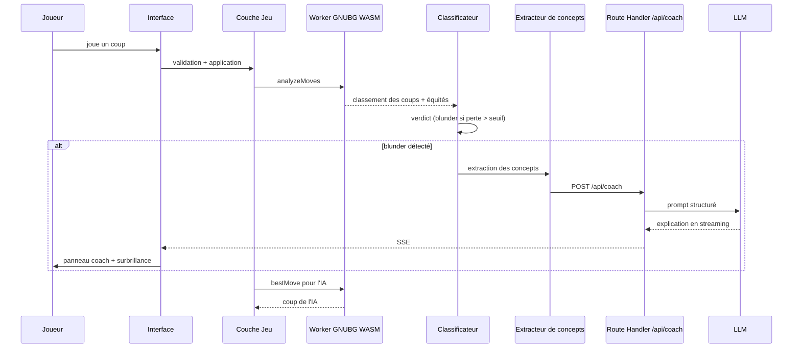

# ARCHITECTURE — Backgammon Coach IA

> Application web de Backgammon avec coach IA temps réel, portée sur mobile via Capacitor.
> **Statut : document reflétant la structure réelle du code (audit 2026-10).**

> 📚 **Carte d'orientation** : [`PROJECT_MAP.md`](PROJECT_MAP.md) permet de comprendre
> le projet en 1 minute et d'ajouter une fonction en 2 minutes. **Lire en premier.**

> ⚠️ **Charte de scalabilité obligatoire** : toute nouvelle création de code DOIT
> respecter les règles impératives définies dans [`SCALABILITY.md`](SCALABILITY.md)
> (taille max des fichiers, isolation des composants, mémoïsation, tests, interdiction
> des monolithes). Aucune fonctionnalité ne peut être ajoutée sans s'y conformer.

---

## 1. Vision et objectifs

Une application de Backgammon où le joueur joue contre une IA de niveau mondial (GNU Backgammon) et reçoit, **en temps réel**, des explications pédagogiques sur ses erreurs :

- **Blunders de pions** : coups joués dont la perte d'équité dépasse un seuil configurable.
- **Blunders de videau** : décisions de double/prendre/passer incorrectes.

Principes directeurs :

| Principe | Signification |
|---|---|
| **Vérité moteur** | GNUBG est l'autorité absolue sur la force d'un coup. Le LLM n'évalue jamais, il n'explique que. |
| **Interprétation structurée** | Un extracteur de concepts transforme la position en données typées avant toute explication. |
| **Pédagogie, pas jugement** | Le coach explique *pourquoi* le coup est mauvais et *quoi* retenir. |
| **Local-first, cloud-ready** | Le jeu et l'analyse rapide fonctionnent offline ; le cloud ajoute comptes, historique, rollouts profonds et coach LLM. |

### Cibles

- **Web** : Next.js (App Router) déployé sur plateforme Node (Vercel/Netlify).
- **Mobile** : même base de code compilée via **Capacitor** (iOS/Android).

---

## 2. Stack technique (réelle)

| Domaine | Choix |
|---|---|
| Framework | **Next.js 15 (App Router)** — projet unique à la racine |
| Langage | **TypeScript strict** |
| Style | **Tailwind CSS 3** |
| Moteur de jeu | **GNU Backgammon en WebAssembly** (Web Worker côté client) |
| Moteur serveur | **Backend Python** (`backend-engine/`) : FastAPI + client GNUBG |
| Coach IA | **LLM pluggable** (interface OpenAI-compatible) |
| Persistance | **Supabase** (Postgres + Auth + RLS) |
| Mobile | **Capacitor 8** |
| Tests | **Vitest** (unitaire) + **Playwright** (e2e) |

---

## 3. Structure réelle du projet

```
backgammon/
├── ARCHITECTURE.md
├── package.json                 # Next.js 15 + React 19 + Tailwind 3
├── next.config.mjs
├── tailwind.config.ts
├── src/
│   ├── app/                     # App Router : pages + Route Handlers
│   │   ├── page.tsx             # Écran principal de jeu (Home)
│   │   ├── drills/page.tsx      # Exercices (blunders)
│   │   ├── puzzles/page.tsx     # Puzzles quotidiens
│   │   ├── progression/page.tsx # Progression
│   │   └── api/                 # Route Handlers serveur
│   │       ├── coach/           # Explications LLM (SSE)
│   │       ├── evaluate/        # Évaluation de position
│   │       ├── rollout/         # Rollouts profonds
│   │       └── health/          # Health check
│   ├── components/              # Composants React
│   │   ├── board/               # Plateau (BackgammonBoard.tsx, Board.tsx, dés, videau)
│   │   ├── coach/               # Panneau coach
│   │   ├── hud/                 # HUD de match, difficulté
│   │   ├── multiplayer/         # Modales multijoueur
│   │   ├── rating/              # Review de partie, courbes
│   │   ├── stats/               # Dashboard progression
│   │   ├── auth/                # Authentification
│   │   ├── common/              # ErrorBoundary, i18n, annonces
│   │   ├── toast/               # Notifications
│   │   └── providers/           # AppProviders
│   ├── engine/                  # Moteur de règles pur (backgammonEngine.ts)
│   ├── features/                # Logique métier par domaine
│   │   ├── coach/               # Extracteur, classificateur, prompts
│   │   ├── drills/              # Moteur d'exercices
│   │   ├── multiplayer/         # Validation, Elo, matchmaking, rooms
│   │   ├── puzzles/             # Puzzles
│   │   ├── rating/              # Analyse de partie, PR
│   │   ├── openings/            # Base d'ouvertures
│   │   ├── export/              # XGID/SGF, partage
│   │   └── knowledge/           # Base de connaissances
│   ├── hooks/                   # useBackgammonGame, useMultiplayerGame, useBoardTheme…
│   ├── lib/                     # Services : supabase, i18n, offline, monitoring…
│   ├── workers/                 # gnubg.worker.ts (WASM)
│   └── utils/                   # Utilitaires
├── backend-engine/              # Backend Python séparé (FastAPI + GNUBG)
│   ├── app/                     # main.py, models.py, parsers.py, gnubg_client.py…
│   ├── tests/                   # Tests Python
│   ├── Dockerfile
│   └── requirements.txt
├── supabase/
│   └── migrations/              # Schéma SQL + RLS
├── docs/                        # Documentation détaillée
├── e2e/                         # Tests Playwright
├── ios/                         # Projet Capacitor iOS
├── android/                     # Projet Capacitor Android
└── scripts/                     # Scripts de build mobile
```

---

## 4. Répartition des responsabilités

- **Côté client (offline-capable)** : règles du jeu, génération des coups légaux, adversaire IA, évaluation rapide, détection de blunders, extraction de concepts, affichage.
- **Côté serveur (Route Handlers Next.js)** : explications LLM (SSE), rollouts profonds, évaluation.
- **Backend Python (`backend-engine/`)** : moteur GNUBG serveur (rollouts lourds, pool de workers).
- **Supabase** : identité, historique, statistiques, multijoueur temps réel.

---

## 5. Modules détaillés

### 5.1 Moteur de règles — `src/engine/backgammonEngine.ts`

Module **100 % pur**, sans dépendance React/Node/navigateur :

- Représentation du plateau : tableau de 26 entiers (`board[0]` = barre X, `board[1..24]` = flèches, `board[25]` = barre O ; positif = X, négatif = O).
- Génération exhaustive des coups légaux (`generateLegalMoves`, `computeLegalTargets`).
- Machine à états de partie, videau, bear-off, gammons/backgammons.
- Sérialisation XGID, pip count, borne-off count.

### 5.2 Moteur XG-Web & GNUBG — `src/workers/xgEngine.worker.ts` + `/xg-web-core`
- **Moteur Hybride XG-Web (WASM SIMD 2-Ply)** :
  - **Option A (Client TypeScript)** : Table exacte 1-sided bear-off (54 264 états, PR 0.00 en bear-off) dans `src/lib/engine/bearoffTable.ts` + Keith Count officiel (`keithCount.ts`).
  - **Grand-Maître 2-Ply (`/xg-web-core`)** : Core Rust pur compilé en WASM SIMD (`xg_web_core.wasm`, 63 Ko) + 3 micro-réseaux quantifiés int8 (121 Ko) + table MET Kazaross-XG2.
  - **Worker Dédié** : `src/workers/xgEngine.worker.ts` pour exécution 2-ply non-bloquante (< 60 ms/coup).
- **Client Fallback** : `src/workers/gnubg.worker.ts` exposant l'API d'évaluation tri-phase instantanée.
- **Serveur Optionnel** : `backend-engine/` (FastAPI) pour rollouts profonds externes.

### 5.3 Classificateur d'erreurs — `src/features/coach/moveClassifier.ts`

Traduit les équités brutes en verdicts pédagogiques (EMG) :

| Verdict | Seuil de perte d'équité |
|---|---|
| Excellent / optimal | ≤ 0.010 |
| Bon | ≤ 0.020 |
| Erreur | > 0.020 |
| **Blunder** | > 0.080 |
| Howler | > 0.250 |

### 5.4 Extracteur de concepts — `src/features/coach/featureExtractor.ts`

Fonction pure `Position + contexte → PositionConcepts` : pip counts, classification (race/contact/prime/backgame/bearoff), blots, points clés, menaces, contexte videau.

### 5.5 Coach LLM — `src/app/api/coach/route.ts`

- Route Handler serveur (clé API côté serveur) avec streaming SSE.
- Fournisseur pluggable (OpenAI, Anthropic, Ollama).
- Cache d'explications (`src/features/coach/explanationCache.ts`).
- Mode dégradé : explication règle-basée locale (`generateRuleBasedExplanation`).

### 5.6 Adversaire IA — `src/hooks/useBackgammonGame.ts`

Niveaux : débutant (0-ply + bruit), intermédiaire (0-ply), expert (1-ply).

### 5.7 Persistance — `src/lib/supabase/` + `src/lib/offline/`

- Auth email/mot de passe + OAuth.
- Mode invité : données locales (IndexedDB / SQLite Capacitor).
- Sync offline-first (`src/lib/offline/syncQueue.ts`).

### 5.8 Multijoueur temps réel — `src/features/multiplayer/` + Supabase Realtime

- Matchmaking Elo, salons privés par code.
- Canaux Realtime : broadcast, presence, Postgres Changes.
- Séquençage strict anti-désynchronisation.

---

## 6. Flux nominal — analyse temps réel



---

## 7. Stratégie Capacitor

- Le projet Next.js est buildé en **export statique** et bundlé dans la webview Capacitor.
- **Offline** : UI, règles, moteur WASM, classificateur, concepts, coach règle-basée, SQLite local.
- **Réseau** : `/api/coach` (LLM), `/api/analyze` (rollouts), sync Supabase.
- Plugins : SQLite, Preferences, Haptics, Share.

---

## 8. Considérations transverses

### 8.1 Licence GPL

GNUBG est sous GPLv2/v3. Le WASM est une œuvre dérivée : isoler le moteur dans le worker + `public/engine/`, publier le source de la couche moteur.

### 8.2 Performance

- WASM + données chargés en lazy-load.
- Web Worker obligatoire (aucune évaluation sur le thread principal).
- Budgets : 0-ply < 50 ms desktop / < 150 ms mobile ; 1-ply < 300 ms.

### 8.3 Sécurité

- Clés LLM uniquement en variables d'environnement serveur.
- RLS Supabase sur toutes les tables ; validation Zod des payloads.
- Rate limiting sur `/api/coach`.

### 8.4 Accessibilité et i18n

- UI en français (v1), architecture i18n prête (`src/lib/i18n/`).
- Plateau jouable au clavier, contrastes AA, cibles tactiles ≥ 44 px.

---

## 9. Dette technique connue (audit 2026-10)

> Ces fichiers hérités violent la charte de scalabilité ([`SCALABILITY.md`](SCALABILITY.md)).
> **Règle : aucun nouveau code ne doit s'y ajouter** — toute modification passe par
> l'extraction d'un module conforme.

| Point | Gravité | Statut |
|---|---|---|
| `BackgammonBoard.tsx` (~2468 lignes) monolithique | Élevée | Legacy, à découper |
| `page.tsx` (~1738 lignes) concentre toute la logique | Élevée | À découper |
| `useBackgammonGame.ts` (~1389 lignes) | Élevée | À découper |
| `knowledgeBaseData.ts` (~1587 lignes de données) | Faible | À externaliser en JSON |

---

## 10. Décisions ouvertes

1. **Fournisseur LLM par défaut en production** et modèle de coût.
2. **Hébergement** : Vercel/Netlify vs conteneur auto-hébergé (impacte les timeouts des rollouts).
