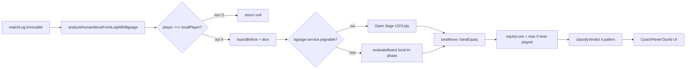
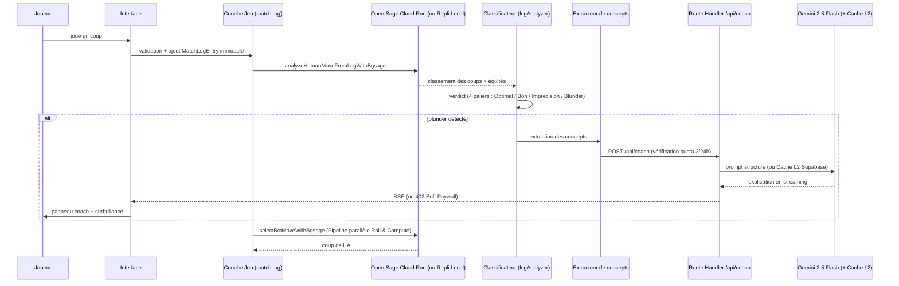

# ARCHITECTURE — Backgammon Coach IA

> Application web de Backgammon avec coach IA temps réel, portée sur mobile via Capacitor.
> **Statut : document reflétant la structure réelle du code (audit 2026-10).**

> 📚 **Carte d'orientation** : [`PROJECT_MAP.md`](PROJECT_MAP.md) permet de comprendre
> le projet en 1 minute et d'ajouter une fonction en 2 minutes. **Lire en premier.**
>
> 💎 **Référentiel d'Excellence Master** : [`docs/MASTER_SPEC_EXCELLENCE.md`](docs/MASTER_SPEC_EXCELLENCE.md)
> regroupe les spécifications ultimes de compétition : Game Feel FLIP, Glicko-2 Composite, Audio modal & Provably Fair.

> ⚠️ **Charte de scalabilité & Doctrine Atomique obligatoires** : toute nouvelle création de code DOIT
> respecter les 5 Lois Fondamentales définies dans [`SCALABILITY.md`](SCALABILITY.md) :
> 1. "1 Bouton / 1 Événement = 1 Micro-Programme Isolé" (`src/actions/`)
> 2. Machine à États Finis Unique (`gamePhase`)
> 3. Immuabilité Absolue & Source de Vérité par la Log (`matchLog`)
> 4. Analyse Log-Driven Exclusivement Réservée au Joueur Connecté
> 5. Composants Visuels 100 % Muets ("Dumb UI")
> Aucune fonctionnalité ne peut être ajoutée sans s'y conformer.

---

## 1. Vision et objectifs

Une application de Backgammon où le joueur joue contre une IA de niveau mondial (Open Sage sur Google Cloud Run) et reçoit, **en temps réel**, des explications pédagogiques sur ses erreurs :

- **Blunders de pions** : coups joués dont la perte d'équité dépasse un seuil configurable.
- **Blunders de videau** : décisions de double/prendre/passer incorrectes.

Principes directeurs :

| Principe | Signification |
|---|---|
| **Vérité moteur** | Open Sage (bgsage) est l'autorité absolue sur la force d'un coup et du videau. Le LLM n'évalue jamais, il n'explique que. |
| **Interprétation structurée** | Un extracteur de concepts transforme la position en données typées avant toute explication. |
| **Pédagogie, pas jugement** | Le coach explique *pourquoi* le coup est mauvais et *quoi* retenir. |
| **Local-first, cloud-ready** | Le jeu et l'analyse rapide fonctionnent offline ; le cloud ajoute comptes, historique, rollouts profonds et coach LLM. |

### Cibles

- **Web** : Next.js (App Router) déployé sur plateforme Node (Vercel/Netlify).
- **Mobile** : même base de code compilée via **Capacitor** (iOS/Android).

---

## 2. Stack technique (réelle)

| Domaine | Choix |
|---|---|
| Framework | **Next.js 15 (App Router)** — projet unique à la racine |
| Langage | **TypeScript strict** |
| Style | **Tailwind CSS 3** |
| Moteur de jeu | **Open Sage (bgsage-service sur Google Cloud Run) + repli local tri-phase TypeScript** (point d'entrée unifié côté client) |
| Moteur serveur | **Open Sage** (`bgsage-service/`) : FastAPI + moteur neuronal `bgsage` (PR 0.23, 4 niveaux de bot + videau Double/Take/Pass) sur Google Cloud Run |
| Moteur serveur (legacy) | **Backend Python** (archivé sous `archive/backend_engine_gnubg_legacy/`) : FastAPI + client GNUBG |
| Coach IA | **Google Gemini `gemini-2.5-flash`** via streaming SSE + Market Window + Cache L2 Supabase (`coach_explanations`) |
| Persistance | **Supabase** (Postgres + Auth + RLS + Cache Coach L2 + Erreurs Récurrentes + Glicko-2/FSRS + Quotas Stripe) |
| Mobile & PWA | **Capacitor 8** (iOS/Android) + **PWA Web installable** (Desktop & Mobile) |
| Tests | **Vitest** (1 253 tests unitaires sur 215 fichiers) + **Playwright** (e2e) |

---

## 3. Structure réelle du projet

```
backgammon/
├── ARCHITECTURE.md
├── package.json                 # Next.js 15 + React 19 + Tailwind 3
├── next.config.mjs
├── tailwind.config.ts
├── src/
│   ├── app/                     # App Router : pages + Route Handlers
│   │   ├── page.tsx             # Orchestrateur principal (3 vues : LOBBY, GAME, SUMMARY)
│   │   ├── academy/             # Hub SEO Gammon Academy (/academy, /openings/[roll], /concepts/[slug])
│   │   ├── drills/page.tsx      # Exercices sur blunders personnels
│   │   ├── puzzles/page.tsx     # Puzzles quotidiens V2 (unifié avec /daily-puzzle)
│   │   ├── daily-puzzle/page.tsx# Écran DailyPuzzleScreen V2 (certifié Open Sage 3-ply + FSRS)
│   │   ├── progression/page.tsx # Dashboard de progression & statistiques
│   │   ├── pricing/page.tsx     # Grille tarifaire VIP & FAQ (/pricing)
│   │   └── api/                 # Route Handlers serveur
│   │       ├── coach/           # Explications LLM (SSE + quota 402)
│   │       │   └── review/      # Synthèse & cours explicatif de fin de partie (SSE + quota 402)
│   │       ├── evaluate/        # Évaluation de position (proxy Open Sage + repli local)
│   │       ├── rollout/         # Rollouts profonds ([jobId], stream, cancel)
│   │       ├── stripe/          # Stripe Billing (checkout, webhook)
│   │       ├── multiplayer/     # Validation serveur d'actions (validate-action)
│   │       └── health/          # Health check
│   ├── components/              # Composants React
│   │   ├── board/               # Plateau (Board.tsx, dés, videau, animations FLIP)
│   │   ├── academy/             # Composants Gammon Academy (table des 15 ouvertures, MET, concepts)
│   │   ├── coach/               # Panneau coach
│   │   ├── dice/                # Audit cryptographique des dés (DiceAuditModal.tsx)
│   │   ├── subscription/        # Soft Paywall VIP (SubscriptionModal.tsx)
│   │   ├── puzzle/              # Composants Daily Puzzle V2 (DailyPuzzleBoard, StreakBadge)
│   │   ├── summary/             # Rapport de fin de match (PostMatchTrainingReport, PostMatchAiSynthesis)
│   │   ├── hud/                 # HUD de match, difficulté, sélecteur de cadence
│   │   ├── multiplayer/         # Modales multijoueur
│   │   ├── rating/              # Review de partie, courbes, cours IA (GameReviewCourse)
│   │   ├── stats/               # Dashboard progression, erreurs récurrentes (RecurringErrorsCard)
│   │   ├── onboarding/          # Onboarding léger (3 écrans)
│   │   ├── auth/, nav/          # Authentification, barre horlogère, menu compte (UserAccountMenu)
│   │   ├── common/, modals/     # ErrorBoundary, i18n, conteneur de modales (GameModalsContainer)
│   │   ├── toast/               # Notifications
│   │   └── providers/           # AppProviders
│   ├── engine/                  # Moteur de règles pur (backgammonEngine.ts, smartClickResolver.ts)
│   ├── features/                # Logique métier par domaine
│   │   ├── academy/             # Données encyclopédiques 3-ply et traductions 6 langues
│   │   ├── coach/               # Extracteur, classificateur, prompts, logAnalyzer.ts
│   │   ├── drills/              # Moteur d'exercices
│   │   ├── multiplayer/         # Validation, Elo, matchmaking, rooms
│   │   ├── puzzles/             # Adaptateur puzzles
│   │   ├── rating/              # Analyse de partie, PR
│   │   ├── openings/            # Base d'ouvertures
│   │   ├── export/              # XGID/SGF, partage
│   │   └── knowledge/           # Base de connaissances
│   ├── hooks/                   # useBackgammonGame, useCoach, useCoachQuota, useGameModals…
│   ├── lib/                     # Services : engine, crypto, subscription, stripe, puzzle, rating, telemetry, gameFeel, sound…
│   ├── workers/                 # gnubg.worker.ts (évaluateur tri-phase hors thread principal)
│   └── utils/                   # Utilitaires
├── bgsage-service/              # Microservice Open Sage (FastAPI + moteur neuronal bgsage sur Cloud Run)
│   ├── app/                     # main.py, models.py, xgid.py, notation.py
│   ├── tests/                   # Tests pytest (test_xgid.py, test_api.py)
│   ├── Dockerfile               # python:3.11-slim + build-essential/cmake/git
│   ├── requirements.txt         # fastapi, uvicorn, pydantic, bgsage
│   └── requirements-dev.txt     # + pytest, httpx
├── archive/                     # Moteurs historiques archivés (backend_engine_gnubg_legacy, wildbg)
├── supabase/
│   └── migrations/              # 8 migrations SQL + RLS (recurring_errors, cache L2, Glicko-2/FSRS, quotas Stripe)
├── docs/                        # Documentation détaillée & ADRs
├── e2e/                         # Tests Playwright
├── ios/                         # Projet Capacitor iOS
├── android/                     # Projet Capacitor Android
└── scripts/                     # Scripts de build mobile & benchmarks
```

---

## 4. Répartition des responsabilités

- **Côté client (offline-capable)** : règles du jeu, génération des coups légaux, adversaire IA, évaluation rapide de repli (tri-phase TypeScript + table Bear-Off 54 264 états + Keith Count), extraction de concepts, affichage.
- **Côté serveur (Route Handlers Next.js)** : explications LLM (SSE), contrôle de quota Coach IA (`402`), Stripe Checkout & Webhooks, rollouts profonds, évaluation.
- **`bgsage-service/` (Open Sage)** : moteur neuronal de précision professionnelle (PR 0.23), 4 niveaux de bot (1-ply bruité / 1-ply / 2-ply / 3-ply), game plans, décision cube. Source d'équités du coach IA.
- **Supabase** : identité, historique, statistiques, cache Coach L2, puzzles FSRS, abonnements Stripe, multijoueur temps réel.

---

## 4bis. Pipeline d'analyse Coach (Log-Driven)

> L'analyse du Coach est **purement fonctionnelle et déterministe** : elle ne lit jamais
> l'état visuel React, uniquement le journal immuable du match (`matchLog`).

### Flux de données



### Convention d'encodage du plateau (SANS miroir)

Le plateau `board` est un tableau de **26 entiers** en **indices absolus** (1 à 24), sans
aucun miroir ni inversion :

| Indice | Signification |
|---|---|
| `board[1..24]` | Flèches 1 à 24 (indices absolus, identiques à l'affichage) |
| `board[X_BAR]` (25) | Barre de X (Blanc) — valeur positive |
| `board[O_BAR]` (0) | Barre de O (Noir) — valeur négative |
| `board[X_OFF]` / `board[O_OFF]` | Pions sortis (bear-off) |

- **Valeurs positives** = pions X (Blanc, avance de 24 → 1).
- **Valeurs négatives** = pions O (Noir, avance de 1 → 24).
- **`pipCount`** : X = `Σ v·p`, O = `Σ (-v)·(25-p)` — symétrique et correct.
- **`evaluateBoard`** gère la perspective via `state.turn` (le joueur actif), sans miroir.
- **`analyzeBoardMoves`** inverse l'équité (`playerEquity = -oppEval.cubefulEquity`).

> **Sanity check** : [`analyzeBoardMoves`](src/lib/engine/evaluator.ts:687) logue en dev
> `BOARD ANALYSÉ POUR <turn> <board>` + le pip count, et vérifie que le meilleur coup
> part bien d'une flèche contenant un pion du joueur actif (`board[from]` du bon signe).

### Modules impliqués

| Module | Rôle |
|---|---|
| [`src/actions/types.ts`](src/actions/types.ts:25) | `MatchLogEntry` immuable (source de vérité) |
| [`src/features/coach/logAnalyzer.ts`](src/features/coach/logAnalyzer.ts:1) | `analyzeHumanMoveFromLogWithBgsage` (hybride) + `classifyVerdict` (4 paliers) |
| [`src/lib/engine/bgsageClient.ts`](src/lib/engine/bgsageClient.ts:1) | Client HTTP vers le `bgsage-service` (Open Sage) |
| [`src/features/coach/analyzeHumanLogAction.ts`](src/features/coach/analyzeHumanLogAction.ts:43) | Micro-programme log-driven (LOI 4) |
| [`src/hooks/useCoach.ts`](src/hooks/useCoach.ts:148) | Orchestration : lit `matchLog`, déclenche l'analyse hybride, met à jour l'état |
| [`src/lib/engine/evaluator.ts`](src/lib/engine/evaluator.ts:687) | `analyzeBoardMoves` (évaluateur local de repli) |

### Verdicts (4 paliers)

| Perte d'équité | Verdict |
|---|---|
| ≤ 0.010 | `Optimal ✅` |
| ≤ 0.020 | `Bon 👍` |
| > 0.020 | `Imprécision ⚠️` |
| > 0.080 | `Blunder ❌` |

### Ciblage exclusif du joueur connecté

- `if (logEntry.player !== localPlayer) return null;` — l'IA (`O`) n'est **jamais** analysée.
- Le PR est calculé sur `matchLog.filter(entry => entry.player === localPlayer)`.

---

## 5. Modules détaillés

### 5.1 Moteur de règles — `src/engine/backgammonEngine.ts`

Module **100 % pur**, sans dépendance React/Node/navigateur :

- Représentation du plateau : tableau de 26 entiers (`board[0]` = barre O, `board[1..24]` = flèches, `board[25]` = barre X ; positif = X, négatif = O).
- Génération exhaustive des coups légaux (`generateLegalMoves`, `computeLegalTargets`).
- Machine à états de partie, videau, bear-off, gammons/backgammons.
- Sérialisation XGID, pip count, borne-off count.

### 5.2 Moteur Open Sage (bgsage-service/) & Client `src/lib/engine/bgsageClient.ts`
- **Moteur neuronal Open Sage (bgsage sur Google Cloud Run)** :
  - **Service FastAPI (`bgsage-service/`)** : déployé sur Google Cloud Run (`https://bgsage-service-468274233732.europe-west1.run.app`), exposant `/api/evaluate`, `/api/evaluate-board`, `/api/selfplay`, `/api/health`.
  - **Client TypeScript (`src/lib/engine/bgsageClient.ts`)** : pilote les coups de pions des bots (`selectBotMoveWithBgsage`), les décisions de videau (`evaluateBotCubeWithBgsage`) et le Coach IA (`evaluateWithBgsage`).
  - **Retrait de WildBG WASM** : WildBG a été retiré au profit exclusif d'Open Sage.
- **Client Fallback Hors-Ligne** : `src/lib/engine/evaluator.ts` exposant l'évaluation tri-phase instantanée hors-ligne.
- **Doc de référence** : [`DOCS_ENGINE.md`](DOCS_ENGINE.md) et [`bgsage-service/README.md`](bgsage-service/README.md).

### 5.3 Classificateur d'erreurs — `src/features/coach/moveClassifier.ts`

Traduit les équités brutes en verdicts pédagogiques (EMG) :

| Verdict | Seuil de perte d'équité |
|---|---|
| Excellent / optimal | ≤ 0.010 |
| Bon | ≤ 0.020 |
| Erreur | > 0.020 |
| **Blunder** | > 0.080 |
| Howler | > 0.250 |

### 5.4 Extracteur de concepts — `src/features/coach/featureExtractor.ts`

Fonction pure `Position + contexte → PositionConcepts` : pip counts, classification (race/contact/prime/backgame/bearoff), blots, points clés, menaces, contexte videau.

### 5.5 Coach LLM — `src/app/api/coach/route.ts`

- Route Handler serveur (clé API côté serveur) avec streaming SSE et contrôle de quota (`402 Payment Required` au-delà de 3 analyses gratuites / 24h).
- Fournisseur principal Google Gemini (`gemini-2.5-flash`) + Cache L2 partagé Supabase (`coach_explanations`).
- Mode dégradé : explication règle-basée locale (`generateRuleBasedExplanation`).

### 5.5bis Cours explicatif & Synthèse IA de fin de partie — `src/app/api/coach/review/route.ts`

- Route Handler serveur (streaming SSE + contrôle de quota `402`) qui reçoit le bilan complet d'une partie (`CompleteGameAnalysis`).
- Génère un cours pédagogique structuré (titre, résumé, forces, faiblesses, leçons, prochaines étapes).
- Prompts dans [`src/features/coach/gameReviewPrompts.ts`](src/features/coach/gameReviewPrompts.ts:1) + repli local déterministe.
- Affiché dans [`PostMatchAiSynthesis`](src/components/summary/PostMatchAiSynthesis.tsx:29) et dans l'onglet « 🎓 Cours IA » de [`GameReviewModal`](src/components/rating/GameReviewModal.tsx:20) via [`GameReviewCourse`](src/components/rating/GameReviewCourse.tsx:1).

### 5.6 Adversaire IA — `src/hooks/useBackgammonGame.ts` & `src/lib/engine/bgsageClient.ts`

4 niveaux propulsés par **Open Sage** (bgsage-service sur Google Cloud Run) :
- **Grandmaster** : Open Sage 3-ply (0.00 PR vs 3-ply)
- **Expert** : Open Sage 2-ply (~2.22 PR)
- **Intermédiaire** : Open Sage 1-ply (~4.89 PR)
- **Débutant** : Open Sage 1-ply + bruit gaussien ±0.14 Eq (~15.07 PR)
- **Videau (Cube)** : Prise en charge complète (`OFFER_DOUBLE`, `TAKE_DOUBLE`, `PASS_DOUBLE`) via `evaluateBotCubeWithBgsage`.

**Pipeline parallèle « Roll & Compute »** (`runOpponentTurn`) : les dés du Bot sont lancés immédiatement
et le calcul Open Sage tourne pendant l'animation (`T1 + T2`), borné par `COMPUTE_HARD_DEADLINE_MS`
avec repli local. Les délais T0–T6 proviennent de [`speedPresets.ts`](src/lib/gameFeel/speedPresets.ts)
(cadences Coach / Tournoi / Blitz, sélectionnables dans le HUD et persistées en localStorage).
Sur un double, l'intervalle entre les pions est réduit de 25 %.

### 5.7 Persistance — `src/lib/supabase/` + `src/lib/offline/`

- Auth email/mot de passe + OAuth.
- Mode invité : données locales (IndexedDB / SQLite Capacitor).
- Sync offline-first (`src/lib/offline/syncQueue.ts`).

### 5.7bis Erreurs récurrentes — `src/lib/supabase/db.ts` + table `recurring_errors`

- Table `recurring_errors` (migration [`20261020000000_recurring_errors.sql`](supabase/migrations/20261020000000_recurring_errors.sql:1)) : agrège les erreurs par `(user_id, concept_id)`.
- RPC [`upsert_recurring_error()`](supabase/migrations/20261020000000_recurring_errors.sql:88) : upsert atomique (compteur + perte cumulée).
- Déclenché depuis [`recordBlunderToBankIfApplicable()`](src/components/coach/CoachPanel.tsx:248) quand un blunder a un `conceptId`.
- Affiché dans [`RecurringErrorsCard`](src/components/stats/RecurringErrorsCard.tsx:1) (tableau de progression).

### 5.8 Multijoueur temps réel — `src/features/multiplayer/` + Supabase Realtime

- Matchmaking Glicko-2 / Elo, salons privés par code.
- Canaux Realtime : broadcast, presence, Postgres Changes.
- Séquençage strict anti-désynchronisation et RNG Provably Fair dans [`MatchHeader.tsx`](src/components/hud/MatchHeader.tsx:67).

### 5.9 RNG Cryptographique Provably Fair — `src/lib/crypto/provablyFairRng.ts` & `DiceAuditModal.tsx`

- Protocole **Commit-Play-Reveal HMAC-SHA256** avec échantillonnage par rejet strict (`< 252`) garantissant zéro biais de modulo ($42/252 = 1/6$).
- Intégré dans [`useBackgammonGame.ts`](src/hooks/useBackgammonGame.ts) (`state.provablyFair`, révélation de `serverSeed` en fin de partie) et [`MatchHeader.tsx`](src/components/hud/MatchHeader.tsx) (jets multijoueur).
- Audit interactif en 1 clic via [`DiceAuditModal.tsx`](src/components/dice/DiceAuditModal.tsx) (montée dans [`GameModalsContainer.tsx`](src/components/modals/GameModalsContainer.tsx) et accessible depuis le bouton `🛡️ Audit Dés (SHA-256)` de [`PostMatchTrainingReport.tsx`](src/components/summary/PostMatchTrainingReport.tsx)).

### 5.10 Économie Freemium, Quota Coach IA & Stripe — `src/lib/subscription/` & `src/lib/stripe/`

- **Quota Gratuit (3 analyses Coach IA / 24h)** : géré côté serveur et local par [`quotaService.ts`](src/lib/subscription/quotaService.ts) (table `coach_usage_logs` + RPC `check_and_increment_coach_quota`, migration [`20261025000000_subscription_quotas_stripe.sql`](supabase/migrations/20261025000000_subscription_quotas_stripe.sql)) et exposé au client par [`useCoachQuota.ts`](src/hooks/useCoachQuota.ts).
- **Soft Paywall** : lorsque `/api/coach` ou `/api/coach/review` renvoie `402 Payment Required` (`QUOTA_EXCEEDED`), [`PostMatchAiSynthesis.tsx`](src/components/summary/PostMatchAiSynthesis.tsx) affiche la bannière d'upgrade et ouvre [`SubscriptionModal.tsx`](src/components/subscription/SubscriptionModal.tsx).
- **Stripe Billing** : grille tarifaire ([`plans.ts`](src/lib/stripe/plans.ts), page [`/pricing`](src/app/pricing/page.tsx), entrée menu [`UserAccountMenu.tsx`](src/components/nav/UserAccountMenu.tsx)) et endpoints [`/api/stripe/checkout`](src/app/api/stripe/checkout/route.ts) + [`/api/stripe/webhook`](src/app/api/stripe/webhook/route.ts).

### 5.11 Puzzles Quotidiens V2 & Répétition Espacée FSRS — `src/lib/puzzle/`

- Routes [`/puzzles`](src/app/puzzles/page.tsx) et [`/daily-puzzle`](src/app/daily-puzzle/page.tsx) unifiées sur [`DailyPuzzleScreen`](src/app/daily-puzzle/page.tsx:24).
- Catalogue certifié Open Sage 3-ply ([`puzzleService.ts`](src/lib/puzzle/puzzleService.ts)) et ordonnanceur de révision espacée FSRS ([`fsrsScheduler.ts`](src/lib/puzzle/fsrsScheduler.ts), migration [`20261024000000_glicko2_daily_puzzle_fsrs.sql`](supabase/migrations/20261024000000_glicko2_daily_puzzle_fsrs.sql)).
- Agrégation unifiée des statistiques dans [`userProgressionService.ts`](src/features/progression/userProgressionService.ts).

### 5.12 Classement Glicko-2 Composite & Anti-Triche Ex-Gaussien

- [`glicko2Service.ts`](src/lib/rating/glicko2Service.ts) : calcul Glicko-2 pondéré par le différentiel de PR et la longueur du match $w(L) = L/(L+4)$.
- [`antiCheatDetector.ts`](src/lib/telemetry/antiCheatDetector.ts) : modélisation Ex-Gaussienne des temps de réflexion et détection des pertes de focus (`visibilitychange` / `blur`) pour identifier le *Smart Cheating*.

---

## 6. Flux nominal — analyse temps réel



---

## 7. Stratégie Capacitor

- Le projet Next.js est buildé en **export statique** et bundlé dans la webview Capacitor.
- **Offline** : UI, règles, évaluateur tri-phase local + table Bear-Off 54 264 états, classificateur, concepts, coach règle-basée, SQLite local.
- **Réseau** : Open Sage Cloud Run, `/api/coach` (LLM), `/api/rollout` (rollouts), sync Supabase.
- Plugins : SQLite, Preferences, Haptics, Share.

---

## 8. Considérations transverses

### 8.1 Indépendance de licence

Le moteur principal en ligne repose sur le microservice **Open Sage (`bgsage-service`)** isolé sur Google Cloud Run, et le moteur client hors-ligne est 100 % écrit en TypeScript pur (`src/lib/engine/evaluator.ts`).

### 8.2 Performance & Game Feel

- Animations de pions via **Web Animations API (FLIP)** (`flightPhysics.ts`) et drag-and-drop 0 re-render React (`pointerGestureMachine.ts`).
- Synthèse acoustique modale Web Audio API 0 ms de latence (`modalAcousticEngine.ts`).
- Web Worker disponible pour le calcul local hors thread principal (`gnubg.worker.ts`).

### 8.3 Sécurité

- Clés LLM et Stripe uniquement en variables d'environnement serveur.
- RLS Supabase durci sur toutes les tables (8 migrations SQL) ; validation Zod des payloads.
- Rate limiting et contrôle de quota (`quotaService.ts`) sur `/api/coach` et `/api/coach/review`.

### 8.4 Accessibilité et i18n (6 langues + RTL)

- Internationalisation complète en **6 langues** (`fr`, `en`, `es`, `pt`, `de`, `ar` avec support RTL natif) dans `src/i18n/` et `src/lib/i18n/`.
- Plateau jouable au clavier, contrastes AA, cibles tactiles ≥ 44 px.

---

## 9. Dette technique connue (audit 2026-10)

> Ces fichiers hérités dépassent les budgets de lignes de la charte de scalabilité ([`SCALABILITY.md`](SCALABILITY.md)).
> **Règle : aucun nouveau code ne doit s'y ajouter** — toute modification passe par
> l'extraction d'un module conforme.

| Point | Gravité | Statut |
|---|---|---|
| `page.tsx` (découpé à 293 lignes, 3 vues exclusives) | — | ✅ Résolu (conforme R1 < 300 lignes) |
| `useBackgammonGame.ts` (~2370 lignes) | Élevée | À découper (extraction reducer / effets IA) |
| `Board.tsx` (~994 lignes) | Moyenne | À découper (sous-composants SVG) |
| `knowledgeBaseData.ts` (~1587 lignes de données) | Faible | À externaliser en JSON |

---

## 10. Innovations Propriétaires : ERH & Anti-Triche Ex-Gaussien

Le projet intègre deux modèles d'analyse comportementale avancée :
- **Profilage Anti-Triche Ex-Gaussien (`antiCheatDetector.ts`)** : modélisation de la distribution des temps de réflexion ($RT = \mathcal{N}(\mu, \sigma^2) + \text{Exp}(1/\tau)$) et détection des pertes de focus (`visibilitychange` / `blur`) pour identifier le *Smart Cheating* sélectif.
- **Profilage de style et récurrence (`recurring_errors` + FSRS)** : identification des faiblesses récurrentes par concept stratégique et planification automatique des révisions à J+1, J+3, J+7, J+14, J+30.
