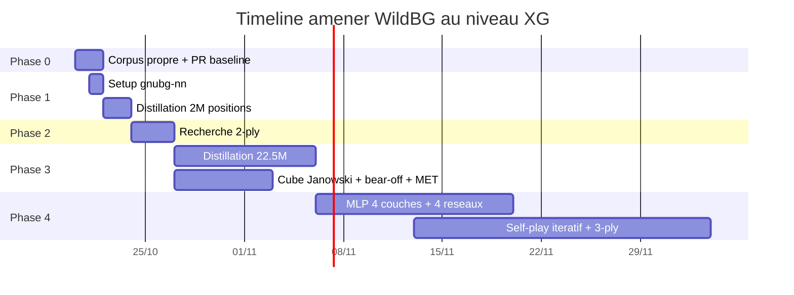

# Plan d'amélioration — Amener WildBG au niveau eXtreme Gammon (XG)

> **Date** : Octobre 2026. Ce document planifie les étapes pour faire passer le
> moteur WildBG (niveau intermédiaire, erreur ~5.9) vers le niveau eXtreme
> Gammon (PR ≤ 0.5, niveau champion du monde), en suivant **la technique la plus
> proche de XG**.
>
> **Objectif réaliste révisé** : PR ~1-2 (niveau « champion »), car le meilleur
> projet open-source MIT (Raccoon) plafonne à PR 0.95 en checker cubeless. Le
> PR ≤ 0.5 (XG commercial) reste un horizon théorique, pas un objectif de
> livraison.
>
> **Stratégie retenue** : distillation massive depuis gnubg (levier dominant) +
> recherche multi-ply + approfondissement du réseau, en appliquant les **7
> leçons de XG** (voir [`TECHNIQUE_XG.md`](TECHNIQUE_XG.md)).

---

## Sommaire

1. [État actuel (mesuré)](#1-état-actuel-mesuré)
2. [Diagnostic — pourquoi WildBG n'est pas au niveau XG](#2-diagnostic--pourquoi-wildbg-nest-pas-au-niveau-xg)
3. [La découverte décisive — le plafond vient des labels](#3-la-découverte-décisive--le-plafond-vient-des-labels)
4. [Les 7 leçons de XG appliquées à WildBG](#4-les-7-leçons-de-xg-appliquées-à-wildbg)
5. [Les 5 méthodes (classées par rentabilité)](#5-les-5-méthodes-classées-par-rentabilité)
6. [Plan d'exécution par phases (timing précis)](#6-plan-dexécution-par-phases-timing-précis)
7. [Tableau de timing global (Gantt)](#7-tableau-de-timing-global-gantt)
8. [Checkpoints de validation](#8-checkpoints-de-validation)
9. [Risques et mitigations](#9-risques-et-mitigations)
10. [Recommandation](#10-recommandation)

---

## 1. État actuel (mesuré)

| Élément | Valeur |
|---|---|
| Moteur | WildBG (branche `nets`, réseaux forts) |
| Force documentée | erreur ~5.9 (1-pointers, analysé gnubg 2-ply) |
| mEMG | ~7.5 |
| ELO | ~1800 |
| PR mesuré (corpus maison, peu fiable) | ~185 (à re-mesurer avec un corpus propre) |
| Niveau | Intermédiaire / joueur de club |
| Cible XG | PR ≤ 0.5 (champion du monde) |
| Cible réaliste | PR ~1-2 (niveau « champion ») |

### Architecture exacte de WildBG (branche `nets`)

| Caractéristique | Réseau contact | Réseau race |
|---|---|---|
| Entrées | 202 | ~186 |
| Couches cachées | 300 → 250 → 200 | 16 |
| Activation | Hardsigmoid | Tanh |
| Sortie | 6 sorties exclusives + softmax | 6 sorties exclusives + softmax |

**Entraînement** : self-play TD-Gammon pur (Tesauro 1992), rollouts 1-ply
(1296 parties/position), **sans distillation massive** et **sans features
expertes Berliner**.

**Inférence** : `tract` (pure Rust → WASM), batch evaluation (tous les coups
légaux en un forward pass).

---

## 2. Diagnostic — pourquoi WildBG n'est pas au niveau XG

1. **Réseaux entraînés par self-play TD-Gammon** (pas de distillation massive) :
   WildBG suit l'approche TD-Gammon (Tesauro 1992), qui atteint un niveau
   « strong master » mais **pas** le niveau XG moderne.
2. **Pas de recherche multi-ply profonde** : WildBG évalue en 0-ply/1-ply, sans
   rollout 2-ply/3-ply comme XG.
3. **Encodage TD-Gammon classique (202 entrées)** : pas les features expertes
   (Berliner) ni les encodages modernes.
4. **Cube simplifié** : la branche `nets` a un `CubeInfo` « quick and dirty »
   (seuil fixe), pas la formule Janowski complète.

---

## 3. La découverte décisive — le plafond vient des labels

**Le plafond de WildBG provient de la qualité des labels (self-play), pas de
l'architecture du réseau.** Pour dépasser ce plafond, il faut un « professeur
externe » (gnubg) qui fournit des labels de meilleure qualité que le self-play.

Preuves croisées :

- **Raccoon** (MIT, PR 0.95) : 40M positions gnubg 2-ply → PR 0.95. Son gain
  vient de la distillation, pas d'une architecture révolutionnaire.
- **Backgammon-NN** (Rust + tract-ONNX, même stack que WildBG) : 22.5M positions
  → ferme ~38% du gap vers gnubg. Le vrai gain vient des labels, pas du réseau.
- **Backgammon-NN bat WildBG 61.2% à temps égal**, alors que les deux partagent
  une approche réseau comparable : la différence est la qualité des données
  d'entraînement.

**Implication stratégique** : ré-entraîner les réseaux WildBG existants
(contact + race) sur des millions de positions gnubg 2-ply, plutôt que réécrire
le moteur ou changer d'architecture.

---

## 4. Les 7 leçons de XG appliquées à WildBG

> Source : [`TECHNIQUE_XG.md`](TECHNIQUE_XG.md). Chaque leçon est mappée à une
> phase du plan (§6).

| # | Leçon XG | Application WildBG | Phase |
|---|---|---|---|
| 1 | Approfondir le réseau (MLP 4 couches `[512,512,256,256]`, ~562k params, ReLU) | Remplacer les 2 réseaux actuels par un MLP profond | Phase 4 |
| 2 | Spécialiser par phase (contact/race/crashed/backgame) | Étendre de 2 → 4 réseaux spécialisés | Phase 4 |
| 3 | Découpler le cube (Janowski) | Porter le `CubeInfo` Janowski complet de `main` → `nets` | Phase 3 |
| 4 | Rollouts tronqués + réduction de variance (levier n°1) | Rollouts 5-7 coups + éval 1-3 ply | Phase 4 |
| 5 | Bear-off exact + MET rolloutée | Tables bear-off exactes + MET Kazaross-XG2 | Phase 3 |
| 6 | Volume d'entraînement massif | Distillation 2M → 22.5M positions gnubg | Phases 1 & 3 |
| 7 | Optimiser la vitesse CPU (Rust) | Batch evaluation + parallélisme rayon | Continu |

---

## 5. Les 5 méthodes (classées par rentabilité)

> Classement par rentabilité décroissante (gain de PR / effort) :
> **distillation > recherche multi-ply > architecture > self-play itératif > cube**.

### Méthode 1 — Distillation massive depuis gnubg (levier dominant) 🥇

**Principe** : ré-entraîner les réseaux WildBG sur des **millions de positions
étiquetées par GNU Backgammon 2-ply** (comme Raccoon, PR 0.95 avec 40M).

**Source de données** : [`gnubg-nn`](https://github.com/StonesAndDice/gnubg-nn-pypi)
(GPL-3.0, **côté serveur uniquement**) fournit les poids officiels gnubg
(`gnubg.wd`, ~1 Mo), les tables de bear-off exactes, et le pipeline de self-play
complet (`gnubg_nn.training`).

**Volume critique — le « genou » de rentabilité** (mesures Backgammon-NN) :

| Volume de positions | Gain observé |
|---|---|
| 500K → 2.5M | Gain net (forte pente) |
| 2.5M → 17.5M | Gain marginal (pente faible) |
| 17.5M → 22.5M | Gain faible |
| 22.5M → 37.5M | **Aucun gain** (plateau) |

Le « genou » se situe entre **2.5M et 22.5M positions** : au-delà de 22.5M, le
rendement s'effondre. **Inutile de viser 40M** (Raccoon) — 22.5M suffit pour
fermer ~38% du gap vers gnubg.

### Méthode 2 — Recherche multi-ply (2-ply/3-ply) 🥈

**Principe** : ajouter une recherche expectiminimax 2-ply/3-ply par-dessus
l'évaluation 0-ply de WildBG (balayage des 21 tirages adverses pondérés 1/36
et 2/36, avec élagage alpha-bêta pour rester < 150 ms).

**Impact attendu** : gain de ~1-2 points de PR par ply supplémentaire.

### Méthode 3 — Architecture résiduelle + features expertes Berliner 🥉

**Principe** : enrichir l'encodage avec les features expertes (Berliner) et
éventuellement une architecture résiduelle. Secondaire par rapport à la
distillation (le vrai gain vient des labels).

### Méthode 4 — Self-play itératif

**Principe** : itérer self-play → distillation → self-play (comme alexstrehl,
PR 0.94 en 0-ply avec 562K paramètres).

### Méthode 5 — Cube Janowski complet

**Principe** : remplacer le `CubeInfo` simplifié par la formule Janowski complète
(déjà implémentée sur la branche `main` de WildBG).

---

## 6. Plan d'exécution par phases (timing précis)

> Le plan suit la technique XG : distillation d'abord (levier dominant), puis
> recherche multi-ply, puis approfondissement du réseau et self-play itératif.
> Chaque phase a un **objectif PR**, des **actions chiffrées**, une **durée**,
> un **checkpoint mesurable**, et des **risques/mitigations**.

---

### Phase 0 — Corpus propre + mesure PR baseline

| Attribut | Détail |
|---|---|
| **Objectif PR** | Baseline fiable (remplace le PR ~185 peu fiable) |
| **Durée** | 1-2 jours |
| **Effort** | 🟢 faible |

**Actions** :
1. Générer un corpus de **≥ 1000 positions** self-play avec la **convention
   WildBG exacte** (voir [`INTEGRATION_WILDBG.md`](INTEGRATION_WILDBG.md) §2,
   échange des indices de barre 0/25).
2. Étiqueter chaque position avec gnubg 2-ply via
   [`GnubgPersistentClient`](../backend-engine/app/gnubg_client.py:91)
   (process persistant, ~1-2 s de démarrage amorti).
3. Mesurer le PR objectif via [`measure_wildbg_pr.mjs`](../scripts/measure_wildbg_pr.mjs)
   (formule officielle `PR = 500 × perte_équité / décisions_non_forcées`).
4. Documenter le PR baseline dans ce document (§1).

**Checkpoint** : corpus propre validé (convention exacte), PR baseline fiable
mesuré et documenté.

**Risques** : convention de plateau erronée → équités fausses silencieuses.
**Mitigation** : tests différentiels massifs vs gnubg sur les 1000 positions.

---

### Phase 1 — Distillation 2M positions gnubg 2-ply

| Attribut | Détail |
|---|---|
| **Objectif PR** | ~10 (depuis ~185) |
| **Durée** | ~7h calcul + 1 jour setup |
| **Effort** | 🟡 moyen |

**Actions** :
1. Installer `gnubg-nn` côté serveur (jamais embarqué) :
   ```bash
   pip install gnubg-nn
   ```
2. Générer **2M positions** self-play étiquetées gnubg 2-ply (via
   `gnubg_nn.training`, parallélisé sur 8+ workers Docker).
3. Ré-entraîner les réseaux WildBG (contact + race) sur ce corpus, en
   conservant l'architecture actuelle (202/186 entrées).
4. Exporter en ONNX, recompiler le WASM via
   [`build-wildbg.ps1`](../scripts/build-wildbg.ps1).
5. Re-mesurer le PR.

**Checkpoint** : PR < 20 après 500K positions, < 10 après 2M.

**Risques** : distillation trop lente → paralléliser (8+ workers).
**Mitigation** : utiliser le backend Docker existant
([`backend-engine`](../backend-engine/README.md)).

---

### Phase 2 — Recherche 2-ply

| Attribut | Détail |
|---|---|
| **Objectif PR** | ~5 (depuis ~10) |
| **Durée** | 2-3 jours |
| **Effort** | 🟡 moyen |

**Actions** :
1. Implémenter `search_2ply` dans le crate [`wildbg-cabi`](../wildbg-cabi/src/lib.rs)
   (étendre le `MultiPlyEvaluator` actuel, limité à 1-ply).
2. Balayer les 21 tirages adverses pondérés (1/36 doubles, 2/36 simples).
3. Élagage alpha-bêta pour rester < 150 ms.
4. Exposer via la C ABI (`wildbg_best_move` avec profondeur).

**Checkpoint** : PR < 5, coups optimaux ≥ 60/100.

**Risques** : latence > 150 ms → élagage agressif + batch evaluation.
**Mitigation** : réutiliser le batch evaluation existant (tous les coups en un
forward pass).

---

### Phase 3 — Distillation 22.5M (le genou) + cube Janowski complet

| Attribut | Détail |
|---|---|
| **Objectif PR** | ~1-2 (depuis ~5) |
| **Durée** | 1-2 semaines |
| **Effort** | 🔴 élevé |

**Actions** :
1. Générer **22.5M positions** gnubg 2-ply (le « genou », pas 40M).
2. Ré-entraîner les réseaux sur ce corpus complet.
3. **Porter le `CubeInfo` Janowski complet** de la branche `main` vers `nets`
   (Leçon 3) : `equity_no_double`, `equity_double_take`,
   `equity_opponent_owns`, take point et gammon price en match play.
4. **Intégrer les tables de bear-off exactes** (jusqu'à 13 points) et la **MET
   Kazaross-XG2** (Leçon 5).
5. Recompiler le WASM et re-mesurer le PR.

**Checkpoint** : PR < 2, coups optimaux ≥ 80/100 (22.5M positions, plateau atteint).

**Risques** : plateau de rendement au-delà de 22.5M → ne pas dépasser 22.5M.
**Mitigation** : arrêt au genou mesuré (aucun gain 22.5M → 37.5M).

---

### Phase 4 — Approfondir le réseau + self-play itératif + 3-ply

| Attribut | Détail |
|---|---|
| **Objectif PR** | ~1 (plafond réaliste, pas ≤ 0.5) |
| **Durée** | plusieurs semaines |
| **Effort** | 🔴 très élevé |

**Actions** :
1. **Approfondir le réseau** (Leçon 1) : passer à un MLP 4 couches
   `[512, 512, 256, 256]` (~562k params, ReLU), comme PureTD (2026).
2. **Spécialiser par phase** (Leçon 2) : étendre de 2 → 4 réseaux
   (contact / race / crashed / backgame).
3. **Self-play itératif** (Méthode 4) : boucle self-play → distillation →
   self-play avec le réseau distillé comme professeur.
4. **Recherche 3-ply** (Méthode 2 étendue) : 441 positions évaluées, avec
   variante « red » (échantillonnage 7 dés sur 21).
5. **Rollouts tronqués + réduction de variance** (Leçon 4, levier n°1) :
   rollouts 5-7 coups + évaluation 1-3 ply, à la manière de XGRoller++.

**Checkpoint** : PR ~1-2, coups optimaux ≥ 85/100 (plafond réaliste).

**Risques** : convergence lente du self-play itératif → accepter PR ~1-2.
**Mitigation** : la distillation directe (Phase 3) reste le socle ; le self-play
itératif est un raffinement incrémental.

---

## 7. Tableau de timing global (Gantt)

> Timeline séquentielle. Les phases 3 et 4 peuvent se chevaucher partiellement
> (la génération de données 22.5M tourne en parallèle du portage du cube).

| Semaine | Phase | Jalons | PR attendu |
|---|---|---|---|
| **S1** | Phase 0 | Corpus propre + PR baseline fiable | ~185 (baseline) |
| **S1** | Phase 1 (setup) | `gnubg-nn` installé, pipeline de distillation prêt | — |
| **S1-S2** | Phase 1 (calcul) | 2M positions générées + réseaux ré-entraînés | ~10 |
| **S2-S3** | Phase 2 | Recherche 2-ply implémentée | ~5 |
| **S3-S5** | Phase 3 | 22.5M positions + cube Janowski + bear-off/MET | ~1-2 |
| **S5+** | Phase 4 | MLP 4 couches + 4 réseaux + self-play + 3-ply | ~1 |

### Diagramme Gantt



---

## 8. Checkpoints de validation

| Checkpoint | Critère mesurable |
|---|---|
| Phase 0 | Corpus propre (convention WildBG exacte), PR baseline fiable |
| Phase 1 | PR < 20 après 500K positions, < 10 après 2M |
| Phase 2 | PR < 5, coups optimaux ≥ 60/100 |
| Phase 3 | PR < 2, coups optimaux ≥ 80/100 (22.5M positions, plateau atteint) |
| Phase 4 | PR ~1-2, coups optimaux ≥ 85/100 (plafond réaliste, pas ≤ 0.5) |

---

## 9. Risques et mitigations

| Risque | Mitigation |
|---|---|
| PR 0.5 très difficile (niveau XG commercial) | Accepter PR ~1-2 comme « champion » réaliste (plafond Raccoon = 0.95) |
| Distillation 22.5M trop lente | Paralléliser (8+ workers), utiliser le backend Docker |
| Plateau de rendement au-delà de 22.5M | Ne pas dépasser 22.5M (aucun gain mesuré 22.5M→37.5M) |
| Encodage inexact → équités fausses silencieuses | Tests différentiels massifs vs gnubg |
| GPL de gnubg-nn | Utiliser **uniquement** côté serveur (outil de build), jamais embarqué |
| Taille WASM croît avec les features | Rester sous ~15 Mo, compression gzip + lazy-load |
| Latence 3-ply > 150 ms | Variante « red » (échantillonnage 7 dés/21) + élagage alpha-bêta |

---

## 10. Recommandation

**Commencer par la Phase 0** (corpus propre + mesure PR fiable), car toutes les
décisions ultérieures dépendent d'une mesure de référence correcte. Ensuite,
**Phase 1** (distillation 2M) qui est le levier le plus rentable (le plus gros
gain de PR pour le moindre effort), puis **Phase 2** (recherche 2-ply) et
**Phase 3** (distillation 22.5M, le « genou » + cube Janowski). La **Phase 4**
(approfondissement du réseau + self-play itératif + 3-ply) est optionnelle :
elle vise un PR ~1-2, pas ≤ 0.5.

**Stratégie retenue** : distillation massive depuis gnubg (Méthode 1) +
recherche 2-ply (Méthode 2) + approfondissement du réseau (Leçon 1), en
conservant l'architecture WildBG existante et en appliquant les 7 leçons de XG.
Ré-entraîner les réseaux (contact + race) sur des millions de positions gnubg
2-ply, plutôt que réécrire le moteur.
