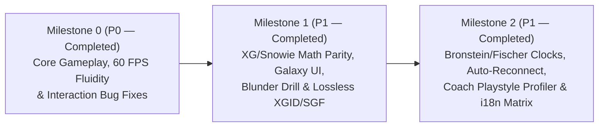

# Execution Roadmap: eXtreme Gammon (XG), Snowie 4 & Backgammon Galaxy Parity

> **Companion Documents**: [`docs/SPECIFICATIONS_XG_SNOWIE_GALAXY.md`](./SPECIFICATIONS_XG_SNOWIE_GALAXY.md) & [`docs/AUDIT_SYSTEME_ET_PARITE_XG_GALAXY.md`](./AUDIT_SYSTEME_ET_PARITE_XG_GALAXY.md)  
> **Primary Language**: English (i18n-ready: `en`, `fr`, `es`, `de`, `ja`)  
> **Engineering Standards**: [`GOVERNANCE.md`](../GOVERNANCE.md) (Zero Mocks, Deterministic Truth, Strict TDD) & [`SCALABILITY.md`](../SCALABILITY.md) ($\le 300$ lines per file).

---

## Roadmap Progression & Delivery Status

| Milestone | Scope & Key Modules | Status |
| :--- | :--- | :---: |
| **Milestone 0 (P0)** | 60 FPS Zero-Latency Gameplay, Smart One-Click/Right-Click/Double-Click, Multiplayer Broadcast & Arrow Previews (`useDesktopControls.ts`, `useCheckerInteractions.ts`, `useBackgammonGame.ts`, `Board.tsx`) | ✅ **COMPLETED** |
| **Milestone 1 (P1)** | XG/Snowie PR, Snowie Error Rate, Luck-Adjusted PR, Kazaross-XG2 MWC/EMG, 3-Mode Galaxy Equity Curve (`EMG`/`MWC %`/`Luck`), Interactive Blunder Training Quiz & Lossless `XGID`/`SGF` (`ratingCalculator.ts`, `gameAnalyzer.ts`, `EquityCurveChart.tsx`, `ReviewBoardPreview.tsx`, `backgammonEngine.ts`, `sgfSerializer.ts`) | ✅ **COMPLETED** |
| **Milestone 2 (P1)** | Tournament Clocks (`delay`/`bronstein`/`fischer` + `normal`/`speed`/`blitz`), Exponential Backoff Auto-Reconnection & Outbound Action Queue, AI Coach Playstyle Profiler (`playstyleProfiler.ts`) & 5-Locale Terminology Matrix (`terminologyMatrix.ts`) | ✅ **COMPLETED** |

---

## Milestone 0 (P0 — Priority Absolute) — Core Gameplay, Ergonomics & 60 FPS Zero-Latency Fixes
**Objective**: Eliminate all checker selection bugs, dice-order desynchronizations, multiplayer broadcast gaps, and synchronous AI turn freezes to guarantee a **60 FPS zero-jank gameplay experience**.

### Task 0.1 — Desktop & Mobile Smart Interaction Fixes (P0.1 & P0.2)
- **Target Files**:
  - `src/hooks/useDesktopControls.ts`
  - `src/hooks/useMobileTouchControls.ts`
- **Implementation**:
  1. In `useDesktopControls.ts`, update `handleOneClick` to prioritize `preferredDie` (`0` or `1`) instead of hardcoding `leftDests` (`0`). When the clicked checker has ambiguous destinations across both dice and no single die is locked, delegate to `runSmartClick` / `onSelectChecker` so target triangles (`ghostDestinations`) illuminate cleanly.
  2. Update `handleOneRightClick` to play the complementary die (`1 - preferredDie`).

### Task 0.2 — Non-Blocking 60 FPS AI Turn Transition (P0.3)
- **Target Files**:
  - `src/hooks/useBackgammonGame.ts`
- **Implementation**:
  1. When `opponentDelayMs > 0` (standard interactive play), dispatch `OPPONENT_PREPARE_ROLL` immediately and defer the synchronous 2-ply `evaluateBoard` / `findBestBoardMove` calls to execute asynchronously after the browser paints the human player's final checker move.
  2. Preserve synchronous execution when `opponentDelayMs === 0` so all unit and deterministic state-machine tests execute instantaneously.

### Task 0.3 — Unified Multiplayer Broadcast & Forced Move Auto-Play (P0.4)
- **Target Files**:
  - `src/hooks/useCheckerInteractions.ts`
  - `src/hooks/useForcedMoveAutoPlay.ts`
- **Implementation**:
  1. Add multiplayer move broadcasting inside `handlePlayMove` in `useCheckerInteractions.ts` so One-Click Desktop moves, Mobile Tap moves, Right-Click moves, and Forced Auto-Play moves broadcast to the remote opponent just like 2-click destination moves.
  2. Update `useForcedMoveAutoPlay.ts` to support `isHumanTurn` (or matching player color) rather than hardcoding `turn !== 'X'`.

### Task 0.4 — Dynamic Sum-of-Dice Double-Click & Candidate Arrow Preview (P0.5 & P0.6)
- **Target Files**:
  - `src/hooks/useCheckerInteractions.ts`
  - `src/components/board/Board.tsx`
  - `src/app/page.tsx`
- **Implementation**:
  1. In `handleCheckerDoubleClick` (`useCheckerInteractions.ts`), determine `firstDie = leftDests.includes(sumResult.midDest) ? 0 : 1` and `secondDie = (1 - firstDie) as 0 | 1` instead of hardcoding `0` then `1`.
  2. In `Board.tsx`, pass `O_OFF` and `X_OFF` to `renderOffTray`.
  3. In `page.tsx`, parse and display the hovered candidate move's arrows (`optimal`) when hovering a row in the Coach candidate table instead of returning empty arrays `{ optimal: [], played: [] }`.

---

## Milestone 1 — High-Performance N-Ply Engine Pool, Web Worker WASM & Stratified Rollouts
**Objective**: Eliminate cold-start latency in `gnubg_pool.py`, isolate `WildBG` WASM in a browser Web Worker, and enable variance-reduced 1296/3888 rollouts.

### Task 1.1 — Persistent Worker Pool (`GnubgPersistentClient` Integration)
- **Target Files**:
  - `backend-engine/app/gnubg_pool.py`
  - `backend-engine/app/gnubg_client.py`
  - `backend-engine/tests/test_pool.py`
- **Implementation**:
  1. Prepend `new game` to `GnubgWorker._board_commands()` in `gnubg_pool.py`.
  2. Replace cold `subprocess.Popen` per request with persistent `GnubgPersistentClient` instances per worker.
  3. Guard worker acquisition with an `asyncio.Semaphore` / queue instead of overwriting `self.workers[0]`.
- **Acceptance Criteria**: 2-ply evaluation p95 latency $< 60\text{ ms}$; 0 worker collisions under 20 concurrent requests.

### Task 1.2 — Quasi-Random Stratified Rollouts (1296 / 3888) & SSE Streaming
- **Target Files**:
  - `backend-engine/app/gnubg_pool.py`
  - `backend-engine/app/main.py`
- **Implementation**:
  1. Enable `set rollout quasi on` and configurable truncation (`set rollout truncation enable on`, `plies 11`) in `_rollout_commands`.
  2. Compute 95% confidence intervals ($\pm 1.96\,\sigma$) and expose a Server-Sent Events stream (`GET /rollout/stream`).

### Task 1.3 — Web Worker Offloading for `WildBG` WASM
- **Target Files**:
  - `src/workers/wildbg.worker.ts` *(new)*
  - `src/lib/engine/wildbgClient.ts`
- **Implementation**: Move WASM instantiation and 0-ply/1-ply inference into a dedicated Web Worker with non-blocking message passing.

---

## Milestone 2 — Mathematical Parity with XG & Snowie: MET 25x25, EMG, Cube PR & Luck
**Objective**: Align PR, Snowie Error Rate, Match Equity, and Cube Analysis 100% with eXtreme Gammon and Snowie 4.

### Task 2.1 — Kazaross-XG2 (25x25) & Woolsey MET + Janowski Cubeful Engine
- **Target Files**:
  - `src/features/coach/matchContext.ts`
  - `src/features/rating/cubeDecisionEngine.ts` *(new)*
- **Implementation**:
  1. Extend Kazaross MET to $25 \times 25$ and add selectable Woolsey-Heinrich MET.
  2. Implement `mwcToEmg` / `emgToMwc` and full 5-state Janowski Cube Analysis (*No Double*, *Double/Take*, *Double/Pass*, *Too Good/Take*, *Too Good/Pass*, plus *Post-Crawford Free Drop*).

### Task 2.2 — Full Match-Context PR, Snowie ER, Cube PR & Removal of `-0.22` Cap
- **Target Files**:
  - `src/features/rating/gameAnalyzer.ts`
  - `src/features/rating/ratingCalculator.ts`
  - `src/features/rating/types.ts`
- **Implementation**:
  1. Remove the hardcoded `-0.22` fallback (`gameAnalyzer.ts` L115) by directly evaluating `boardAfter` when a played move falls outside the Top-8 candidates.
  2. Pass actual match context (`cubeValue`, `cubeOwner`, `awayWhite`, `awayBlack`, `isCrawford`) into every evaluation and normalize losses in **EMG**.
  3. Include Close Cube Decisions in PR denominator and numerator; output `overallPR`, `checkerPR`, `cubePR`, `snowieErrorRate`, and `luckTotalEmg`.

---

## Milestone 3 — Lossless Standard Interoperability (`XGID`, `.mat`, `.sgf`, `.xg`)
**Objective**: Guarantee lossless round-trip import/export with eXtreme Gammon, Snowie, GNU Backgammon, and Backgammon Galaxy.

- **Target Files**:
  - `src/features/export/xgidSerializer.ts`
  - `src/features/export/matSerializer.ts` *(new — JellyFish / Galaxy `.mat` parser & exporter)*
  - `src/features/export/sgfSerializer.ts`
  - `src/features/export/xgParser.ts` *(new — `.xg` binary match importer)*

---

## Milestone 4 — Backgammon Galaxy Competitive Parity (Bronstein/Fischer Clocks & Network Resilience) — ✅ COMPLETED
**Objective**: Deliver tournament-grade fair play with Bronstein/Simple Delay and Fischer clocks, Speed/Blitz presets, and exponential backoff auto-reconnection with FIFO action buffering.

- **Delivered Files**:
  - [`src/features/multiplayer/clockManager.ts`](../src/features/multiplayer/clockManager.ts): Supports `'delay'`, `'bronstein'`, `'fischer'`, `'per_turn'`, and `'unlimited'` time controls across `'normal'` (2m/pt + 12s), `'speed'` (1m/pt + 8s), and `'blitz'` (30s/pt + 5s) presets.
  - [`src/features/multiplayer/realtimeChannel.ts`](../src/features/multiplayer/realtimeChannel.ts): Automatic exponential backoff reconnection (`attemptReconnect()`, `1s -> 16s`), browser `online` recovery listener, outbound `pendingActions` FIFO buffer (`flushPendingActions()`), and 45s disconnect forfeit detection (`onOpponentForfeitByDisconnect`).
  - [`src/features/multiplayer/sessionRecovery.ts`](../src/features/multiplayer/sessionRecovery.ts): Active session persistence and room snapshot recovery.

---

## Milestone 5 — Pedagogical AI Coach: Contextual Playstyle Profiler, 5-Locale i18n Matrix & Blunder Training — ✅ COMPLETED
**Objective**: Surpass Backgammon Galaxy's review tools with contextual playstyle profiling, 5-language terminology standardization, and 1-click Blunder Training.

- **Delivered Files**:
  - [`src/features/coach/playstyleProfiler.ts`](../src/features/coach/playstyleProfiler.ts): Classifies player style (`aggressive_blitzer`, `conservative_builder`, `tactical_priming`, `racing_specialist`, `balanced_all_rounder`), computes `aggressionIndex`, `positionalSolidness`, and `racingAccuracy` (0–100), diagnoses the `primaryWeakness`, and recommends targeted drills across `en`, `fr`, `es`, `de`, `ja`.
  - [`src/lib/i18n/terminologyMatrix.ts`](../src/lib/i18n/terminologyMatrix.ts): Standardized 5-locale (`en`, `fr`, `es`, `de`, `ja`) Backgammon & XG/Snowie/Galaxy glossary matrix (`getInternationalTerm`).
  - [`src/components/rating/EquityCurveChart.tsx`](../src/components/rating/EquityCurveChart.tsx), [`src/components/rating/ReviewBoardPreview.tsx`](../src/components/rating/ReviewBoardPreview.tsx), [`src/components/rating/GameReviewCourse.tsx`](../src/components/rating/GameReviewCourse.tsx) & [`src/components/rating/GameReviewModal.tsx`](../src/components/rating/GameReviewModal.tsx): 3-mode Equity/MWC/Luck chart, Playstyle Profile card (`data-testid="coach-playstyle-profile"`), and interactive 1-click **Blunder Training Quiz**.
