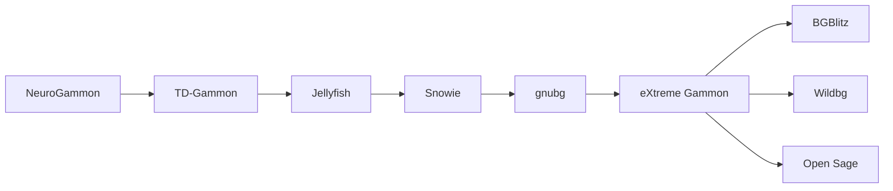

# Référence technique — eXtreme Gammon (XG)

> **Date** : Octobre 2026. Ce document synthétise la technique du moteur de
> backgammon commercial de référence **eXtreme Gammon (XG)**, et en tire les
> leçons applicables au moteur **WildBG** du projet Backgammon Coach IA.
>
> **Contexte** : amener WildBG (niveau intermédiaire, erreur ~5.9) vers le
> niveau XG (PR ≤ 0.5). Ce document est le pendant « technique de référence »
> de [`PLAN_AMELIORATION_XG.md`](PLAN_AMELIORATION_XG.md) (le plan d'action) et
> de [`REFERENCE_WILDBG.md`](REFERENCE_WILDBG.md) (l'analyse interne de WildBG).

---

## Sommaire

1. [Histoire et auteur](#1-histoire-et-auteur)
2. [Technique d'évaluation](#2-technique-dévaluation)
3. [Pourquoi XG atteint PR ≤ 0.5](#3-pourquoi-xg-atteint-pr--05)
4. [Tableau comparatif des PR (étude Depreli 2012)](#4-tableau-comparatif-des-pr-étude-depreli-2012)
5. [Documenté vs secret](#5-documenté-vs-secret)
6. [Comparaison des moteurs](#6-comparaison-des-moteurs)
7. [Les 7 leçons applicables à WildBG](#7-les-7-leçons-applicables-à-wildbg)
8. [Sources](#8-sources)

---

## 1. Histoire et auteur

| Élément | Détail |
|---|---|
| **Auteur** | **Xavier Dufaure de Citres**, ingénieur français |
| **Société** | Cofondateur de **GameSite 2000 Ltd.** (2000) |
| **2002** | Première version du moteur (remplace **Snowie** sur GammonSite) |
| **Juin 2009** | Sortie d'**eXtreme Gammon** (Windows) |
| **2011** | **XG2** : retraining massif, `XGRoller++`, nouvelle MET |
| **2019** | **Lifetime Achievement Award** de l'US Backgammon Federation |

### Lignée des moteurs de backgammon



La lignée retrace l'évolution depuis les premiers réseaux de neurones appliqués
au backgammon (NeuroGammon, TD-Gammon de Tesauro) jusqu'aux moteurs modernes.
XG occupe une position charnière : il hérite de gnubg (open source) mais
introduit un réseau profond propriétaire et des rollouts optimisés qui en font
la référence commerciale.

---

## 2. Technique d'évaluation

### 2.1 Le réseau de neurones

| Caractéristique | Valeur |
|---|---|
| **Type** | MLP feedforward (perceptron multicouche) |
| **Entrées** | ~150 entrées |
| **Sorties** | 5 sorties **cubeless** |
| **Couches cachées** | **Secret commercial** (non divulgué) |

Les 5 sorties cubeless :

| Sortie | Signification |
|---|---|
| `win` | Probabilité de gagner (simple) |
| `win gammon` | Probabilité de gagner un gammon |
| `win backgammon` | Probabilité de gagner un backgammon |
| `lose gammon` | Probabilité de perdre un gammon |
| `lose backgammon` | Probabilité de perdre un backgammon |

### 2.2 L'équité cubeless

L'équité est calculée à partir des 5 sorties :

```
E = 2·P(win) − 1 + P(wg) + P(wbg) − P(lg) − P(lbg)
```

où `P(win)` est la probabilité de gagner (toutes issues confondues), et les
termes `wg`, `wbg`, `lg`, `lbg` pondèrent les issues gammon/backgammon.

### 2.3 Le cube découplé (formules Janowski)

Le cube n'est **pas appris par le réseau**. Il est calculé séparément via les
**formules de Janowski** :

- **Take point** : le seuil d'équité en dessous duquel il faut passer (drop).
- **Gammon price** : la valeur relative d'un gammon dans le calcul du cube.

Ce découplage (réseau cubeless + cube analytique) est une décision d'architecture
majeure : le réseau se concentre sur la position pure, et le cube est calibré
par des formules exactes.

### 2.4 La recherche expectimax

XG utilise une recherche **expectimax** (expectiminimax) à profondeur variable :

| Profondeur | Positions évaluées |
|---|---|
| 1-ply | 1 position |
| 2-ply | 21 positions |
| 3-ply | 441 positions |
| 4-ply | 9 261 positions |
| 5-ply | ~194 000 positions |

**3-ply « red »** : variante qui **échantillonne 7 dés sur 21** pour accélérer
la recherche (compromis vitesse/précision).

### 2.5 Les rollouts tronqués

Les rollouts (simulations Monte-Carlo) sont **tronqués** : au lieu de jouer
jusqu'à la fin de la partie, on joue **5-7 coups** puis on évalue la position
résultante avec une recherche **1-3 ply**, avec **réduction de variance**.

Trois niveaux de rollouts :

| Niveau | Truncation |
|---|---|
| `XGRoller` | 1T (1 coup tronqué) |
| `XGRoller+` | 2T (2 coups tronqués) |
| `XGRoller++` | 3T (3 coups tronqués) |

### 2.6 Bear-off exact, MET, opening book, réseau backgame

| Composant | Détail |
|---|---|
| **Bear-off exact** | Tables exactes jusqu'à **13 points** |
| **MET** | **Kazaross-XG2** (Match Equity Table) |
| **Opening book** | Livre d'ouvertures intégré |
| **Réseau backgame** | Réseau **dédié** aux positions de backgame |

### 2.7 Performance

| Métrique | Valeur |
|---|---|
| Débit | **> 1M évaluations/seconde** |
| GPU | **Aucun** (CPU uniquement) |
| Vitesse relative | **3× plus rapide que gnubg** en 3-ply |

---

## 3. Pourquoi XG atteint PR ≤ 0.5

Six facteurs expliquent la supériorité de XG :

1. **Retraining massif** : 73 trillions de positions (XG2), gain de **+13.2 Elo**.
2. **Réseau plus profond + features plus riches** que gnubg.
3. **Rollouts optimisés et rapides** (tronqués + réduction de variance).
4. **MET et bear-off exacts** (Kazaross-XG2, tables jusqu'à 13 points).
5. **Réseau backgame spécialisé** (les backgames sont des positions difficiles).
6. **Cube découplé** (formules Janowski calibrées, pas apprises par le réseau).

---

## 4. Tableau comparatif des PR (étude Depreli 2012)

Étude indépendante de **Depreli (2012)** mesurant le Performance Rating (PR) de
chaque moteur (plus bas = meilleur) :

| Moteur | Configuration | PR |
|---|---|---|
| **XG2** | XGRoller++ | **0.11** |
| **XG2** | 5-ply | 0.25 |
| **XG2** | 4-ply | 0.33 |
| **gnubg** | 4-ply | 0.35 |
| **XG2** | 3-ply | 0.45 |
| **gnubg** | 3-ply | 0.46 |
| **gnubg** | 2-ply | 0.58 |
| **BGBlitz** | 4-ply | 0.90 |
| **Snowie** | 3-ply | 1.24 |

> **Lecture** : XG2 en XGRoller++ (0.11) domine largement. À profondeur égale,
> XG2 bat gnubg (0.33 vs 0.35 en 4-ply ; 0.45 vs 0.46 en 3-ply). Le gap se
> creuse surtout grâce aux rollouts optimisés (XGRoller++).

---

## 5. Documenté vs secret

### Documenté (public)

- Architecture générale (MLP feedforward, ~150 entrées, 5 sorties cubeless).
- Recherche expectimax (profondeurs 1-5 ply).
- Rollouts tronqués (5-7 coups + évaluation 1-3 ply + réduction de variance).
- Bear-off exact (jusqu'à 13 points).
- MET (Kazaross-XG2).
- Volume de retraining (73 trillions de positions).

### Secret (non divulgué)

- Nombre exact de couches et d'unités cachées.
- Features précises (encodage exact des entrées).
- Procédure de retraining (détails du pipeline).
- Réseau backgame (architecture dédiée).
- Formules de cube exactes (calibration Janowski précise).

---

## 6. Comparaison des moteurs

| Moteur | Licence | Architecture | PR (référence) |
|---|---|---|---|
| **XG** | Commercial fermé | MLP profond | 0.11 (XGR++) |
| **gnubg** | Open source | 3 réseaux 1 couche (~30k poids) | 0.35 (4-ply) |
| **Open Sage** | Open source | 16 réseaux spécialisés | 0.23 (3T) — parité/supérieur à XG |
| **Wildbg** | Open source (Rust) | 2 réseaux (contact + race) | ~5.9 (erreur) |

> **Note** : Open Sage (16 réseaux spécialisés, PR 0.23 en 3T) atteint la parité
> voire surpasse XG en open source — preuve que la spécialisation par phase est
> une voie viable sans secret commercial.

---

## 7. Les 7 leçons applicables à WildBG

### Leçon 1 — Approfondir le réseau

**Recommandation** : passer d'un MLP à 1 couche (WildBG actuel) à un **MLP
profond à 4 couches** `[512, 512, 256, 256]`, soit **~562k paramètres**, avec
activation **ReLU** — comme le projet **PureTD (2026)**.

**Pourquoi** : XG doit sa force en partie à un réseau plus profond que gnubg.
Un réseau plus profond capture des interactions non-linéaires plus riches.

### Leçon 2 — Spécialiser par phase

**Recommandation** : entraîner des réseaux **spécialisés par phase** :
`contact` / `race` / `crashed` / `backgame`.

**Pourquoi** : XG a un réseau backgame dédié ; Open Sage (16 réseaux) prouve que
la spécialisation est un levier majeur. WildBG a déjà 2 réseaux (contact + race) ;
étendre à 4 phases est une évolution naturelle.

### Leçon 3 — Découpler le cube

**Recommandation** : garder le réseau **cubeless** et calculer le cube
séparément via les **formules Janowski** (take point, gammon price).

**Pourquoi** : XG ne fait pas apprendre le cube au réseau. WildBG a déjà un
`CubeInfo` Janowski complet sur la branche `main` — à porter vers `nets`.

### Leçon 4 — Rollouts tronqués + réduction de variance (levier n°1)

**Recommandation** : implémenter des **rollouts tronqués** (5-7 coups +
évaluation 1-3 ply) avec **réduction de variance**, à la manière de XGRoller++.

**Pourquoi** : c'est le **levier n°1** de XG — le XGRoller++ (0.11) domine
largement le 5-ply (0.25). La troncature + réduction de variance donne plus de
force par unité de calcul que la recherche profonde brute.

### Leçon 5 — Bear-off exact + MET rolloutée

**Recommandation** : intégrer des **tables de bear-off exactes** (jusqu'à 13
points) et une **MET** (Kazaross-XG2 ou équivalente) **rolloutée**.

**Pourquoi** : XG combine bear-off exact et MET précise pour éliminer les
erreurs de fin de partie et de match play.

### Leçon 6 — Volume d'entraînement massif

**Recommandation** : viser un **volume d'entraînement massif** — 73 trillions de
positions (XG) ou 200M parties (PureTD).

**Pourquoi** : le retraining massif de XG2 a apporté +13.2 Elo. Le volume de
données est un facteur de force de premier ordre (voir aussi la distillation
gnubg dans [`PLAN_AMELIORATION_XG.md`](PLAN_AMELIORATION_XG.md)).

### Leçon 7 — Optimiser la vitesse CPU

**Recommandation** : optimiser le débit d'inférence **CPU** (pas de GPU), en
exploitant **Rust** (déjà la stack de WildBG).

**Pourquoi** : XG atteint >1M éval/s sans GPU, 3× plus rapide que gnubg. La
vitesse brute multiplie l'efficacité des rollouts et de la recherche. Rust est
bien placé pour ce type d'optimisation.

---

## 8. Sources

- **Manuel XG2** — documentation officielle d'eXtreme Gammon.
- **Interview Simborg** — entretien avec Xavier Dufaure de Citres.
- **Étude Depreli (2012)** — mesure indépendante des PR des moteurs.
- **Papier PureTD (2026)** — architecture MLP profond `[512,512,256,256]`, ReLU.
- **Open Sage** — moteur open source à 16 réseaux spécialisés (PR 0.23).
