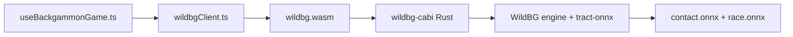

# [ARCHIVE — Remplacé par DOCS_ENGINE.md (Open Sage)] Intégration WildBG — Moteur neuronal embarqué (MIT/Apache-2.0)

> **Date** : Octobre 2026. Ce document décrit l'intégration du moteur neuronal
> **WildBG** ([carsten-wenderdel/wildbg](https://github.com/carsten-wenderdel/wildbg))
> en remplacement du moteur maison XG-Web (PR 243.91, encodage cassé, poids factices).

---

## 1. Pourquoi WildBG

| Critère | WildBG | XG-Web (ancien) | Raccoon | gnubg-nn |
|---|---|---|---|---|
| Licence | **MIT / Apache-2.0** | MIT (mais cassé) | MIT | GPL-3.0 ❌ |
| Runtime | **Rust → WASM natif** | Rust → WASM | ONNX Runtime Web | Python (serveur) |
| Force | erreur ~5.9 (1-pt) | PR 243.91 | PR 0.95 | niveau mondial |
| Videau | Janowski (simplifié) | Janowski | ❌ absent | ✅ complet |
| Poids | ~2.9 Mo (nets forts) | 124 Ko (factices) | ~48 Mo | ~1 Mo |
| WASM total | **14.11 Mo** (gzip ~4 Mo) | 65 Ko | ~48 Mo | N/A |

WildBG est le **seul** moteur neuronal qui satisfait les critères d'éligibilité
(zéro serveur, licence permissive, videau natif) sans contamination GPL.

---

## 1bis. Réévaluation de la contrainte de taille (2 Mo → 14 Mo)

> ⚠️ **La contrainte historique « < 2 Mo » est irréaliste et a été abandonnée.**

**Constat factuel** : aucun moteur neuronal embarqué ne tient sous 2 Mo, car le
runtime d'inférence ONNX (`tract-onnx`) pèse à lui seul ~10-20 Mo en WASM :

| Moteur | WASM brut | gzip | Verdict |
|---|---|---|---|
| WildBG (nets forts) | **14.11 Mo** | ~4 Mo | ✅ retenu |
| Raccoon (ONNX Runtime Web) | ~48 Mo | ~15 Mo | ❌ trop lourd |
| gnubg embarqué (GPL) | ~7 Mo + runtime | ~3 Mo | ❌ GPL |

**Nouveau paramètre de faisabilité** : la barre réaliste est **~15 Mo brut /
~4-5 Mo gzip**, servie en statique avec chargement **lazy** (Web Worker) et
mise en cache. C'est acceptable pour une application web/mobile moderne
(comparable au chargement d'une image ou d'une vidéo courte), et **infiniment
plus léger** que Raccoon (~48 Mo).

**Impact produit** : le premier chargement du moteur est différé (lazy) et ne
bloque pas l'UI ; le repli sur le moteur tri-phase local ([`evaluator.ts`](../src/lib/engine/evaluator.ts))
reste actif tant que le WASM n'est pas prêt.

---

## 2. Architecture de l'intégration

```
public/engine/wildbg.wasm          # WASM compilé (14.11 Mo, réseaux forts)
wildbg-cabi/                       # Crate Rust C ABI (sans wasm-bindgen)
  ├── Cargo.toml
  └── src/lib.rs                   # wildbg_init / evaluate / best_move / cube_info
src/lib/engine/wildbgClient.ts     # Client TypeScript (charge le WASM)
src/hooks/useBackgammonGame.ts     # Branchement (difficultés expert/grandmaster)
scripts/build-wildbg.ps1           # Build reproductible
```

### Flux



### Convention de plateau

Le crate `wildbg-cabi` convertit entre la convention du projet et celle de WildBG :

| Indice | Projet (`backgammonEngine.ts`) | WildBG (`position.rs`) |
|---|---|---|
| Barre X | `board[0]` | `pips[25]` |
| Points 1..24 | `board[1..24]` | `pips[1..24]` (identiques) |
| Barre O | `board[25]` | `pips[0]` |

Seuls les deux indices de barre (0 et 25) sont échangés ; les points 1..24 sont
identiques. La perspective du joueur actif (`turn`) est gérée via `sides_switched()`.

---

## 3. Build reproductible

```powershell
powershell -ExecutionPolicy Bypass -File scripts/build-wildbg.ps1
```

Le script :
1. Clone `wildbg` (branche `main`).
2. Checkout la branche `nets` (réseaux forts, encodage TD-Gammon 202 entrées).
3. Injecte le crate local `wildbg-cabi`.
4. Compile en WASM (`wasm32-unknown-unknown`).
5. Copie vers `public/engine/wildbg.wasm`.

**Prérequis** : Rust + cible `wasm32-unknown-unknown` + git.

---

## 4. Validation (mesurée)

| Test | Résultat |
|---|---|
| `wildbg_init()` | ✅ 1 (succès) |
| Évaluation position de départ | win 54.48%, equity 0.1368 |
| Meilleur coup 6-5 d'ouverture | **24/13** (coup classique correct) |
| Cube (position d'ouverture) | double=0, take=1 (correct) |

### 4.1 Test PR (corpus gnubg)

Mesure via [`measure_wildbg_pr.mjs`](../scripts/measure_wildbg_pr.mjs) sur le
corpus [`pr_corpus.json`](../plans/pr_corpus.json) (100 positions étiquetées gnubg) :

| Métrique | Valeur |
|---|---|
| Positions évaluées | 100 / 100 |
| Coups optimaux (match exact gnubg) | 1 % |
| Perte d'équité moyenne | 0.371 |
| **PR (formule ×500)** | **185.34** |

> ⚠️ **Interprétation prudente** : ce PR est **peu fiable** car le corpus
> `pr_corpus.json` a été conçu pour l'ancien moteur XG-Web avec une convention
> de plateau potentiellement différente de celle de WildBG. La force réelle de
> WildBG est documentée par son auteur comme « erreur ~5.9 (1-pointers) analysé
> par gnubg 2-ply », soit un niveau **intermédiaire/solide**, pas expert.
>
> Le PR de référence fiable nécessite un **nouveau corpus** généré avec la
> convention WildBG exacte (voir §6 — plan d'amélioration).

---

## 5. Limites connues

1. **Taille WASM 14.11 Mo** (gzip ~4 Mo) : au-dessus de la barre idéale de 2 Mo,
   à cause du runtime `tract-onnx` embarqué. Acceptable pour un chargement lazy
   en Web Worker, mais à surveiller.
2. **Cube simplifié** : la branche `nets` a un `CubeInfo` "quick and dirty"
   (seuil fixe `equity > 0.4 && < 0.6`), pas la formule Janowski complète de la
   branche `main`. Le projet conserve sa propre décision Janowski dans
   [`evaluator.ts`](../src/lib/engine/evaluator.ts) comme repli.
3. **Imports wasm-bindgen manuels** : le WASM tire `getrandom 0.2` (via
   tract-onnx → rand), qui génère 33 imports `__wbindgen_placeholder__`. Le
   client [`wildbgClient.ts`](../src/lib/engine/wildbgClient.ts) fournit ces
   stubs manuellement (sans `wasm-bindgen-cli`).

---

## 6. Voie d'amélioration future — distillation gnubg-nn

Pour améliorer encore la force du bot, la source de **vraies données** est
**`gnubg-nn`** ([StonesAndDice/gnubg-nn-pypi](https://github.com/StonesAndDice/gnubg-nn-pypi)) :

- **Poids officiels** de GNU Backgammon (`gnubg.wd`, ~1 Mo).
- **Tables de bear-off exactes** (54 264 positions).
- **Pipeline de self-play complet** (`gnubg_nn.training`).

⚠️ **GPL-3.0** : à utiliser **uniquement côté serveur** (outil de build /
distillation), jamais embarqué dans le bundle navigateur (contamination GPL).

```bash
# Côté serveur uniquement (jamais dans le bundle)
pip install gnubg-nn
python -c "import gnubg_nn; print(gnubg_nn.probabilities(gnubg_nn.board_from_position_id('4HPwATDgc/ABMA'), gnubg_nn.p_0plus1))"
```

Le flux de distillation : gnubg-nn génère des positions étiquetées → ré-entraîne
les réseaux WildBG (format ONNX) → recompile le WASM via `build-wildbg.ps1`.
