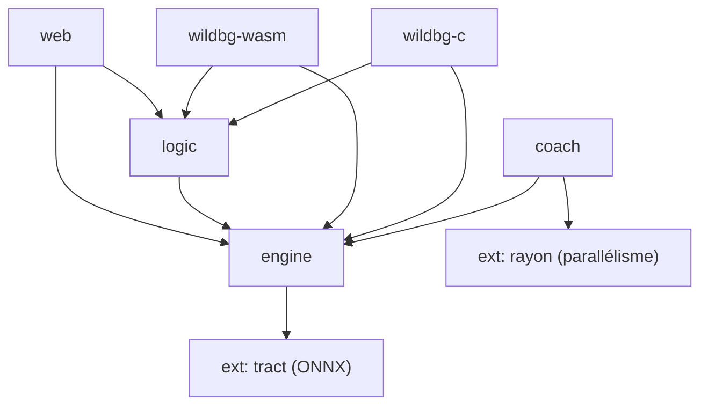

# [ARCHIVE — Remplacé par DOCS_ENGINE.md (Open Sage)] Référence technique WildBG — Comment il fonctionne & comment le refaire en mieux

> **Date** : Octobre 2026. Ce document est une **analyse complète du fonctionnement
> interne de WildBG** ([carsten-wenderdel/wildbg](https://github.com/carsten-wenderdel/wildbg)),
> basée sur sa documentation officielle (`docs/dev/architecture.md`, `engine.md`,
> `training.md`) et son code source Rust. Il sert de **spécification de référence**
> pour reconstruire un moteur équivalent, mais meilleur.

---

## 1. Vue d'ensemble de l'architecture

WildBG est scindé en **deux parties** :

| Partie | Langage | Rôle |
|---|---|---|
| **Rust** (crates) | Rust | Moteur de jeu, génération de coups, inférence, génération de données d'entraînement (rollouts) |
| **Python** (training) | Python/PyTorch | Entraînement supervisé des réseaux de neurones |

**Principe clé** : le Python **ne connaît rien au backgammon**. Les entrées des
réseaux sont générées par le code Rust. Le Python ne fait que de l'apprentissage
supervisé sur des données déjà encodées.

### Les 5 crates Rust



| Crate | Rôle |
|---|---|
| **`engine`** | Cœur : génération de coups, encodage des entrées, inférence ONNX, meilleur coup |
| **`coach`** | Génération de données d'entraînement (self-play + rollouts) |
| **`logic`** | Équités cubeful, match play, cube (au-dessus de `engine` qui est cubeless) |
| **`wildbg-c`** | Bindings C (pour intégration native) |
| **`wildbg-wasm`** | Bindings WebAssembly (navigateur) |
| **`web`** | API HTTP JSON (axum + utoipa) |

---

## 2. Le cœur : `engine`

### 2.1 Représentation de la position

La structure centrale est `Position` :

```rust
pub struct Position {
    pips: [i8; 26],  // indices 0..25
    x_off: u8,       // pions X sortis (bear-off)
    o_off: u8,       // pions O sortis
}
```

- `pips[25]` = barre X, `pips[0]` = barre O.
- `pips[1..24]` = points 1..24 (positif = X, négatif = O).
- `engine` **ne connaît pas le cube** (uniquement cubeless).

### 2.2 Génération de coups

`Position::all_positions_after_moving(dice)` retourne **toutes les positions
résultantes** (pas des objets `Move`), déjà **inversées** (`sides_switched()`)
pour être vues du point de vue de l'adversaire.

### 2.3 Le trait `Evaluator`

Le trait central :

```rust
pub trait Evaluator {
    fn eval(&self, pos: &Position) -> Probabilities;
}
```

`Probabilities` = 6 valeurs (win/lose × normal/gammon/backgammon), somme = 1.0.
L'équité cubeless = `win_normal - lose_normal + 2*(win_gammon - lose_gammon) + 3*(win_bg - lose_bg)`.

**Implémentations** :
- `OnnxEvaluator` : inférence ONNX (via `tract`).
- `CompositeEvaluator` : 2 `OnnxEvaluator` (contact + race) + gestion game-over.
- `RolloutEvaluator` : rollouts Monte-Carlo.
- `MultiPlyEvaluator` : recherche 1-ply (moyenne sur les 21 tirages).

### 2.4 Encodage des entrées (le point le plus important)

WildBG utilise l'encodage **TD-Gammon** (Tesauro 1992), **sans features expertes**
(Berliner) — c'est un TODO documenté.

**Encodage par point (pip)** : 4 entrées par joueur, via une table de lookup
`TD_INPUTS` de 31 entrées (de -15 à +15 pions) :

| Nombre de pions | 4 entrées |
|---|---|
| -15..-1 (adversaire) | `[0,0,0,0]` (toutes nulles) |
| 0 (vide) | `[0,0,0,0]` |
| 1 (à moi) | `[1,0,0,0]` |
| 2 | `[0,1,0,0]` |
| 3 | `[0,0,1,0]` |
| 4 | `[0,0,1,1]` |
| 5 | `[0,0,1,2]` |
| ... | ... |
| 15 | `[0,0,1,12]` |

**Encodage Contact** (`ContactInputsGen`, `NUM_INPUTS = 202`) :
```
[0]        = x_off (pions X sortis)
[1]        = o_off (pions O sortis)
[2..6]     = barre X (4 entrées)
[6..102]   = points 1..24 de X (24 × 4)
[102..202] = points 1..24 de O (24 × 4, inversés)
```

**Encodage Race** (`RaceInputsGen`, `NUM_INPUTS = 186`) :
- Pas de barre ni de point 24 (jamais de pion là en course).
- `[0]` = x_off, `[1]` = o_off, puis 23 points × 4 × 2 joueurs.

### 2.5 Inférence ONNX

Les réseaux sont stockés en **ONNX**, l'inférence est faite par **`tract`**
(pure Rust, pas de Python). `OnnxEvaluator` implémente `BatchEvaluator` pour
évaluer **tous les coups légaux en un seul forward pass batché** (optimisation
majeure : ~2% de gain en rollout).

### 2.6 Meilleur coup

`best_position_by_equity` : génère tous les coups, évalue en batch, retourne la
position de **plus faible équité** (car déjà inversée = vue de l'adversaire).

---

## 3. L'entraînement (le pipeline complet)

### 3.1 Philosophie

**Pas de TD-learning ni de reinforcement learning.** WildBG repose entièrement
sur :
1. **Rollouts** (Rust) pour générer les données.
2. **Apprentissage supervisé** (Python/PyTorch) sur ces données.

### 3.2 La boucle d'entraînement (3 étapes, répétées)

```
1. Self-play : trouver ≥ 100 000 positions (via le moteur actuel).
2. Rollout : 1-ply, 1296 parties par position (36 tirages × 36 réponses).
3. Entraînement supervisé : 2 réseaux (contact + race) sur les données de rollout.
```

Chaque génération de réseaux sert de **tremplin** pour la génération suivante
(self-play avec des réseaux de plus en plus forts).

### 3.3 Les binaires `coach`

| Binaire | Rôle |
|---|---|
| `generate-positions` | Self-play → CSV de positions |
| `generate-training-data` | Rollout des positions → CSV avec probabilités |
| `convert-to-inputs` | CSV → entrées/sorties pour PyTorch |
| `compare-evaluators` | Duel de 2 réseaux |
| `compare-folder` | Duel de tous les réseaux d'un dossier |

### 3.4 Entraînement Python

- `training/src/train_contact.py` et `train_race.py`.
- Hyperparamètres : epochs, optimizer, loss function, learning rate (le plus impactant).
- Sortie : nouveaux `.onnx` dans `training-data/`.

---

## 4. Forces et faiblesses de WildBG (analyse critique)

### Forces
- ✅ **Architecture propre** : séparation nette Rust (moteur) / Python (entraînement).
- ✅ **Licence permissive** (MIT/Apache-2.0), pas de contamination GPL.
- ✅ **Inférence pure Rust** (`tract`), portable WASM/natif.
- ✅ **Batch evaluation** : tous les coups légaux en un forward pass.
- ✅ **Pipeline d'entraînement public et auditable**.

### Faiblesses (leviers d'amélioration)
- ❌ **Encodage TD-Gammon 1992** : pas de features expertes (Berliner), pas de
  features modernes (pip count, blot, ancre, contact).
- ❌ **Pas de recherche multi-ply profonde** : seulement 1-ply (rollout), pas de
  2-ply/3-ply comme XG.
- ❌ **Cube simplifié** : `CubeInfo` "quick and dirty" (seuil fixe), pas Janowski complet.
- ❌ **Rollout 1-ply seulement** : 1296 parties/position, pas de rollout 2-ply.
- ❌ **Pas de distillation massive** : contrairement à Raccoon (40M positions gnubg),
  WildBG s'entraîne par self-play (plus lent à converger).

---

## 5. Comment refaire WildBG en mieux (spécification)

### 5.1 Encodage enrichi (le levier n°1)

Remplacer l'encodage TD-Gammon 202 entrées par un encodage moderne :

| Feature | Description | Gain |
|---|---|---|
| **Pip count** | Différentiel de course (déjà dans `expert.rs`) | Course précise |
| **Blots** | Nombre de blots exposés par joueur | Sécurité |
| **Ancres** | Points ancrés (2+ pions) dans le jan adverse | Défense |
| **Contact** | Pions en contact (frappes possibles) | Blitz/backgame |
| **Prime** | Longueur de la prime (6 points consécutifs) | Blitz |
| **Bear-off** | Pions sortis + distance au bear-off | Fin de partie |

Cible : **~250-400 entrées** (comme gnubg, qui utilise ~200 entrées + features expertes).

### 5.2 Recherche multi-ply (levier n°2)

Ajouter une recherche **2-ply/3-ply** par-dessus l'évaluation 0-ply :
- Balayer les 21 tirages adverses pondérés (1/36 doubles, 2/36 simples).
- Élagage alpha-bêta pour rester < 150 ms.
- Le `MultiPlyEvaluator` actuel ne fait que 1-ply ; l'étendre à 2-ply/3-ply.

### 5.3 Cube Janowski complet (levier n°3)

Remplacer le `CubeInfo` simplifié par la formule Janowski complète (déjà
implémentée sur la branche `main` de WildBG) :
- `equity_no_double`, `equity_double_take`, `equity_opponent_owns`.
- Take point et gammon price en match play.

### 5.4 Distillation massive (levier n°4, le plus rentable)

Au lieu du self-play pur, **distiller** depuis un moteur fort (gnubg 2-ply) :
- Source : `gnubg-nn` (GPL, côté serveur uniquement).
- Volume : 2M → 40M positions (comme Raccoon, PR 0.95).
- Résultat : convergence beaucoup plus rapide que le self-play.

### 5.5 Rollout 2-ply (levier n°5)

Étendre le rollout de 1-ply à 2-ply pour un étiquetage plus précis des données
d'entraînement (10x plus lent, mais meilleure qualité).

---

## 6. Feuille de route de reconstruction

| Étape | Description | Effort |
|---|---|---|
| 1 | Reprendre l'architecture Rust (engine + coach + logic) | 🟢 (déjà fait par WildBG) |
| 2 | Enrichir l'encodage (features expertes) | 🟡 moyen |
| 3 | Ajouter la recherche 2-ply/3-ply | 🟡 moyen |
| 4 | Porter le cube Janowski complet | 🟢 faible |
| 5 | Distiller depuis gnubg-nn (2M → 40M positions) | 🔴 élevé |
| 6 | Rollout 2-ply + self-play itératif | 🔴 très élevé |

---

## 7. Conclusion

WildBG est une **excellente base** : architecture propre, licence permissive,
inférence Rust portable. Ses **4 faiblesses** (encodage 1992, pas de multi-ply,
cube simplifié, pas de distillation) sont exactement les **4 leviers** pour le
refaire en mieux et atteindre le niveau XG. La voie la plus rentable est la
**distillation massive depuis gnubg** (levier n°4), suivie de l'**encodage
enrichi** (levier n°1).
