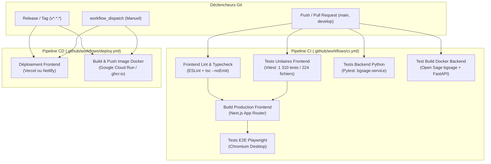

# DevOps & CI/CD — Backgammon Suite

Ce document décrit l'architecture complète d'intégration et de déploiement continus (**CI/CD**) mise en place via **GitHub Actions**, ainsi que les procédures de conteneurisation Docker et de déploiement cloud (Vercel, Netlify, GHCR).

---

## 1. Vue d'ensemble de l'architecture CI/CD



---

## 2. Pipeline d'Intégration Continue (CI)

Le workflow `.github/workflows/ci.yml` s'exécute automatiquement sur chaque `push` et `pull_request` ciblant `main` ou `develop`. Il garantit l'intégrité du code à tous les niveaux de la pile :

| Job | Outils & Commandes | Rôle |
|---|---|---|
| **Frontend Lint & Typecheck** | `npm run lint`<br>`npm run typecheck` | Détecte les erreurs syntaxiques, conventions React 19 / Next.js et conformité stricte TypeScript. |
| **Frontend Tests** | `npm test -- --run` | Exécute la suite complète de 1 310 tests Vitest sur 224 fichiers (moteur, IA, videau, multijoueur, sécurité). |
| **Backend Tests** | `pytest bgsage-service/tests -v` | Exécute les tests unitaires Python Open Sage (modèles Pydantic, évaluation 0-3 ply, cube, selfplay). |
| **Docker Build & Verify** | `docker build` + `docker run` | Valide la compilation de l'image Docker `bgsage-service` (Python 3.11 + `bgsage`) et teste `/health`. |
| **Frontend Build** | `npm run build` | Compile l'application Next.js 15 en mode production (App Router, routes dynamiques, SSR). |
| **Playwright E2E** | `npm run test:e2e:desktop` | Exécute les scénarios de bout en bout (lancer de dés, déplacement de pions, coach grand-maître). |

---

## 3. Pipeline de Déploiement Continu (CD)

Le workflow `.github/workflows/deploy.yml` est déclenché lors d'un `push` sur la branche `main`, lors de la publication d'une `release`, ou manuellement via `workflow_dispatch`.

### 3.1 Déploiement Frontend (Vercel & Netlify)

Le workflow inspecte automatiquement les secrets configurés dans le dépôt GitHub :

#### Option A : Vercel (Recommandé pour Next.js)
1. Si le secret `VERCEL_TOKEN` est présent, le job exécute :
   ```bash
   npx vercel pull --yes --environment=production --token=$VERCEL_TOKEN
   npx vercel build --prod --token=$VERCEL_TOKEN
   npx vercel deploy --prebuilt --prod --token=$VERCEL_TOKEN
   ```
2. Configuration associée : [`vercel.json`](file:///c:/Users/LAPTOP/Desktop/PROJET%20TUTO/BACKGAMMON/vercel.json) définit la conformité du framework Next.js et les en-têtes de sécurité stricts (`DENY`, `nosniff`, `Permissions-Policy`).

#### Option B : Netlify
1. Si le secret `NETLIFY_AUTH_TOKEN` est présent, le job compile et déploie le build de production :
   ```bash
   npm run build
   npx netlify-cli deploy --prod --dir=.next --auth=$NETLIFY_AUTH_TOKEN --site=$NETLIFY_SITE_ID
   ```
2. Configuration associée : [`netlify.toml`](file:///c:/Users/LAPTOP/Desktop/PROJET%20TUTO/BACKGAMMON/netlify.toml) intègre `@netlify/plugin-nextjs` et les en-têtes de sécurité HTTP.

---

### 3.2 Déploiement Backend (Conteneur Docker Open Sage sur Google Cloud Run & GHCR)

Le moteur neuronal d'analyse Backgammon **Open Sage** (`bgsage-service/`, FastAPI + `bgsage` C++) est packagé sous forme d'image Docker déployée sur **Google Cloud Run** (`https://bgsage-service-468274233732.europe-west1.run.app`) et publiée sur le **GitHub Container Registry (GHCR)** :

- **Registre** : `ghcr.io`
- **Image** : `ghcr.io/<votre-orga-ou-username>/bgsage-service:latest`
- **Tags automatiques** :
  - `:latest` (sur la branche `main`)
  - `:sha-<commit-hash>` (traçabilité de chaque build)
  - `:vX.Y.Z` (lors de tags sémantiques)

#### Téléchargement et lancement de l'image publiée :
```bash
# Authentification avec GHCR (si image privée) ou pull direct (si publique)
docker pull ghcr.io/<votre-username>/bgsage-service:latest

# Lancement en arrière-plan avec redémarrage automatique
docker run -d \
  --name bgsage-service \
  -p 8080:8080 \
  --restart unless-stopped \
  ghcr.io/<votre-username>/bgsage-service:latest
```

---

## 4. Orchestration Locale & Auto-Hébergée (Docker Compose)

Pour déployer l'intégralité de la pile (Frontend Next.js + Microservice Open Sage `bgsage-service`) sur un serveur VPS (ex: Hetzner, OVH, DigitalOcean) ou en local :

```bash
# Construction et lancement simultanés des deux services
docker compose up --build -d
```

### Services instanciés :
- **`frontend`** : Accessible sur `http://localhost:3000` (Next.js 15 en conteneur multi-stage non-root).
- **`bgsage-service`** : Accessible sur `http://localhost:8080` (FastAPI + Open Sage `bgsage` avec healthcheck actif sur `GET /health`).

Pour vérifier la santé des conteneurs :
```bash
docker compose ps
docker compose logs -f
```

---

## 5. Guide de Configuration des Secrets GitHub

Pour activer les déploiements cloud automatiques, ajoutez les variables suivantes dans votre dépôt :  
**GitHub > Settings > Secrets and variables > Actions > New repository secret**

| Variable | Nécessaire pour | Description / Comment l'obtenir |
|---|---|---|
| `GITHUB_TOKEN` | Déploiement Docker GHCR | **Automatique** : Fourni nativement par GitHub Actions avec la permission `packages: write`. |
| `VERCEL_TOKEN` | Déploiement Vercel | Token d'accès personnel généré depuis [Vercel Account Tokens](https://vercel.com/account/tokens). |
| `VERCEL_ORG_ID` | Déploiement Vercel | Identifiant de votre organisation ou compte Vercel (trouvé dans `.vercel/project.json` après `vercel link`). |
| `VERCEL_PROJECT_ID` | Déploiement Vercel | Identifiant de votre projet Vercel. |
| `NETLIFY_AUTH_TOKEN`| Déploiement Netlify | Token d'accès personnel généré depuis [Netlify User Settings](https://app.netlify.com/user/applications). |
| `NETLIFY_SITE_ID` | Déploiement Netlify | Identifiant API de votre site Netlify (trouvé dans Site Settings > General > Site details). |
