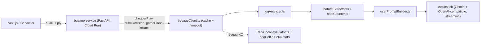

# Étude d'Ingénierie : Moteur Neuronal de Backgammon & IA Coach par LLM

> **Statut** : mis à jour le 2026-10-26 pour correspondre à l'**implémentation réelle** du dépôt.
> Les sections marquées 🎯 **Cible** décrivent ce qui n'est pas encore implémenté.
> Décision d'architecture de référence : [ADR 0009](adr/0009-open-sage-cloud-run.md).

---

## 0. Principe directeur (inchangé)

Un LLM ne sait pas évaluer un tablier de Backgammon sans halluciner (21 tirages distincts par demi-coup,
~420 états par tour). L'architecture **découple** donc :

1. **L'inférence mathématique** → moteur neuronal **Open Sage (`bgsage`)**.
2. **Les calculs géométriques exacts** → **Feature Extractor déterministe** (TypeScript pur).
3. **La synthèse pédagogique** → **LLM** (Gemini / API OpenAI-compatible), qui n'a le droit de faire aucun calcul.



---

## PARTIE 1 : Benchmark des moteurs (résumé)

> [!NOTE]
> Les chiffres de PR ci-dessous viennent de sources externes (benchmarks publiés par les auteurs).
> Ils n'ont **pas** été remesurés dans ce projet, sauf mention « mesuré ».

| Critère | bgsage (Open Sage) | GNU Backgammon | WildBG | BGBlitz | XG2 |
|---|---|---|---|---|---|
| Langage | C++ / Python (PyBind11) | C | Rust (C-API, WASM) | Java | Delphi / x86 32-bit |
| Licence | **MPL-2.0** (code + poids) | GPL-3.0 | Apache-2.0 / MIT | Propriétaire | Propriétaire, pas d'API |
| Classification du plan de jeu | **Oui** (`classify_game_plans`) | Non (Contact/Crashed/Race) | Non | Non exposée | Non |
| Intégration Python | Native (`pip install bgsage`) | Sous-processus CLI | HTTP / FFI | Passerelle JVM | Impossible |
| **Statut dans le projet** | ✅ **Moteur unique** | 🗄️ Archivé (ADR 0001) | 🗄️ Archivé (ADR 0008) | ❌ Non utilisé | ❌ Non utilisé |

### Ce que nous avons essayé puis abandonné

- **GNU Backgammon (WASM / Docker)** : précis mais lourd, lent à initialiser → `archive/backend_engine_gnubg_legacy/`.
- **WildBG (WASM côté navigateur)** : l'audit contre Open Sage 3-ply a mesuré un PR de **~26,6** pour le 0-ply WildBG
  (pas de recherche multi-ply) → `archive/projet_abandonne_bot_non_fiable/`.

> [!IMPORTANT]
> L'étude d'origine recommandait un modèle hybride **« Edge WASM (WildBG) + Cloud (bgsage) »**.
> **Ce n'est pas ce qui a été fait** : WildBG a été retiré. L'Edge est assuré par un **repli local déterministe**
> ([evaluator.ts](../src/lib/engine/evaluator.ts) + table de bear-off exacte), pas par un réseau neuronal.

### Licence

- bgsage (MPL-2.0) : copyleft **au niveau du fichier**. Le service n'étant qu'un consommateur du package
  (aucun fichier bgsage modifié), aucune obligation de publication sur notre code.
- Le binaire `gnubg-setup.exe` présent à la racine n'est pas distribué avec l'application ; à retirer du dépôt.

---

## PARTIE 2 : Pourquoi bgsage pour nourrir le LLM

1. **Plan de jeu natif** : `classify_game_plans(board)` renvoie le plan du joueur et de l'adversaire ;
   `checker_play(..., include_game_plans=True)` renvoie en plus le plan **résultant de chaque coup**
   (`player_game_plan`, `opponent_game_plan`). Le LLM reçoit donc un cadre stratégique explicite.
2. **Décomposition de l'équité** : pour chaque coup candidat → `equity` (cubeful), `cubeless_equity`,
   `equity_diff`, et les probabilités `win`, `gammon_win`, `backgammon_win`, `gammon_loss`, `backgammon_loss`.
3. **Videau** : `cube_action(board, cube_value, cube_owner, away1, away2)` → `equity_nd`, `equity_dt`,
   `equity_dp`, `optimal_action`.
4. **Course** : `is_race(board)`.

---

## PARTIE 3 : Déploiement réel

### 3.1 Microservice `bgsage-service/` (FastAPI)

Fichiers : [main.py](../bgsage-service/app/main.py), [xgid.py](../bgsage-service/app/xgid.py),
[notation.py](../bgsage-service/app/notation.py), [models.py](../bgsage-service/app/models.py).

- Trois analyseurs chargés **une seule fois** au démarrage : `BgBotAnalyzer(eval_level="1ply" | "2ply" | "3ply")`.
- Import de `bgsage` protégé (`try/except ImportError`) pour permettre les tests unitaires sans moteur compilé.

| Endpoint | Rôle |
|---|---|
| `GET /health` | Sonde de disponibilité |
| `POST /api/evaluate` | **Contrat principal** : XGID (format frontend 11 champs ou XG canonique 10 champs) + `ply` 1..3 |
| `POST /api/evaluate-board` | Board 26 entiers + dés (cube centré, money) |
| `POST /analyze` | Analyse 1-ply avec probabilités **non cumulatives** |
| `POST /api/selfplay` | Parties bot vs bot (`simulate_game`) |

> [!WARNING]
> **Probabilités cumulatives vs non cumulatives** : `/api/evaluate` renvoie les probabilités **cumulatives**
> de bgsage (`winGammon` inclut les backgammons). Seul `/analyze` les convertit en valeurs exclusives.
> Tout code consommateur doit savoir lequel il lit.

Si les dés valent `0`, seuls `cubeDecision`, `gamePlans` et `isRace` sont calculés (décision avant le lancer).

### 3.2 Hébergement

```bash
gcloud run deploy bgsage-service --source bgsage-service \
  --project gurugammon --region europe-west1 \
  --min-instances 0 --max-instances 1 --memory 1Gi --cpu 1
```

> [!CAUTION]
> Avec **1 vCPU, max 1 instance et min 0**, le 3-ply subit les cold starts et ne parallélise pas.
> L'objectif « < 150 ms » de l'ADR n'est réaliste qu'en 1/2-ply ou avec cache chaud.
> Pour la charge multi-joueurs : `--cpu 2..4`, `--min-instances 1`, `--max-instances` > 1.

### 3.3 Niveaux de bots (mesurés contre Open Sage 3-ply)

| Bot frontend | Réglage | PR mesuré | Coups optimaux |
|---|---|---:|---:|
| `grandmaster` | 3-ply | 0,00 (référence) | 100 % |
| `expert` | 2-ply | 2,22 | 90 % |
| `intermediate` | 1-ply | 4,89 | 85 % |
| `beginner` | 1-ply + bruit ±0,14 Eq | 15,07 | 65 % |

> [!NOTE]
> Ces PR sont **relatifs à notre propre 3-ply**, pas à une vérité terrain par rollout.
> Ils ne sont donc pas comparables aux PR « absolus » de la Partie 1.

### 3.4 Règles de videau implémentées (`bgsageClient.ts`)

- **Le bot double** si `min(E_DT, E_DP) > E_ND + 0.005` **et** `E_ND < E_DP` (exclut *Too Good*).
- **Le bot prend** si `E_DT ≤ E_DP` (= +1,0), sinon il passe.
- **Crawford** : videau verrouillé. Les scores sont transmis en **away** (`away1`, `away2`) extraits du XGID.
- Le contexte de match (prix du gammon, take point via **MET Kazaross**, DMP, post-Crawford) est calculé
  côté frontend par `buildMatchContext` et injecté dans le prompt.

---

## PARTIE 4 : Code d'interfaçage réel

| Fonction | Rôle | Fichier |
|---|---|---|
| `evaluateWithBgsage(xgid, ply)` | Appel HTTP `POST /api/evaluate`, timeout, cache | [bgsageClient.ts](../src/lib/engine/bgsageClient.ts) |
| `selectBotMoveWithBgsage(...)` | Coup du bot (appariement exact avec les séquences légales) | [bgsageClient.ts](../src/lib/engine/bgsageClient.ts) |
| `evaluateBotCubeWithBgsage(...)` | Décision de videau du bot | [bgsageClient.ts](../src/lib/engine/bgsageClient.ts) |
| Cache des évaluations | Évite de rappeler le service pour un même XGID | [bgsageCache.ts](../src/lib/engine/bgsageCache.ts) |
| `analyzeHumanMoveFromLogWithBgsage(...)` | Analyse du coup humain pour le Coach | [logAnalyzer.ts](../src/features/coach/logAnalyzer.ts) |
| `evaluateBoard(state, ply)` | Repli local hors-ligne | [evaluator.ts](../src/lib/engine/evaluator.ts) |

Les adaptateurs Python gnubg (`gnubg -t -q`) et WildBG (HTTP/WASM) décrits dans l'étude d'origine
**ne sont pas utilisés** ; les anciennes versions sont dans `archive/`.

---

## PARTIE 5 : Le Feature Extractor réel

Implémenté en **TypeScript pur** (et non en Python) dans le frontend :
[featureExtractor.ts](../src/features/coach/featureExtractor.ts) + [shotCounter.ts](../src/lib/engine/shotCounter.ts).
Il compare **la position après le coup joué** et **après le meilleur coup**, du point de vue du joueur.

| Feature | Statut | Détail |
|---|---|---|
| Pip count + leader | ✅ | `pipCountDiff` |
| Contact / course pure | ✅ | `contactStatus` |
| Portes du jan intérieur | ✅ | `innerBoardPoints` |
| Plus longue prime | ✅ | `longestPrime` |
| Points clés | ✅ | Golden Point (5/20), Bar Point (7/18), ancre avancée |
| Tirs directs / indirects **par blot** | ✅ exact | Énumération des 36 tirages, entrée depuis la barre incluse |
| Plans de jeu + probabilités par coup | ✅ | `bgsage.playedMetrics` / `optimalMetrics` |
| Contexte de match (MET, Crawford, DMP) | ✅ | `buildMatchContext` |
| Concept théorique associé | ✅ | Base de connaissances (`getTheoryConceptById`) |
| Fenêtre de marché / volatilité | ⚠️ heuristique | `computeMarketWindowMetrics` : **estimation**, pas un comptage exact |
| **Total des tirs (union des 36)** | ✅ exact | [shotExposure.ts](../src/lib/engine/shotExposure.ts) — un lancer frappant 2 blots n'est compté qu'une fois |
| Duplication des numéros adverses | ✅ | Faces de dé frappant directement 2 blots ou plus |
| Keith Count dans le prompt | ✅ | Affiché uniquement en course pure |
| Market Losers exacts (21 tirages adverses) | 🎯 Cible | Nécessite une évaluation post-coup par bgsage |
| Écarts de probabilités pré-calculés | ✅ | Gain, gammon, risque de gammon (optimal − joué) |

> [!NOTE]
> **Corrigé le 2026-10-26** : le prompt additionnait les tirs blot par blot (double comptage).
> Il utilise désormais l'union exacte. Si `shotExposure` est absent (features construites à la main),
> la somme est affichée avec le préfixe « ≤ » pour signaler un majorant.

### Grounding du prompt (implémenté)

[userPromptBuilder.ts](../src/features/coach/userPromptBuilder.ts) produit un prompt structuré FR/EN :

1. **Diagnostic moteur** : verdict, perte d'équité, coup joué et coup optimal, niveau du joueur.
2. **Contexte de match** + fenêtre de marché.
3. **Concepts stratégiques** : course, blots et tirs, structure, points clés.
4. **Données neuronales Open Sage** : plans de jeu, probabilités (gain, gammon, risque de gammon) des deux coups.
5. **Théorie** : principe et règle d'or tirés de la base de connaissances.

Le LLM répond en **JSON strict**, via `/api/coach` (streaming, timeout, repli `gemini-3.8-flash` en cas de 404).
Si le LLM est indisponible, [ruleBasedExplanation.ts](../src/features/coach/ruleBasedExplanation.ts) fournit
une explication déterministe.

---

## Écarts entre l'étude d'origine et l'existant

| Recommandation de l'étude | Réalité |
|---|---|
| Hybride Edge WildBG WASM + Cloud bgsage | **Cloud bgsage seul** + repli local déterministe |
| Pipeline adaptatif 3P puis rollout tronqué 2T/3T si écart ≤ 0,050 | **Non implémenté** : 1/2/3-ply max |
| Niveaux 4P, 1T/2T/3T | **Non exposés** par le service |
| Feature Extractor Python côté serveur | **TypeScript côté client** |
| Prompt en JSON brut (`build_llm_coach_payload`) | Prompt **texte structuré** en sections |
| Claude / GPT / Gemini | **Gemini** par défaut, toute API OpenAI-compatible possible |
| Jacoby / beavers en money game | Non transmis à bgsage (cube centré/possédé seulement) |

## Prochaines étapes recommandées

1. ~~Corriger le total des tirs~~ ✅ fait.
2. ~~Ajouter duplication, Keith Count, écarts de probabilités~~ ✅ fait.
   - Formule officielle de Tom Keith (1993) strictement alignée dans [keithCount.ts](../src/lib/engine/keithCount.ts) :
     `+2` par pion au-delà de 1 sur le point 1, `+1` par pion au-delà de 1 sur le point 2, `+1` par pion au-delà de 3 sur le point 3, et `+1` par case vide sur les points 4, 5 et 6.
   - 10 tests unitaires dédiés validés ([keithCount.test.ts](../src/lib/engine/keithCount.test.ts)).
3. Exposer un niveau **rollout tronqué** dans `bgsage-service`, réservé à l'analyse post-match (pas au jeu live).
4. Redimensionner Cloud Run (CPU, instance minimale) avant l'ouverture au public.
5. Harmoniser les chiffres de PR entre l'ADR 0009 (« 0,23 ») et `DOCS_ENGINE.md` (PR relatifs).

---

> Pour l'analyse économique complète, la segmentation de la demande et le modèle SaaS Stripe, consulter :
> 📄 [Stratégie de Monétisation SaaS et Architecture Économique](STRATEGIE_MONETISATION_ET_ARCHITECTURE_ECONOMIQUE.md).
