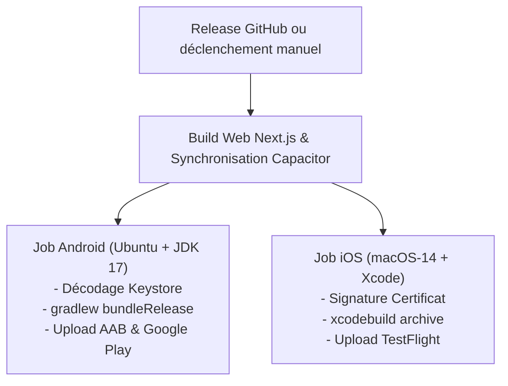

# Guide de Packaging & Publication Mobile — App Store & Google Play

Ce document constitue la référence exhaustive pour la préparation, la signature, la génération des captures d'écran, les fiches de métadonnées et le pipeline de release automatisé vers l'**Apple App Store** et le **Google Play Store**.

---

## 1. Identifiants de l'Application

| Paramètre | Valeur |
|---|---|
| **App Name** | Backgammon Tour |
| **App ID / Package Name** | `com.backgammontour.app` |
| **Framework Mobile** | Capacitor 8 (Next.js 15 Static Export) |
| **Version Initiale** | `1.0.0` (VersionCode: `1`) |

---

## 2. Signature Android & Google Play (AAB)

Google Play impose la fourniture d'un **Android App Bundle (`.aab`)** signé avec un Keystore RSA 2048 bits.

### 2.1 Génération du Keystore de Release
Un script automatisé est mis à votre disposition à la racine du projet :
```bash
# Sous Linux / macOS / Git Bash :
./scripts/generate-android-keystore.sh

# Sous Windows (PowerShell) :
.\scripts\generate-android-keystore.ps1
```
Le fichier est généré dans `android/app/release.keystore` (avec l'alias `backgammon-release-key`).

### 2.2 Configuration dans `android/app/build.gradle`
Le fichier [`android/app/build.gradle`](file:///c:/Users/LAPTOP/Desktop/PROJET%20TUTO/BACKGAMMON/android/app/build.gradle) a été configuré avec le bloc `signingConfigs.release` qui s'adapte automatiquement à l'environnement :
```groovy
signingConfigs {
    release {
        if (System.getenv("KEYSTORE_PATH") != null && file(System.getenv("KEYSTORE_PATH")).exists()) {
            storeFile file(System.getenv("KEYSTORE_PATH"))
            storePassword System.getenv("KEYSTORE_PASSWORD")
            keyAlias System.getenv("KEY_ALIAS")
            keyPassword System.getenv("KEY_PASSWORD")
        }
    }
}
buildTypes {
    release {
        signingConfig signingConfigs.release
        minifyEnabled false
        proguardFiles getDefaultProguardFile('proguard-android.txt'), 'proguard-rules.pro'
    }
}
```

### 2.3 Compilation Locale de l'AAB signé
```bash
# 1. Compilation des assets web Next.js
npm run build:mobile

# 2. Compilation de l'AAB
cd android
./gradlew bundleRelease
```
L'artefact final se trouvera dans : `android/app/build/outputs/bundle/release/app-release.aab`.

---

## 3. Signature iOS & Apple App Store (IPA)

### 3.1 Certificats & Profils de Provisionnement
1. Rendez-vous sur [developer.apple.com](https://developer.apple.com) :
   - Créez un **App ID** avec le Bundle Identifier : `com.backgammontour.app`.
   - Générez un **Certificat de Distribution iOS** (App Store and Ad Hoc).
   - Créez un **Provisioning Profile App Store** associé à l'App ID et au certificat.
2. Téléchargez et installez le profil dans Xcode.

### 3.2 Fichier d'Options d'Exportation
Le fichier [`ios/App/exportOptions-appstore.plist`](file:///c:/Users/LAPTOP/Desktop/PROJET%20TUTO/BACKGAMMON/ios/App/exportOptions-appstore.plist) définit les paramètres pour `xcodebuild` :
- Méthode : `app-store-connect`
- Signature : `automatic` ou `manual` avec sélection du profil.

### 3.3 Archivage et Exportation en ligne de commande :
```bash
cd ios/App
xcodebuild archive \
  -workspace App.xcworkspace \
  -scheme App \
  -configuration Release \
  -archivePath build/App.xcarchive

xcodebuild -exportArchive \
  -archivePath build/App.xcarchive \
  -exportOptionsPlist exportOptions-appstore.plist \
  -exportPath build/out
```

---

## 4. Captures d'Écran Automatisées (Store Screenshots)

Un script Playwright haute-fidélité capture automatiquement les 5 écrans requis dans les résolutions exactes exigées par Apple et Google :

```bash
# Assurez-vous que l'application tourne localement sur le port 3000
npm run dev

# Dans un autre terminal :
node scripts/capture-store-screenshots.mjs
```

### Résolutions Générées :
| Plateforme | Catégorie | Résolution | Dossier Cible |
|---|---|---|---|
| **iOS** | iPhone 6.7" (16 / 15 Pro Max) | 1290 x 2796 px | `store-assets/screenshots/ios/6.7-inch/` |
| **iOS** | iPhone 6.5" (11 Pro Max / XS Max) | 1242 x 2688 px | `store-assets/screenshots/ios/6.5-inch/` |
| **iOS** | iPad Pro 12.9" (6e génération) | 2048 x 2732 px | `store-assets/screenshots/ios/12.9-inch-ipad/` |
| **Android** | Téléphone haute résolution | 1080 x 2400 px | `store-assets/screenshots/android/phone/` |
| **Android** | Tablette 7 pouces | 1200 x 1920 px | `store-assets/screenshots/android/tablet-7/` |
| **Android** | Tablette 10 pouces | 1600 x 2560 px | `store-assets/screenshots/android/tablet-10/` |

---

## 5. Fiches de Métadonnées des Stores (6 Langues)

Les métadonnées sont organisées par langue dans `store-assets/metadata/` :
- **6 locales disponibles** : **Français (`fr-FR/`)**, **Anglais (`en-US/`)**, **Espagnol (`es-ES/`)**, **Portugais (`pt-BR/`)**, **Allemand (`de-DE/`)** et **Arabe (`ar-SA/`)** :
  - `name.txt` : Titre de l'application (max 30 car.)
  - `subtitle.txt` : Sous-titre App Store (max 30 car.)
  - `short_description.txt` : Description courte Google Play (max 80 car.)
  - `description.txt` : Description détaillée exhaustive (jusqu'à 4000 car.)
  - `keywords.txt` : Mots-clés App Store (max 100 car.)
  - `promotional_text.txt` : Accroche promotionnelle App Store (max 170 car.)
  - `release_notes.txt` : Notes de version v1.0.0
  - `urls.txt` : Liens de politique de confidentialité, support technique et site officiel.

---

## 6. Pipeline de Release CI/CD (GitHub Actions)

Le workflow [`.github/workflows/release-mobile.yml`](file:///c:/Users/LAPTOP/Desktop/PROJET%20TUTO/BACKGAMMON/.github/workflows/release-mobile.yml) orchestre la chaîne de publication :



### Secrets GitHub Requis :
| Secret | Usage |
|---|---|
| `ANDROID_KEYSTORE_BASE64` | Contenu encodé en base64 de `release.keystore` |
| `ANDROID_KEYSTORE_PASSWORD`| Mot de passe du Keystore |
| `ANDROID_KEY_ALIAS` | Alias de la clef (ex: `backgammon-release-key`) |
| `ANDROID_KEY_PASSWORD` | Mot de passe de la clef |
| `GOOGLE_PLAY_SERVICE_ACCOUNT_JSON` | Clé JSON du compte de service Google Cloud pour l'API Google Play Developer |
| `APPLE_ID` | Identifiant de connexion Apple Developer |
| `APPLE_TEAM_ID` | Team ID Apple (ex: `XXXXXXXXXX`) |
| `APP_STORE_CONNECT_API_KEY` | Clé d'API App Store Connect pour soumission sans mot de passe |
