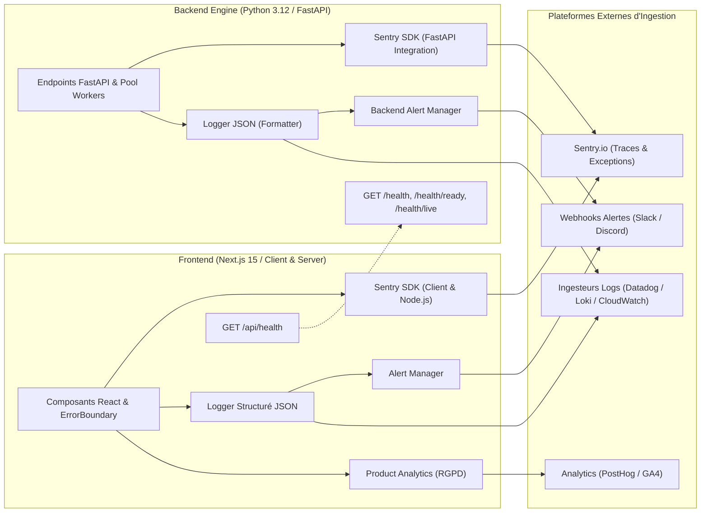

# Observabilité & Monitoring — Backgammon Pro

Ce document détaille l'architecture de surveillance opérationnelle, d'alerte, de traçage d'erreurs (**Sentry**), de **logs structurés JSON**, de **sondes de santé (health-checks)** et d'**analytics produit**.

---

## 1. Vue d'Ensemble de l'Observabilité



---

## 2. Intégration Sentry (Frontend & Backend)

### 2.1 Configuration Frontend
Le SDK `@sentry/nextjs` est initialisé à travers trois points d'entrée :
- [`sentry.client.config.ts`](file:///c:/Users/LAPTOP/Desktop/PROJET%20TUTO/BACKGAMMON/sentry.client.config.ts) : Capture les exceptions côté navigateur avec replays de session en cas d'erreur.
- [`sentry.server.config.ts`](file:///c:/Users/LAPTOP/Desktop/PROJET%20TUTO/BACKGAMMON/sentry.server.config.ts) : Capture les erreurs Node.js lors du rendu SSR et des routes API.
- [`sentry.edge.config.ts`](file:///c:/Users/LAPTOP/Desktop/PROJET%20TUTO/BACKGAMMON/sentry.edge.config.ts) : Initialisation pour le runtime Edge (middleware).
- [`src/lib/monitoring/sentry.ts`](file:///c:/Users/LAPTOP/Desktop/PROJET%20TUTO/BACKGAMMON/src/lib/monitoring/sentry.ts) : Module centralisé fournissant `captureException`, `captureMessage`, `setMonitoringUser`, `addMonitoringBreadcrumb`.
- Intégration dans le composant [`src/components/common/ErrorBoundary.tsx`](file:///c:/Users/LAPTOP/Desktop/PROJET%20TUTO/BACKGAMMON/src/components/common/ErrorBoundary.tsx) pour remonter automatiquement les crashs de rendu React avec le `componentStack`.

### 2.2 Configuration Backend (FastAPI)
- [`backend-engine/app/monitoring.py`](file:///c:/Users/LAPTOP/Desktop/PROJET%20TUTO/BACKGAMMON/backend-engine/app/monitoring.py) :
  - Initialisation automatique avec `FastApiIntegration(transaction_style="endpoint")` et `StarletteIntegration`.
  - Échantillonnage des traces (`traces_sample_rate: 0.2` en prod) et profilage (`profiles_sample_rate: 0.1`).

### Variables d'Environnement :
| Variable | Contexte | Description |
|---|---|---|
| `NEXT_PUBLIC_SENTRY_DSN` | Frontend | DSN public pour les erreurs du navigateur |
| `SENTRY_DSN` | Frontend & Backend | DSN serveur pour les routes API et le microservice Python |

---

## 3. Logs Structurés JSON

### 3.1 Côté Serveur Next.js & Client
Le module [`src/lib/monitoring/logger.ts`](file:///c:/Users/LAPTOP/Desktop/PROJET%20TUTO/BACKGAMMON/src/lib/monitoring/logger.ts) produit :
- **En environnement serveur** : Des lignes JSON conformes aux agrégateurs de logs (Datadog, Loki, CloudWatch, Vercel Log Drain) :
  ```json
  {
    "timestamp": "2026-10-17T06:25:00.000Z",
    "level": "info",
    "service": "backgammon-app",
    "correlationId": "req-98f2-1a2b",
    "message": "Succès opération: evaluate_position",
    "context": { "ply": 2, "durationMs": 42 }
  }
  ```
- **En environnement client** : Un format lisible avec horodatage et contexte dépliable dans les DevTools.
- **Propagation de Corrélation** : Support des `child` loggers pour lier les logs à un `correlationId` ou `userId`.

### 3.2 Côté Backend Python
Le module [`backend-engine/app/logger.py`](file:///c:/Users/LAPTOP/Desktop/PROJET%20TUTO/BACKGAMMON/backend-engine/app/logger.py) injecte un `JSONFormatter` dans le logger standard :
- Un middleware intercepte toutes les requêtes entrantes, lit ou génère un en-tête `X-Correlation-ID`, mesure la latence à la milliseconde et logue chaque requête au format JSON.

---

## 4. Sondes de Santé (Health-Checks)

### 4.1 Backend Engine (FastAPI)

| Endpoint | Méthode | Rôle | Format de Réponse |
|---|---|---|---|
| `/health` | `GET` | Sonde de disponibilité historique (rétrocompatibilité exacte). | `{"status": "ok"}` |
| `/health/ready` | `GET` | **Readiness Probe** pour Kubernetes / Docker Compose. Vérifie que le pool de workers gnubg est prêt à recevoir des tâches. | `{"status": "ready", "gnubg_pool_ready": true, "pool_stats": {...}, "uptime_seconds": 12.4}` |
| `/health/live` | `GET` | **Liveness Probe** rapide confirmant que le serveur répond. | `{"status": "alive"}` |
| `/api/health` | `GET` | Diagnostic complet pour dashboards de maintenance (uptime, Sentry, pool stats). | `{"status": "ok", "service": "backgammon-backend-engine", "version": "0.2.0", ...}` |

### 4.2 Frontend Web App (Next.js)

| Endpoint | Méthode | Rôle | Format de Réponse |
|---|---|---|---|
| `/api/health` | `GET` | Diagnostic complet du frontend. Ping actif du backend (`/health`), vérification de la mémoire Node.js (RSS / Heap) et de Supabase. | Code `200` si tout est sain, ou `207 Multi-Status` (`status: "degraded"`) avec détails d'erreur si le backend est indisponible. |

---

## 5. Système d'Alerte Opérationnel

Les modules [`src/lib/monitoring/alerts.ts`](file:///c:/Users/LAPTOP/Desktop/PROJET%20TUTO/BACKGAMMON/src/lib/monitoring/alerts.ts) et [`backend-engine/app/alerts.py`](file:///c:/Users/LAPTOP/Desktop/PROJET%20TUTO/BACKGAMMON/backend-engine/app/alerts.py) surveillent les anomalies en temps réel :

- **Types d'Alertes Gérées** :
  - `HIGH_LATENCY` : Latence anormale sur les évaluations (> 2.5s).
  - `CONSECUTIVE_FAILURES` : Échecs répétés de communication réseau.
  - `RATE_LIMIT_TRIGGERED` : Pic de code HTTP 429.
  - `CRITICAL_ERROR` : Exceptions non interceptées dans les workers.
- **Protection Anti-Tempête (Debounce)** : Déduplication automatique des alertes identiques sur une fenêtre glissante de 60 secondes.
- **Canaux de Dispatch** :
  - Notification Sentry avec sévérité adaptée.
  - Envoi Webhook externe (Slack, Discord, PagerDuty) via la variable `ALERT_WEBHOOK_URL`.

---

## 6. Analytics Produit & Télémétrie

Le module [`src/lib/analytics/productAnalytics.ts`](file:///c:/Users/LAPTOP/Desktop/PROJET%20TUTO/BACKGAMMON/src/lib/analytics/productAnalytics.ts) assure le suivi produit dans le strict respect du **RGPD** :

- **Consentement Utilisateur** : Aucun événement n'est émis tant que le consentement n'est pas accordé (`analytics.setConsent(false)` bloque et vide le buffer).
- **Taxonomie des Événements** :
  - `game_started` : Difficulté, longueur de match, mode Crawford.
  - `game_completed` : Vainqueur, score, durée, Performance Rating (PR), nombre de blunders.
  - `coach_requested` : Origine du déclencheur (manuel, alerte blunder, review).
  - `coach_explanation_viewed` : Type de coup, sévérité, provider (LLM vs heuristique), durée.
  - `deep_rollout_submitted` : Profondeur (ply), nombre d'essais (trials).
  - `cube_action` : Décision de videau (double, take, pass).
  - `drill_completed` / `daily_puzzle_completed` : Taux de réussite et tentatives.
- **Compatibilité Multi-Fournisseurs** :
  - Google Analytics 4 via `gtag`.
  - PostHog via `window.posthog`.
  - Mode console sécurisé en développement local.
