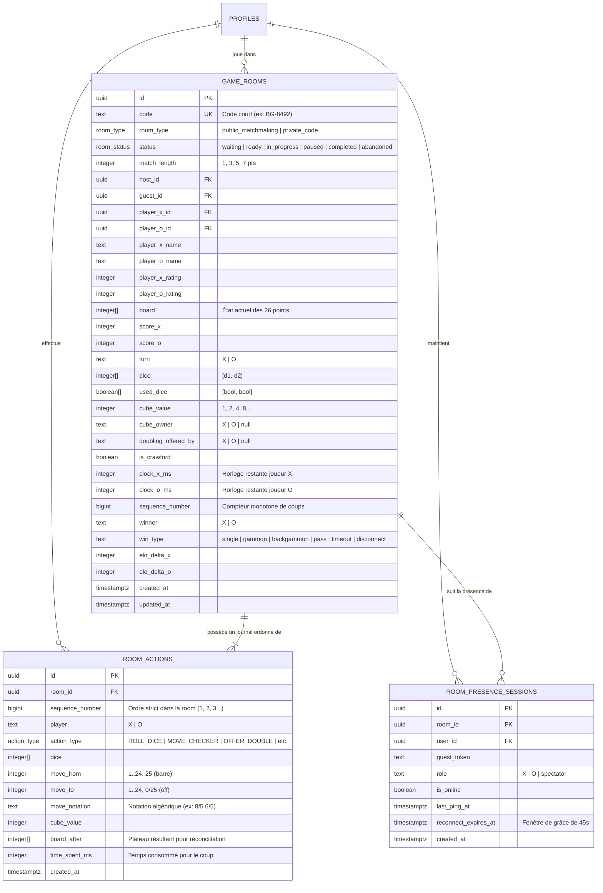
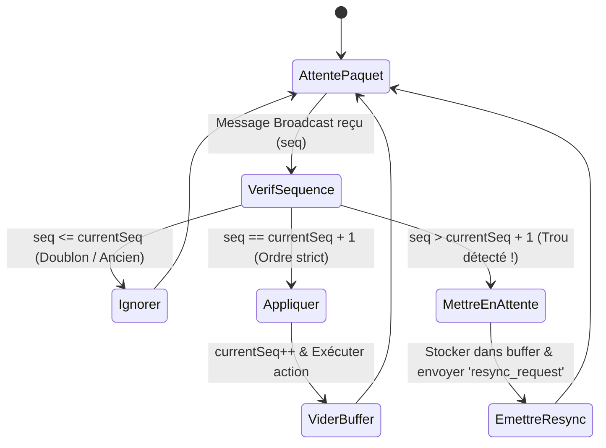

# SPÉCIFICATION D'ARCHITECTURE — MULTIJOUEUR SUPABASE REALTIME & WEBSOCKET

> **Projet** : Backgammon Tournament Pro  
> **Composant** : Moteur Multijoueur Temps Réel & Synchronisation WebSocket  
> **Technologie** : Supabase Realtime (Channels Broadcast + Presence + Postgres Changes CDC) + PostgreSQL 15+

---

## 1. Vision & Principes Directeurs

Le système multijoueur permet à deux joueurs de s'affronter en temps réel, soit par **matchmaking public classé Elo**, soit par **salon privé avec code d'invitation** (ex. `BG-8492`).

| Principe | Implémentation |
|---|---|
| **Ultra-faible latence (< 30ms)** | Les coups, jets de dés et propositions de videau transitent via le canal WebSocket **Broadcast** en mémoire, sans attendre l'écriture disque. |
| **Persistance & Reprise après crash** | L'état dénormalisé du plateau et le journal ordonné des coups sont persistés dans `game_rooms` et `room_actions` avec publication **CDC (`postgres_changes`)**. |
| **Garantie d'ordre & Anti-désynchronisation** | Chaque action possède un **numéro de séquence monotone strict (`sequence_number`)**. Les paquets perdus ou désordonnés sont mis en mémoire tampon et réconciliés automatiquement via `RoomSequenceManager`. |
| **Résilience réseau & Reconnexion** | Le canal **Presence** détecte instantanément les déconnexions et enclenche un compte à rebours de grâce de **45 secondes** avec synchronisation différentielle à la reconnexion. |

---

## 2. Schéma Relationnel PostgreSQL



---

## 3. Architecture des Canaux Supabase Realtime

### 3.1 Canal Unique par Salon : `room:{roomId}`

Chaque partie active souscrit à un unique canal Supabase multiplexé :
```typescript
const channel = supabase.channel(`room:${roomId}`, {
    config: {
        broadcast: { ack: false, self: false },
        presence: { key: localUserId },
    },
});
```

### 3.2 Canaux de Diffusion (Broadcast)

| Événement | Charge utile (Payload) | Rôle & Fréquence |
|---|---|---|
| `game_action` | `{ sequenceNumber, senderRole, action, clockRemainingMs, timestamp }` | Coup de pion, jet de dés, action de videau (latence < 30ms). |
| `resync_request` | `{ fromSequenceNumber, requestedBy, timestamp }` | Émis lorsqu'un client détecte un trou dans les numéros de séquence. |
| `resync_snapshot` | `{ lastSequenceNumber, state, recentActions }` | Réponse de l'adversaire ou du serveur contenant le snapshot de rattrapage. |
| `quick_emote` | `{ senderRole, emoteId: 'gg' \| 'nice_move' \| 'thinking', timestamp }` | Émoticônes et messages rapides de courtoisie. |

### 3.3 Suivi de Présence (Presence)

- **Suivi réciproque** : chaque joueur publie son état (`userId`, `displayName`, `rating`, `role: 'X' | 'O'`).
- **Déconnexion** : si l'adversaire quitte la présence WebSocket (événement `leave`), le statut bascule immédiatement en `opponent_disconnected`.
- **Compte à rebours de grâce** : un compte à rebours de 45 secondes est déclenché. Si le joueur se reconnecte avant l'expiration, l'état se resynchronise. À zéro seconde, le forfait par déconnexion est validé.

### 3.4 Publication CDC (`postgres_changes`)

Les tables `public.game_rooms` et `public.room_actions` sont ajoutées à la publication `supabase_realtime` :
```sql
alter publication supabase_realtime add table public.game_rooms;
alter publication supabase_realtime add table public.room_actions;
```
Cela permet une synchronisation automatique et résiliente, même après un rafraîchissement complet de la page (F5) ou une mise en veille PWA sur mobile.

---

## 4. Protocole de Séquençage & Réconciliation

Pour éliminer tout risque de désynchronisation causé par la gigue réseau ou des paquets reçus dans le désordre, la classe [`RoomSequenceManager`](file:///c:/Users/LAPTOP/Desktop/PROJET%20TUTO/BACKGAMMON/src/features/multiplayer/realtimeSchema.ts#L106-L170) implémente une machine à états stricte :



---

## 5. Arbitrage, Pendules de Tournoi & Anti-Triche Serveur

1. **Pendules de Tournoi WBF (`clockManager.ts`)** :
   - Cadence officielle Delay (WBF / WBIF) : Réserve principale de temps proportionnelle aux points (ex: 2 min / pt, soit 14 min pour 7 pts) + délai de réflexion gratuit par coup (12 secondes).
   - La réserve principale ne s'épuise que si le coup dépasse les 12 secondes gratuites.
   - Support des cadences Fischer (+incrément) et Per-Turn strict.
   - Détection de chute de drapeau (Flag Fall / Timeout) avec précision à la milliseconde et synchronisation bidirectionnelle via `CLOCK_SYNC`.

2. **Validation Serveur des Coups & Anti-Triche (`actionValidator.ts` & `/api/multiplayer/validate-action`)** :
   - Autorité stricte du tour (`action.player === currentTurn`).
   - Règle de la barre obligatoire : si un pion est sur la barre (`board[0] > 0` pour X, `board[25] < 0` pour O), TOUT coup extérieur est strictement rejeté avec code `BAR_MUST_ENTER`.
   - Contrôle de flèche bloquée : interdiction d'atterrir sur une flèche occupée par 2+ pions adverses (`POINT_BLOCKED`).
   - Contrôle du Bear-off : sortie interdite tant que l'ensemble des 15 pions n'est pas dans le jan intérieur (`BEAR_OFF_NOT_ALLOWED`).
   - Restrictions du videau : interdiction en manche de Crawford, après le jet de dés, ou si le cube est possédé par l'adversaire.

3. **Reconnexion après Coupure & Récupération de Session (`sessionRecovery.ts`)** :
   - Persistance sécurisée de la session active (`bg_active_multiplayer_session`) avec heartbeat continu (`touchActiveSession`).
   - Écouteurs d'événements réseau `window.addEventListener('online' | 'offline')`.
   - Reconnexion automatique avec restauration du snapshot de salle (`fetchRecoverableRoomSnapshot`), reprise des pendules en pause (`pauseClock` / `resumeClock`) et resynchronisation du plateau sans désynchronisation.

---

## 6. Fichiers et Tests Associés

- **Pendules de Match WBF** : [`src/features/multiplayer/clockManager.ts`](file:///c:/Users/LAPTOP/Desktop/PROJET%20TUTO/BACKGAMMON/src/features/multiplayer/clockManager.ts)
- **Validation Serveur Anti-Triche** : [`src/features/multiplayer/actionValidator.ts`](file:///c:/Users/LAPTOP/Desktop/PROJET%20TUTO/BACKGAMMON/src/features/multiplayer/actionValidator.ts)
- **Route API Validation Next.js** : [`src/app/api/multiplayer/validate-action/route.ts`](file:///c:/Users/LAPTOP/Desktop/PROJET%20TUTO/BACKGAMMON/src/app/api/multiplayer/validate-action/route.ts)
- **Récupération de Session & Reconnexion** : [`src/features/multiplayer/sessionRecovery.ts`](file:///c:/Users/LAPTOP/Desktop/PROJET%20TUTO/BACKGAMMON/src/features/multiplayer/sessionRecovery.ts)
- **UI & Bannière Clocks & Recovery** : [`src/components/multiplayer/MultiplayerBanner.tsx`](file:///c:/Users/LAPTOP/Desktop/PROJET%20TUTO/BACKGAMMON/src/components/multiplayer/MultiplayerBanner.tsx)
- **Tests Unitaires Associés (100% Passants, 333 tests au total)** :
  - [`src/features/multiplayer/clockManager.test.ts`](file:///c:/Users/LAPTOP/Desktop/PROJET%20TUTO/BACKGAMMON/src/features/multiplayer/clockManager.test.ts) (9 tests)
  - [`src/features/multiplayer/actionValidator.test.ts`](file:///c:/Users/LAPTOP/Desktop/PROJET%20TUTO/BACKGAMMON/src/features/multiplayer/actionValidator.test.ts) (10 tests)
  - [`src/app/api/multiplayer/validate-action/route.test.ts`](file:///c:/Users/LAPTOP/Desktop/PROJET%20TUTO/BACKGAMMON/src/app/api/multiplayer/validate-action/route.test.ts) (4 tests)
  - [`src/features/multiplayer/sessionRecovery.test.ts`](file:///c:/Users/LAPTOP/Desktop/PROJET%20TUTO/BACKGAMMON/src/features/multiplayer/sessionRecovery.test.ts) (5 tests)
  - [`src/components/multiplayer/MultiplayerBanner.test.tsx`](file:///c:/Users/LAPTOP/Desktop/PROJET%20TUTO/BACKGAMMON/src/components/multiplayer/MultiplayerBanner.test.tsx) (6 tests)

