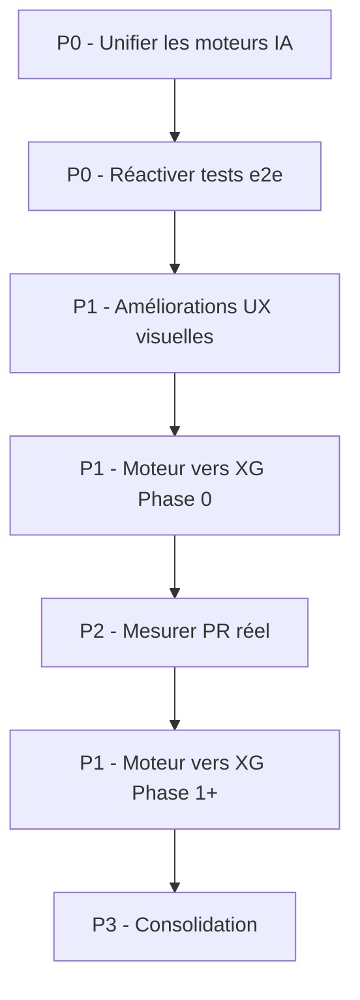

# Plan d'action — Amélioration du produit Backgammon Coach IA

> **Date** : Octobre 2026. Ce document est le **plan d'action global et priorisé**
> pour améliorer le produit sur tous les axes : moteur IA, cohérence, jouabilité,
> UX/visuel, et consolidation. Il synthétise les audits existants et le travail
> d'intégration WildBG déjà réalisé.

---

## 0. État actuel (synthèse)

| Axe | État | Problème principal |
|---|---|---|
| **Moteur IA** | WildBG intégré (14 Mo WASM) | Niveau intermédiaire (erreur ~5.9), pas XG |
| **Cohérence moteurs** | 3 moteurs parallèles | `aiHeuristics.ts` (adversaire) ≠ `evaluator.ts` (coach) ≠ WildBG |
| **Jouabilité** | Tests e2e désactivés | Flux critiques non vérifiés (game-flow, accessibilité) |
| **UX/visuel** | 9 améliorations identifiées | Dés HTML, videau statique, pas de pip count différentiel |
| **Consolidation** | 761/764 tests passent | 3 tests PR obsolètes, doc partiellement à jour |

---

## 1. Les 5 chantiers prioritaires (par valeur produit)

### 🔴 P0 — Unifier les moteurs d'IA (cohérence + force)

**Problème** : 3 moteurs parallèles = incohérence de force. L'adversaire IA
(`aiHeuristics.ts`) est plus faible que le coach (`evaluator.ts`), et WildBG
(nouveau) n'est branché que sur les difficultés expert/grandmaster.

**Actions** :
1. **Unifier le point d'entrée** : un seul `evaluateBoard` / `analyzeBoardMoves`
   qui route vers WildBG (si chargé) → tri-phase (`evaluator.ts`) → heuristique.
2. **Aligner l'adversaire IA sur le coach** : faire jouer l'adversaire avec
   `evaluator.ts` (bear-off exact + Keith) au lieu de `aiHeuristics.ts`.
3. **Déprécier `aiHeuristics.ts`** (redondant).

**Impact** : ⭐⭐⭐⭐⭐ | **Effort** : 🟡 moyen | **Risque** : 🟡 moyen

---

### 🔴 P0 — Réactiver les tests e2e de jouabilité

**Problème** : les flux critiques (tour de jeu, videau, review, accessibilité)
sont marqués `test.skip` car « fragiles ».

**Actions** :
1. Stabiliser les sélecteurs (`data-testid` stables).
2. Remplacer `waitForTimeout` par des attentes conditionnelles (`expect(...).toBeVisible()`).
3. Réactiver `accessibility.spec.ts` (navigation clavier, ARIA, skip links).

**Impact** : ⭐⭐⭐⭐⭐ | **Effort** : 🟡 moyen | **Risque** : 🟡 moyen

---

### 🟠 P1 — Améliorer le moteur vers XG (levier principal)

**Problème** : WildBG est au niveau intermédiaire (erreur ~5.9), loin du niveau
XG (PR ≤ 0.5).

**Actions** (voir [`PLAN_AMELIORATION_XG.md`](PLAN_AMELIORATION_XG.md) et
[`REFERENCE_WILDBG.md`](REFERENCE_WILDBG.md)) — timing précis :

| Phase | Objectif | PR cible | Durée |
|---|---|---|---|
| **0** | Corpus propre + mesure PR fiable | baseline | 1-2 jours |
| **1** | Distillation 2M positions gnubg 2-ply | ~10 | ~7h calcul + 1 jour setup |
| **2** | Recherche 2-ply | ~5 | 2-3 jours |
| **3** | Distillation 22.5M (le genou) + cube Janowski + bear-off/MET | ~1-2 | 1-2 semaines |
| **4** | MLP 4 couches + 4 réseaux + self-play itératif + 3-ply | ~1 | plusieurs semaines |

> La stratégie suit la **technique XG** (7 leçons, voir
> [`TECHNIQUE_XG.md`](TECHNIQUE_XG.md)) : distillation massive depuis gnubg
> (levier dominant) → recherche multi-ply → approfondissement du réseau. Le
> volume cible est **22.5M positions** (le « genou » de rentabilité), pas 40M.

**Impact** : ⭐⭐⭐⭐⭐ | **Effort** : 🔴 élevé | **Risque** : 🟡 moyen

---

### 🟠 P1 — Améliorations UX/visuelles (9 items)

**Problème** : dés HTML simples, videau statique, pas de pip count différentiel.

**Actions** (par ordre de priorité, voir [`feuille-de-route-ux-visuel.md`](../plans/feuille-de-route-ux-visuel.md)) :
1. **Pip count différentiel** (±Δ + pastille vert/rouge) — très facile.
2. **Vrais dés vectoriels/3D** + 4 dés en double — facile.
3. **Videau dynamique** (déplacement + halo) — facile.
4. **Badges numériques** sur tous les points ≥ 2 — très facile.
5. **Thème 2D Flat « Galaxy Void »** — facile.
6. **Flèches SVG de trajectoire** (coach optimal vs joué) — modérée.
7. **Inversion d'orientation** (bascule rapide) — facile.
8. **Toggle pip count** — très facile.
9. **Choix du dé de démarrage** (clic sur les dés) — facile.

**Impact** : ⭐⭐⭐⭐ | **Effort** : 🟢 faible | **Risque** : 🟢 faible

---

### 🟡 P2 — Mesurer le PR réel (chiffre objectif)

**Problème** : le PR auto-référencé ne mesure pas la force réelle.

**Actions** :
1. Générer un corpus propre (convention WildBG exacte).
2. Étiqueter avec gnubg 2-ply (côté serveur, dev uniquement).
3. Mesurer le PR objectif de WildBG et du tri-phase.

**Impact** : ⭐⭐⭐ | **Effort** : 🟢 faible | **Risque** : 🟢 faible

---

### 🟢 P3 — Consolidation (DX, docs, CI)

**Actions** :
1. Corriger les 3 tests PR obsolètes (formule `×120` → `×500`).
2. Mettre à jour `ARCHITECTURE.md` et `PROJECT_MAP.md` (mentionnent l'ancien moteur).
3. Videau cubeful complet (table MET Kazaross-XG2).
4. Optimiser la simulation PR pour la CI.

**Impact** : ⭐⭐ | **Effort** : 🟢 faible | **Risque** : 🟢 faible

---

## 2. Ordre d'exécution recommandé

**Logique** :
1. **P0 d'abord** (unifier + réactiver tests) : ce sont les fondations. Sans
   cohérence des moteurs et sans tests actifs, tout le reste est fragile.
2. **P1 UX** ensuite : gains rapides et visibles, faible risque.
3. **P1 moteur XG** : le chantier le plus long, à lancer en parallèle (Phase 0
   d'abord pour une mesure fiable).
4. **P2-P3** : consolidation finale.

---

## 3. Matrice de priorisation globale

| Priorité | Chantier | Impact | Effort | Risque | Verdict |
|---|---|---|---|---|---|
| **P0** | Unifier les moteurs IA | ⭐⭐⭐⭐⭐ | 🟡 | 🟡 | **URGENT** |
| **P0** | Réactiver tests e2e | ⭐⭐⭐⭐⭐ | 🟡 | 🟡 | **URGENT** |
| **P1** | UX/visuel (9 items) | ⭐⭐⭐⭐ | 🟢 | 🟢 | Recommandé |
| **P1** | Moteur vers XG | ⭐⭐⭐⭐⭐ | 🔴 | 🟡 | Recommandé (long) |
| **P2** | Mesurer PR réel | ⭐⭐⭐ | 🟢 | 🟢 | Recommandé |
| **P3** | Consolidation | ⭐⭐ | 🟢 | 🟢 | Secondaire |

---

## 4. Critères de succès

| Chantier | Critère de succès |
|---|---|
| Unifier moteurs | Un seul point d'entrée d'évaluation, adversaire IA = coach |
| Réactiver tests e2e | 100% des tests e2e actifs et verts |
| UX/visuel | 9 items livrés, conformes à la charte SCALABILITY |
| Moteur XG | PR ≤ 10 (Phase 1), ≤ 5 (Phase 2), ~1-2 (Phase 3-4, plafond réaliste) |
| Mesurer PR | PR objectif mesuré et documenté |
| Consolidation | 764/764 tests verts, doc à jour |

---

## 5. Recommandation finale

**Commencer par les 2 P0** (unifier les moteurs + réactiver les tests e2e), car
ce sont les fondations qui garantissent la fiabilité et la cohérence du produit.
Ensuite, **lancer les améliorations UX** (gains rapides et visibles) **en
parallèle** du **chantier moteur XG** (le plus long, à démarrer tôt avec la
Phase 0 de mesure).
