# 🌍 Masterplan SEO International & Architecture i18n (6 Langues) — « Où va quoi »

> **Référentiel d'architecture officiel** de **Backgammon Tour — Cercle Monte-Carlo & Gammon Academy** (`backgammontour.com` & `gammonacademy.com`).  
> Ce document détaille l'emplacement exact de chaque fichier, son rôle technique, le flux de données multilingue (6 langues + RTL Arabe) et la mécanique d'acquisition SEO / Schema.org.

---

## 1. Cartographie Globale : « Où va quoi ? »

```mermaid
flowchart TD
    subgraph UI["1. Interface & Sélecteur Horloger Monte-Carlo"]
        NAV["src/components/nav/AppNavbar.tsx"]
        SEL["src/components/nav/LanguageSelector.tsx"]
        LOBBY["src/components/lobby/LobbyScreen.tsx"]
        GRID["src/components/lobby/LearningModulesGrid.tsx"]
        ACAD_VIEW["src/components/academy/GammonAcademyView.tsx"]
        ROLLS_TBL["src/components/academy/OpeningRollsTable.tsx"]
    end

    subgraph I18N["2. Moteur i18n Hybride SSR + Export Statique Capacitor"]
        HOOK["src/i18n/index.ts (useTranslation)"]
        UI_DICT["src/i18n/uiTranslations.ts"]
        CTX["src/lib/i18n/I18nContext.tsx (I18nProvider, detectLocale, RTL)"]
        TYPES["src/lib/i18n/types.ts (Locale: fr, en, es, pt, de, ar, ja)"]
        DICTS["src/lib/i18n/translations/{fr,en,es,pt,de,ar,ja}.ts"]
        MATRIX["src/lib/i18n/terminologyMatrix.ts (25 termes XG/WBGF)"]
    end

    subgraph COACH["3. Coach IA Open Sage 3-Ply Multilingue"]
        USE_COACH["src/components/coach/useCoachExplanation.ts"]
        API_COACH["src/app/api/coach/route.ts"]
        SCHEMA["src/lib/security/schemas.ts (Zod 7 langues)"]
        PROMPTS["src/features/coach/prompts.ts"]
        MULTI_PROMPTS["src/features/coach/coachMultiLangPrompts.ts"]
    end

    subgraph SEO["4. Hub SEO Gammon Academy & Schema.org"]
        LAYOUT["src/app/layout.tsx (Metadata + hreflang + JSON-LD)"]
        JSONLD["src/lib/seo/structuredData.ts (@graph 8 entités)"]
        ACAD_PAGE["src/app/academy/page.tsx (/academy)"]
        ACAD_DATA["src/features/academy/academyData.ts (15 Ouvertures 3-Ply)"]
        ACAD_TRANS["src/features/academy/academyTranslations.ts (6 langues)"]
        SITEMAP["public/sitemap.xml + public/robots.txt"]
        ASO["store-assets/metadata/{fr-FR,en-US,es-ES,pt-BR,de-DE,ar-SA}"]
    end

    SEL -->|setLocale| CTX
    NAV --> SEL
    LOBBY --> HOOK
    GRID --> HOOK
    ACAD_PAGE --> ACAD_VIEW
    ACAD_VIEW --> ROLLS_TBL
    ACAD_VIEW --> ACAD_DATA
    ACAD_VIEW --> ACAD_TRANS
    ACAD_VIEW --> MATRIX
    HOOK --> CTX
    HOOK --> UI_DICT
    CTX --> TYPES
    CTX --> DICTS
    USE_COACH -->|language: locale| API_COACH
    API_COACH --> SCHEMA
    API_COACH --> PROMPTS
    PROMPTS --> MULTI_PROMPTS
    LAYOUT --> JSONLD
```

---

## 2. Système Multilingue 6 Langues (`fr`, `en`, `es`, `pt`, `de`, `ar` + `ja`)

### 2.1 Pourquoi une architecture i18n sans sous-routes `[locale]` forcées ?
L'application doit compiler **à la fois** :
1. En **SSR / Edge Next.js 15** pour la production web (`https://backgammontour.com`).
2. En **Export Statique Capacitor (`output: 'export'`)** via `npm run build:mobile` pour générer les binaires natifs iOS et Android (`com.backgammontour.app`), où le middleware serveur Next.js n'existe pas.

Notre architecture hybride résout cette double contrainte :
- **Détection universelle (`detectLocale()` dans [`src/lib/i18n/I18nContext.tsx`](../src/lib/i18n/I18nContext.tsx))** :
  1. Paramètre d'URL `?lang=fr|en|es|pt|de|ar` (utilisé par Googlebot via `hreflang` dans `sitemap.xml` et `<head>`).
  2. Préférence persistée dans `localStorage.getItem('bg_locale')`.
  3. Langues du navigateur (`navigator.languages` / `navigator.language`).
  4. Fuseau horaire (`Intl.DateTimeFormat().resolvedOptions().timeZone`).
- **Support natif du RTL (`dir="rtl"`) pour l'Arabe (`ar`)** :
  - Dès que `locale === 'ar'`, `I18nProvider` applique automatiquement `document.documentElement.lang = 'ar'` et `document.documentElement.dir = 'rtl'` (et restaure `dir = 'ltr'` pour `fr`, `en`, `es`, `pt`, `de`).

### 2.2 Répertoire exact des fichiers i18n

| Fichier | Rôle exact |
| :--- | :--- |
| [`src/lib/i18n/types.ts`](../src/lib/i18n/types.ts) | Définit `Locale`, `PrimaryLocale` (`'fr' \| 'en' \| 'es' \| 'pt' \| 'de' \| 'ar'`), `PRIMARY_LOCALES`, `LOCALE_METADATA` (drapeaux, noms natifs, `dir: 'ltr' \| 'rtl'`) et `isRtlLocale()`. |
| [`src/lib/i18n/translations/fr.ts`](../src/lib/i18n/translations/fr.ts) | Dictionnaire maître Français (~280 clés imbriquées : `common`, `lobby`, `hud`, `coach`, `summary`, `drills`, `puzzles`, `openings`, `progression`, `multiplayer`, `review`, `auth`, `rollout`, `engine`). |
| [`src/lib/i18n/translations/en.ts`](../src/lib/i18n/translations/en.ts) | Dictionnaire complet Anglais (parité 100 % vérifiée par test unitaire). |
| [`src/lib/i18n/translations/es.ts`](../src/lib/i18n/translations/es.ts) | Dictionnaire complet Espagnol (terminologie *Cubo de doblaje*, *Punto Dorado*, *Punto de Barra*). |
| [`src/lib/i18n/translations/pt.ts`](../src/lib/i18n/translations/pt.ts) | Dictionnaire complet Portugais (terminologie *Gamão*, *Dado de dobra*, *Ponto de Ouro*, *Casa*). |
| [`src/lib/i18n/translations/de.ts`](../src/lib/i18n/translations/de.ts) | Dictionnaire complet Allemand (terminologie *Dopplungswürfel*, *Goldener Punkt*, *Bar-Punkt*, *Auswürfeln*). |
| [`src/lib/i18n/translations/ar.ts`](../src/lib/i18n/translations/ar.ts) | Dictionnaire complet Arabe (terminologie *طاولة الزهر / الباك غامون*, *مكعب المضاعفة*, *النقطة الذهبية*). |
| [`src/lib/i18n/terminologyMatrix.ts`](../src/lib/i18n/terminologyMatrix.ts) | Matrice officielle des **25 concepts techniques XG / WBGF** traduits dans les 6 langues + japonais. |
| [`src/i18n/uiTranslations.ts`](../src/i18n/uiTranslations.ts) | Dictionnaire haute-couture de la Navbar, des Skip-links WCAG, du Lobby Monte-Carlo et des cartes Académie dans les 6 langues. |
| [`src/i18n/index.ts`](../src/i18n/index.ts) | Point d'entrée exposant le hook unifié `useTranslation()` (`locale`, `setLocale`, `t`, `ui`, `dir`, `isRtl`, `locales`, `localeMeta`). |
| [`src/components/nav/LanguageSelector.tsx`](../src/components/nav/LanguageSelector.tsx) | Sélecteur visuel horloger Or & Ébène dans la Navbar avec menu déroulant 6 langues + pilules d'accès direct (`data-testid="language-selector"`). |

---

## 3. Connexion du Coach IA Open Sage 3-Ply à la Langue Active

Lorsque le joueur change de langue dans la barre de navigation, **le Coach IA s'adapte instantanément sans rechargement** :

1. [`src/components/coach/useCoachExplanation.ts`](../src/components/coach/useCoachExplanation.ts) lit `const { locale } = useI18n()` et transmet `language: locale` dans le corps de la requête POST `/api/coach` ainsi qu'au générateur déterministe local de secours.
2. [`src/lib/security/schemas.ts`](../src/lib/security/schemas.ts) valide `language: z.enum(['fr', 'en', 'es', 'pt', 'de', 'ar', 'ja'])`.
3. [`src/features/coach/prompts.ts`](../src/features/coach/prompts.ts) et [`src/features/coach/coachMultiLangPrompts.ts`](../src/features/coach/coachMultiLangPrompts.ts) :
   - Injectent la directive système obligatoire en Espagnol (`ESPAÑOL`), Portugais (`PORTUGUÊS`), Allemand (`DEUTSCH`) ou Arabe (`العربية`) avec le glossaire officiel de la langue.
   - Génèrent les explications déterministes basées sur les règles (`generateRuleBasedExplanation`) directement dans la langue du joueur (tirs directs, perte d'équité, Point d'Or, course, sécurité).

---

## 4. Hub SEO « Gammon Academy » (`/academy`)

Pour positionner **`backgammontour.com`** et **`gammonacademy.com`** en 1ère page de Google sur les requêtes transactionnelles et informationnelles à fort volume, la route [`/academy`](../src/app/academy/page.tsx) constitue une véritable encyclopédie interactive en 6 langues :

| Composant / Fichier | Contenu & Mots-Clés Ciblés |
| :--- | :--- |
| [`src/app/academy/page.tsx`](../src/app/academy/page.tsx) | Page Next.js avec `Metadata` dédiée (`canonical: '/academy'`, `hreflang` 6 langues, OpenGraph). |
| [`src/features/academy/academyData.ts`](../src/features/academy/academyData.ts) | **Table complète des 15 Rouleaux d'Ouverture** (`3-1`, `4-2`, `6-1`, `5-3`, `6-5`, `2-1`, `4-3`, `5-2`, `5-4`, `6-2`, `6-3`, `6-4`, `3-2`, `4-1`, `5-1`) avec coup optimal 3-Ply, coup alternatif DMP, équité exacte (`+0.194` pour 3-1), % de gain, % de gammon, catégorie et analyse stratégique en 6 langues. |
| [`src/features/academy/academyTranslations.ts`](../src/features/academy/academyTranslations.ts) | **Guides Stratégiques Grand-Maître en 6 langues** : 1. **Maîtrise du Videau (Doubling Cube)** : Seuil de prise *Dead Cube* (25,0 %) vs *Live Cube* (21,5 %), fenêtre de double (66 %–75 %), *Market Losers*, *Too Good to Double*, Règle de Crawford, Post-Crawford (*Free Drop*), Règle de Jacoby et table *MET Kazaross-XG2*. 2. **Plans de Jeu & PR** : Course (*Keith Count*), Blitz, *Prime vs Prime*, *Holding Game*, *Back Game*, formule `PR = Perte d'équité × 500` et architecture hybride Open Sage 3-Ply. 3. **FAQ SEO** : Réponses structurées aux requêtes à fort volume. |
| [`src/components/academy/OpeningRollsTable.tsx`](../src/components/academy/OpeningRollsTable.tsx) | Tableau interactif filtrable par catégorie stratégique (*Portes fermées*, *Split & Construction*, *Slot agressif*, *Course pure*) avec liens profonds vers `/academy/openings/[roll]`. |
| [`src/components/academy/MatchEquityCalculator.tsx`](../src/components/academy/MatchEquityCalculator.tsx) | **Calculateur Interactif "Link Magnet"** en 6 langues : probabilité de gain du match (**MET Kazaross-XG2**), **Take Point** (*Dead Cube* vs *Live Cube*), **Gammon Price**, **Calculateur de Course de Keith** (*Double / Redouble / Take / Pass*) et copie de permalien **XGID**. |
| [`src/components/academy/AcademyKnowledgeGrid.tsx`](../src/components/academy/AcademyKnowledgeGrid.tsx) | Grille indexable des **21 Concepts Grand-Maître** (Magriel, Woolsey, Kazaross, Mochy) + Matrice terminologique 6 langues. |
| [`src/app/academy/openings/[roll]/page.tsx`](../src/app/academy/openings/[roll]/page.tsx) & [`OpeningRollDetailView.tsx`](../src/components/academy/OpeningRollDetailView.tsx) | **15 Pages SEO Programmatiques** (`generateStaticParams`) dédiées à chaque jet d'ouverture (`/academy/openings/3-1` à `/academy/openings/5-1`). |
| [`src/app/academy/concepts/[slug]/page.tsx`](../src/app/academy/concepts/[slug]/page.tsx) & [`ConceptDetailView.tsx`](../src/components/academy/ConceptDetailView.tsx) | **21 Pages SEO Programmatiques** (`generateStaticParams`) dédiées à chaque concept théorique (`/academy/concepts/golden-point`, `/academy/concepts/crawford-rule`, etc.). |
| [`src/components/academy/GammonAcademyView.tsx`](../src/components/academy/GammonAcademyView.tsx) | Vue maîtresse de l'Académie incluant le sommaire d'ancres rapides, le calculateur MET/Keith, les 21 concepts, la matrice terminologique et le maillage interne vers `/`, `/drills` et `/puzzles`. |

---

## 5. SEO Technique Avancé, Schema.org (`@graph`), Sitemap & ASO Multi-Stores

### 5.1 Graphe JSON-LD Schema.org ([`src/lib/seo/structuredData.ts`](../src/lib/seo/structuredData.ts))
Injecté automatiquement dans le `<head>` de [`src/app/layout.tsx`](../src/app/layout.tsx), le graphe déclare **8 entités `@graph` interconnectées** :
1. **`WebSite`** (`#website`) avec `inLanguage: ['fr-FR', 'en-US', 'es-ES', 'pt-BR', 'de-DE', 'ar-SA']`.
2. **`VideoGame`** & **`SoftwareApplication`** (`#application`) avec `sameAs: ['https://gammonacademy.com', 'https://bgmontecarlo.com']` et `offers` gratuit (`0 EUR`).
3. **`Course`** (`/academy#course`) décrivant le programme pédagogique de la *Gammon Academy*.
4. **`ItemList`** (`/academy#opening-rolls-list`) listant les 15 rouleaux d'ouverture par équité 3-Ply décroissante.
5. **`DefinedTermSet`** (`/academy#lexicon-matrix`) exposant le glossaire officiel XG/WBGF pour les *Featured Snippets* de définition Google.
6. **`HowTo`** (`/academy#howto-keith-count`) détaillant en 3 étapes le calcul du Keith Count et la décision de videau.
7. **`FAQPage`** (`/academy#faq`) exposant les questions/réponses stratégiques pour les *Rich Snippets* Google.
8. **`BreadcrumbList`** (`/#breadcrumbs`) déclarant l'arborescence canonique (`/`, `/academy`, `/puzzles`, `/drills`, `/progression`).

### 5.2 Sitemap XML Multilingue (43 URLs), Robots.txt & GEO (`llms.txt`)
- [`public/sitemap.xml`](../public/sitemap.xml) : déclare **43 URLs canoniques** (les 5 routes principales avec 7 balises `hreflang` chacune + les **15 pages `/academy/openings/[roll]`** + les **21 pages `/academy/concepts/[slug]`** + `/llms.txt` et `/llms-full.txt`).
- [`public/robots.txt`](../public/robots.txt) : autorise explicitement toutes les routes éditoriales ainsi que les robots IA (`GPTBot`, `OAI-SearchBot`, `ClaudeBot`, `PerplexityBot`, `Google-Extended`), bloque `/api/` et pointe vers `https://backgammontour.com/sitemap.xml`.
- [`public/llms.txt`](../public/llms.txt) & [`public/llms-full.txt`](../public/llms-full.txt) : référentiels Markdown officiels (standard *llmstxt.org*) pour maximiser les citations dans ChatGPT Search, Perplexity, Claude, Gemini et Google AI Overviews.

### 5.3 App Store Optimization (ASO) en 6 Langues ([`store-assets/metadata/`](../store-assets/metadata/))
Les fiches App Store (iOS) et Google Play (Android) sont intégralement rédigées et prêtes au déploiement dans les 6 marchés :
- [`store-assets/metadata/fr-FR/`](../store-assets/metadata/fr-FR/) (Français)
- [`store-assets/metadata/en-US/`](../store-assets/metadata/en-US/) (Anglais)
- [`store-assets/metadata/es-ES/`](../store-assets/metadata/es-ES/) (Espagnol)
- [`store-assets/metadata/pt-BR/`](../store-assets/metadata/pt-BR/) (Portugais / Brésil — *Gamão*)
- [`store-assets/metadata/de-DE/`](../store-assets/metadata/de-DE/) (Allemand)
- [`store-assets/metadata/ar-SA/`](../store-assets/metadata/ar-SA/) (Arabe — *طاولة الزهر*)
