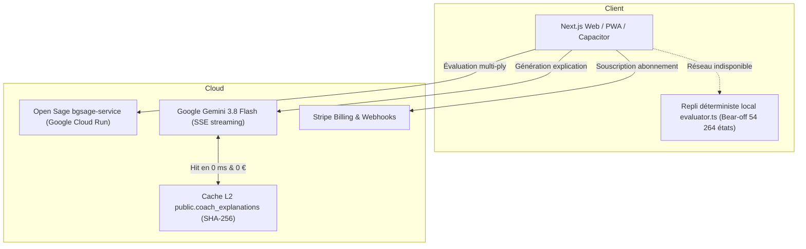

# Stratégie de Monétisation SaaS et Architecture Économique

> **Statut** : Document stratégique de référence (Octobre 2026).
> **Corrélation codebase** : Aligné avec l'implémentation Stripe réelle ([stripePlans.ts](../src/lib/stripe/stripePlans.ts)), le service de quotas ([quotaService.ts](../src/lib/subscription/quotaService.ts)) et le [Manifeste Directeur](../SYSTEM_SPEC_PROFITABILITY_MANIFESTO.md).

---

## 1. Analyse de la Niche et Segmentation de la Demande

Le marché du backgammon compétitif est historiquement polarisé entre des outils d'analyse bureau austères et vieillissants (**eXtreme Gammon 2 / XG2**, Windows 32 bits, 59,95 $) et des plateformes web ou mobiles (**Backgammon Galaxy**, **Backgammon Studio Heroes**) qui peinent à offrir un véritable accompagnement pédagogique génératif.

### 1.1 Panorama des Modèles Concurrents

| Plateforme | Modèle Économique | Grille Tarifaire | Limites & Frictions |
| :--- | :--- | :--- | :--- |
| **Backgammon Galaxy** | Freemium Hybride (SaaS + Coins GC) | **Star** : 6,99 €/mo ou 69,99 €/an **StarPRO** : 129,99 €/an | Gamification intrusive (pièces), moteur GNUbg serveur, tuteur IA encore embryonnaire. |
| **Backgammon Studio Heroes** | Freemium Fédéral B2B2C | **Standard** : 40 $/an **Tarif Fédéral** (FFBG/USBGF) : 25 $/an | Inscription sur parrainage obligatoire, activation manuelle des abonnements par e-mail, UX complexe. |
| **eXtreme Gammon 2 (XG2)** | Licence Perpétuelle Desktop | **PC** : 59,95 $ **Mobile** : 9,95 $ unique | Abandonware 32-bit Windows, incompatible macOS natif, aucune synthèse sémantique des coups. |
| **Chess.com (Benchmark)** | Freemium SaaS à 3 paliers | **Gold** : 49 $/an **Platinum** : 79 $/an **Diamond** : 119 $/an (Coach IA) | Modèle de référence mondial à conversion continue et haute valeur perçue. |

### 1.2 Le Culte du Performance Rating (PR) et la Propension à Payer (WTP)

Contrairement aux échecs où seul l'Elo prévaut, la variance des dés rend le score d'une partie trompeur. La communauté compétitive (BMAB, USBGF, FFBG) évalue le niveau réel par le **Performance Rating (PR)** :

$$\text{PR} = 500 \times \frac{\text{Perte d'équité totale}}{\text{Nombre de décisions non forcées}}$$

| Niveau (Standards BMAB / USBGF) | PR Cible | Perte d'Équité Moyenne | Profil & Rôle Commercial |
| :--- | :---: | :---: | :--- |
| **Super Grand-Maître (SGM)** | $\le 2,50$ | $\le -0,005$ | Élite mondiale (ex. Mochy), prescripteurs d'opinion et ambassadeurs. |
| **Grand-Maître (GM)** | $\le 4,00$ | $\le -0,008$ | Compétiteurs de pointe & coachs ; forte demande d'oracles et rollouts. |
| **Maître (Master)** | $\le 6,50$ | $\le -0,013$ | Joueurs de tournois et cash games / chouettes (ROI financier direct). |
| **Avancé / Intermédiaire** | $\le 10,00$ à $\le 16,00$ | $-0,020$ à $-0,032$ | **Cœur de cible SaaS** : forte propension à payer pour franchir un palier technique. |
| **Débutant / Occasionnel** | $\ge 24,00$ | $\ge -0,048$ | Acquisition gratuite, fidélisation et progression par l'IA Coach. |

---

## 2. Ingénierie des Revenus : SaaS Récurrent vs Crédits à l'Usage

### 2.1 Pourquoi le paiement par crédits à l'usage a été écarté
1. **L'Anxiété du Compteur (*Meter Anxiety*)** : Dès que chaque question au coach coûte un crédit prépayé, le joueur n'ose plus cliquer que sur ses grosses gaffes ($\ge 0.080$), délaissant ses imprécisions structurelles ($0.020$ à $0.040$). L'engagement quotidien et l'apprentissage s'effondrent.
2. **Complexité d'Ingénierie Logicielle Démesurée** : Le modèle à crédits impose un grand livre comptable transactionnel (*ledger*) en base avec verrous ACID, gestion d'expiration multi-lots (7j, 30j, 365j) et séquestre à deux phases (*reserve/commit/rollback*) pour recréditer le joueur en cas de timeout réseau.

### 2.2 Supériorité de l'Abonnement Récurrent (Implémenté)
L'abonnement Stripe Checkout / Billing repose sur une **autorisation sans état (*stateless*)** liée au profil utilisateur (`subscription_tier`, `subscription_status`, `current_period_end`), avec synchronisation par webhooks asynchrones idempotents.

---

## 3. Grille Tarifaire Déployée dans le Projet

Notre implémentation concrète dans [stripePlans.ts](../src/lib/stripe/stripePlans.ts) utilise une architecture à 3 paliers avec effet leurre (*Decoy Pricing*) :

| Palier Codebase | Rôle Marketing | Tarif TTC | Prix Équivalent | Conditions & Avantages |
| :--- | :--- | :--- | :--- | :--- |
| **`free`** (*Contender*) | Acquisition & Rétention | **0,00 €** | 0,00 € | - Jeu illimité & calcul du PR exact gratuit. - **3 revues de match complètes / 24h** ([quotaService.ts](../src/lib/subscription/quotaService.ts)). |
| **`coach_monthly`** | Leurre (*Decoy*) | **9,99 € / mois** | 9,99 € / mois | - 1 siège joueur. - Accès illimité au Coach IA & Banque de gaffes. |
| **`coach_yearly`** | **Cœur de cible (Recommandé)** | **79,99 € / an** | **6,67 € / mois** | - **-33 % d'économie** (soit 39,89 € / an économisés). - **7 jours d'essai gratuit** + Garantie 30j remboursé. |
| **`club_chouette`** | Ancrage haut (*Multi-sièges*) | **149,99 € / an** | **2,50 € / joueur / mois** | - **Pack 5 sièges** pour clubs ou chouettes. - 14 jours d'essai gratuit. |

### Métriques Cibles (Unit Economics)
- **Taux de conversion payant cible** : 8 % à 11 % des MAU.
- **Répartition** : 70 % annuel / 30 % mensuel.
- **ARPPU pondéré** : ~9,45 € / mois par utilisateur payant (~113,40 € / an).
- **ARPU global par MAU** : ~1,04 € / mois (~12,48 € / an).

---

## 4. Structure des Coûts Techniques (COGS) & Marges Réelles

Contrairement à l'hypothèse de l'étude externe qui envisageait un cluster `gnubg` en conteneurs Docker combiné à du WebAssembly client, notre production utilise une stack plus performante, plus robuste et juridiquement sécurisée :

### Modélisation des Coûts pour 10 000 MAU (1 100 Abonnés Payants)

| Poste de Dépense | Architecture Réelle Déployée | Coût Mensuel Estimé | Coût / Utilisateur Payant | % du CA (~10 400 €) |
| :--- | :--- | :---: | :---: | :---: |
| **Moteur Neuronal** | Open Sage (`bgsage-service` Cloud Run, auto-scaling) | 280,00 € | 0,25 € | 2,7 % |
| **IA Coach Génératif** | Gemini 3.8 Flash (SSE) + Cache Supabase L2 | 160,00 € | 0,15 € | 1,5 % |
| **Base & Temps Réel** | Supabase (PostgreSQL, Auth, RLS, Realtime) + Vercel/Netlify | 200,00 € | 0,18 € | 1,9 % |
| **Frais Monétiques** | Stripe Web (2,9 % + 0,25 €, lissé par l'annuel à 70 %) | 395,00 € | 0,36 € | 3,8 % |
| **Total Coûts Variables** | **COGS complets** | **1 035,00 €** | **0,94 €** | **9,9 %** |
| **Marge Brute Globale** | **Excédent brut avant marketing** | **~9 365,00 €** | **~8,51 €** | **90,1 %** |

Même pour un utilisateur intensif (*power user*) générant 800 explications LLM et 50 analyses de match par mois, son coût technique unitaire reste inférieur à 1,80 €/mois, garantissant une **marge brute plancher supérieure à 82 %**.

---

## 5. Stratégie d'Acquisition à Bas Coût (Go-to-Market Organique)

Afin de maintenir un Coût d'Acquisition Client (**CAC**) inférieur à 5,00 €, le lancement commercial s'appuie sur trois canaux organiques prioritaires :

### 5.1 Fédérations Nationales (FFBG, USBGF, UKBGF, WBGF)
- **Partenariat d'adhésion automatisé** : Saisie du numéro de licence fédérale à l'inscription donnant droit à **-25 % sur le forfait annuel** (soit 59,99 €/an) avec **15 % de rétrocommission** reversée à la fédération.
- Suppression de la friction historique de Backgammon Studio Heroes (activation manuelle par e-mail).
- Outils gratuits pour directeurs de tournois : gestion des tournois en ligne, rondes Swiss et exports certifiés BMAB.

### 5.2 Clubs Physiques et Événements Locaux (Paris, Manhattan, ABT)
- Licence **Grandmaster AI Coach offerte** aux présidents et directeurs de clubs référencés (Chicago Point, UKBGF, USBGF Prime Clubs).
- Outil gratuit de gestion des classements de club annuel.
- **Bouton de partage WhatsApp en 1 clic** : « La Gaffe de la Semaine du Club » avec analyse pédagogique de l'IA Coach.
- Dotations de tournois : bons d'abonnement 3 mois offerts aux vainqueurs de consolante et finalistes.

### 5.3 Viralité Communautaire (r/backgammon, bkgm.com)
- **Le « Décodeur de Position IA » sans inscription** : Widget web public permettant de coller un XGID ou importer une photo pour obtenir l'arbitrage mathématique et l'explication du Coach IA (lien partageable viralisant l'essai de 7 jours).
- **Le Certificat « Chance vs Compétence » (Luck vs PR)** : Démonstration visuelle décorrélant la malchance aux dés de la qualité des décisions (facteur anti-tilt transformant les défaites malchanceuses en fierté de jeu).

---

## 6. Calendrier et Doctrine d'Exécution

Conformément à la doctrine fondamentale définie dans le [Manifeste Directeur](../SYSTEM_SPEC_PROFITABILITY_MANIFESTO.md) :

> **« Interdiction formelle de disperser les efforts sur la commercialisation tant que le produit n'a pas atteint 100 % de Perfection Technique, Mathématique et Esthétique. »**

1. **Jalon Actuel (Socle 100 % Parfait)** :
   - Plateau haute-horlogerie, 60 FPS, zéro bug d'interaction.
   - Vérité mathématique irréprochable du Bot Open Sage (1/2/3-ply) et repli exact.
   - IA Coach neuro-symbolique sans hallucination (Feature Extractor + Gemini 3.8 Flash).
2. **Jalon Activation Monétisation (Post-Perfection)** :
   - Activation du Hard Paywall sur les analyses avancées après les 3 revues quotidiennes offertes.
   - Lancement public de la campagne d'affiliation fédérale FFBG / USBGF et du Décodeur de Position sans inscription.
