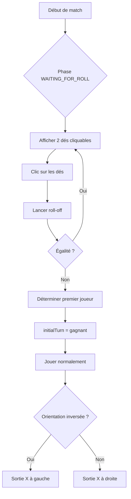

# Feuille de Route — Améliorations UX/Visuelles (Plan d'implémentation détaillé)

> **Source** : tableau récapitulatif fourni + clarifications utilisateur.
> **Décisions validées** :
> 1. Pip count → **toggle masquer/afficher** (pas un mode entraînement dédié).
> 2. Dé de démarrage → **simple clic sur les dés pour relancer** (pas d'écran roll-off dédié).
> 3. Orientation → **bouton de bascule rapide sur le plateau** (pas une option du menu ⚙️).

---

## 0. Règles impératives de documentation & d'implémentation isolée

> **Source** : [`SCALABILITY.md`](../SCALABILITY.md) (charte OBLIGATOIRE) + [`PROJECT_MAP.md`](../PROJECT_MAP.md).

Chaque fonctionnalité ci-dessous DOIT respecter les règles suivantes :

- **R1 — Taille max** : composant `.tsx` ≤ 300 lignes, hook `.ts` ≤ 200, logique pure `.ts` ≤ 400.
- **R2 — Isolation** : un composant = un fichier, auto-documenté (JSDoc : rôle, dépendances, comment le retirer).
- **R3 — Mémoïsation** : `React.memo` sur les composants rendus plusieurs fois, `useCallback`/`useMemo` sur handlers/valeurs dérivées, lookups en `Set`/`Map` (O(1)).
- **R4 — Tests** : toute logique métier a un test Vitest ; tout composant interactif a un test de rendu/interaction.
- **R5 — Pas de monolithe** : interdiction de mélanger rendu + logique + effets de bord.
- **R6 — Délégation pure** : les composants de présentation ne prennent aucune décision métier.
- **R7 — Types centralisés** : pas de type dupliqué.

### ⚠️ Contrainte critique : fichiers monolithiques interdits d'extension

Les fichiers suivants dépassent déjà la charte et **ne doivent PAS recevoir de nouveau code** :

| Fichier | Lignes | Règle violée |
|---|---|---|
| [`Board.tsx`](../src/components/board/Board.tsx) | ~595 | R1, R5 |
| [`useBackgammonGame.ts`](../src/hooks/useBackgammonGame.ts) | ~1244 | R1, R5 |
| [`page.tsx`](../src/app/page.tsx) | ~1484 | R1, R5 |

**Règle d'implémentation** : toute nouvelle logique/UI doit être **extraite dans un nouveau module isolé** conforme à la charte, puis **branchée** dans le fichier existant par une simple importation + délégation (pas d'ajout de logique inline).

### Pattern d'isolation à suivre

```
src/components/board/
├── Die.tsx                 # composant dé vectoriel isolé (React.memo)
├── PipCountBadge.tsx       # badge pip count différentiel isolé
├── DoublingCube.tsx        # videau dynamique isolé
├── CoachArrows.tsx         # flèches SVG coach isolées
├── boardOrientation.ts     # logique pure d'inversion (≤ 400 lignes)
└── *.test.tsx / *.test.ts  # tests associés
```

---

## 1. État actuel (vérifié dans le code)

| Fonctionnalité | État actuel | Fichier(s) concerné(s) |
|---|---|---|
| Pip count | Absolu (`O : X`, `X : Y`) | [`Board.tsx`](../src/components/board/Board.tsx:584) |
| Badges numériques | Piles > 5 uniquement | [`Board.tsx`](../src/components/board/Board.tsx:83) |
| Dés | HTML simple (chiffres) | [`Board.tsx`](../src/components/board/Board.tsx:512) |
| Dés vectoriels | Déjà présents dans le HUD (`MiniDie`) | [`MatchHud.tsx`](../src/components/hud/MatchHud.tsx:69) |
| Videau | Statique (valeur seule, centré) | [`Board.tsx`](../src/components/board/Board.tsx:478) |
| Thèmes | `snowie_classic`, `tournament`, `midnight` | [`boardThemes.ts`](../src/components/board/boardThemes.ts:42) |
| Flèches coach | `coachHighlight` (données `played`/`optimal`) | [`useCoach.ts`](../src/hooks/useCoach.ts:191) |
| Orientation | Fixe (sortie X à droite) | [`Board.tsx`](../src/components/board/Board.tsx:30) |
| Dé de démarrage | `ROLL_DICE` aléatoire, pas de roll-off | [`useBackgammonGame.ts`](../src/hooks/useBackgammonGame.ts:183) |

---

## 2. Tableau récapitulatif priorisé

| # | Axe | Fonctionnalité | Impact | Complexité | État |
|---|---|---|---|---|---|
| 1 | Ergonomie | **Pip Count Différentiel** (±Δ + pastille Vert/Rouge) | ⭐⭐⭐⭐⭐ | Très facile | ❌ |
| 2 | Visuel | **Vrais dés vectoriels/3D** + 4 dés en double | ⭐⭐⭐⭐⭐ | Facile | ❌ |
| 3 | Ergonomie | **Videau dynamique** (déplacement + halo) | ⭐⭐⭐⭐ | Facile | ❌ |
| 4 | Lisibilité | **Badges numériques** sur tous les points ≥ 2 | ⭐⭐⭐⭐ | Très facile | Partiel |
| 5 | Personnalisation | **Thème 2D Flat « Tournoi/Galaxy Void »** | ⭐⭐⭐⭐ | Facile | ❌ |
| 6 | Analyse | **Flèches SVG de trajectoire** (Coach : Optimal vs Joué) | ⭐⭐⭐⭐⭐ | Modérée | ❌ |
| 7 | Personnalisation | **Inversion d'orientation** (bascule rapide) | ⭐⭐⭐ | Facile | ❌ |
| 8 | Ergonomie | **Toggle masquer/afficher le pip count** | ⭐⭐⭐ | Très facile | ❌ |
| 9 | Ergonomie | **Choix du dé de démarrage** (clic sur les dés) | ⭐⭐⭐⭐⭐ | Facile | ❌ |

---

## 3. Détail des implémentations

### #1 — Pip Count Différentiel (±Δ + pastille Vert/Rouge)

**Fichier** : [`Board.tsx`](../src/components/board/Board.tsx:582)

**Implémentation** :
- Calculer `Δ = pipCounts.X - pipCounts.O` (du point de vue du joueur au trait `state.turn`).
- Afficher `±Δ` avec une pastille : **verte** si avance, **rouge** si retard.
- Exemple : `X : 167  (+12)` en vert, ou `X : 167  (-8)` en rouge.
- La pastille est calculée relativement au joueur au trait : si `turn === 'X'`, avance = `Δ > 0` ; si `turn === 'O'`, avance = `Δ < 0`.

**Dépendance** : `pipCount(board)` déjà importé ([`backgammonEngine.ts`](../src/engine/backgammonEngine.ts:186)).

---

### #2 — Vrais dés vectoriels/3D + 4 dés en double

**Fichier** : [`Board.tsx`](../src/components/board/Board.tsx:512)

**Implémentation** :
- Extraire le composant `MiniDie` (déjà vectoriel dans [`MatchHud.tsx`](../src/components/hud/MatchHud.tsx:69)) vers un module partagé (ex. `src/components/board/Die.tsx`) pour réutilisation.
- Remplacer les boutons HTML (chiffres) par des dés SVG avec pips.
- En cas de double (`d1 === d2`), afficher **4 dés** (les 4 coups) au lieu de 2.
- Conserver les états visuels : `used` (barré), `active` (sélectionné), `disabled`.

**Note** : `usedDice` est déjà un tableau de 4 éléments en cas de double ([`useBackgammonGame.ts`](../src/hooks/useBackgammonGame.ts:190)).

---

### #3 — Videau dynamique (déplacement + halo)

**Fichier** : [`Board.tsx`](../src/components/board/Board.tsx:478)

**Implémentation** :
- Déplacer le cube vers le camp du possesseur (`state.cubeOwner`) : haut si `O`, bas si `X`, centré si `null`.
- Ajouter un **halo** (ring lumineux) quand le double est possible (`canDouble`).
- `canDouble` est déjà calculé dans [`useBackgammonGame.ts`](../src/hooks/useBackgammonGame.ts:844) et exposé via `game.canDouble` ; il faut le passer en prop à `Board`.

**Dépendance** : ajouter une prop `canDouble?: boolean` à `BoardProps` et la transmettre depuis [`page.tsx`](../src/app/page.tsx:1178).

---

### #4 — Badges numériques sur tous les points ≥ 2

**Fichier** : [`Board.tsx`](../src/components/board/Board.tsx:83)

**Implémentation** :
- Modifier la condition `countBadge > 5` en `countBadge >= 2`.
- Ajuster le style pour que le badge reste lisible sur les petites piles (taille réduite si nécessaire).
- Appliquer la même règle dans `renderBarSection` ([`Board.tsx`](../src/components/board/Board.tsx:401)).

---

### #5 — Thème 2D Flat « Tournoi/Galaxy Void »

**Fichier** : [`boardThemes.ts`](../src/components/board/boardThemes.ts:11)

**Implémentation** :
- Ajouter `'galaxy_void'` au type `ThemeName`.
- Ajouter l'entrée `galaxy_void` dans `THEMES` : fond sombre profond, flèches plates (dégradés minimaux), zéro distraction.
- Mettre à jour `isValidTheme` et `getNextTheme` dans [`useBoardTheme.tsx`](../src/hooks/useBoardTheme.tsx:41).
- Mettre à jour le libellé du bouton thème dans [`MatchHud.tsx`](../src/components/hud/MatchHud.tsx:513).

---

### #6 — Flèches SVG de trajectoire (Coach : Optimal vs Joué)

**Fichier** : [`Board.tsx`](../src/components/board/Board.tsx:245)

**Implémentation** :
- `coachHighlight` contient déjà `{ played: Move[], optimal: Move[] }` ([`useCoach.ts`](../src/hooks/useCoach.ts:191)).
- Rendre des **flèches SVG** superposées au plateau entre `from` et `to` :
  - **rouge** pour le coup joué (`played`),
  - **vert** pour le coup optimal (`optimal`).
- Utiliser `pointLayout(point)` de [`boardGeometry.ts`](../src/components/board/boardGeometry.ts:81) pour calculer les coordonnées des flèches.
- Superposer un calque SVG `pointer-events-none` au-dessus de la grille.

**Note** : le rendu actuel est HTML/Tailwind (pas SVG plein plateau). Il faudra soit ajouter un calque SVG absolu, soit calculer les positions en pourcentage.

---

### #7 — Inversion d'orientation (bascule rapide sur plateau)

**Fichier** : [`Board.tsx`](../src/components/board/Board.tsx:30)

**Implémentation** :
- Ajouter un état local `inverted` (ou une prop contrôlée) qui inverse l'ordre des rangées :
  - `TOP_ROW` et `BOTTOM_ROW` échangés,
  - sortie X passe de droite à gauche.
- Ajouter un **bouton de bascule rapide** (icône ⇄) sur le plateau (coin du cadre).
- Persister le choix dans `localStorage` (clé dédiée, ex. `backgammon_orientation`).

**Note** : l'inversion est purement visuelle (réordonnancement des points) ; la logique moteur (`board[p]`) reste inchangée.

---

### #8 — Toggle masquer/afficher le pip count

**Fichier** : [`Board.tsx`](../src/components/board/Board.tsx:582)

**Implémentation** :
- Ajouter un état `showPipCount` (par défaut `true`).
- Ajouter un **bouton toggle** (icône 👁 / 👁‍🗨) à côté des badges pip count.
- Persister le choix dans `localStorage` (clé dédiée, ex. `backgammon_show_pipcount`).
- Quand masqué, ne pas rendre la rangée des badges.

---

### #9 — Choix du dé de démarrage (clic sur les dés pour relancer)

**Fichier** : [`useBackgammonGame.ts`](../src/hooks/useBackgammonGame.ts:183) + [`page.tsx`](../src/app/page.tsx:912)

**Implémentation** :
- Au début d'un match (phase `WAITING_FOR_ROLL`, aucun dé lancé), afficher deux dés cliquables (un pour X, un pour O).
- Le joueur **clique** sur les dés pour lancer le roll-off.
- Le joueur avec le dé le plus élevé commence (règle standard) ; en cas d'égalité, relancer.
- Ajouter un état `rollOff` dans le reducer : `{ xDie, oDie, winner }`.
- Le clic déclenche `rollDice()` existant, mais avec une logique de détermination du premier joueur.

**Note** : actuellement `initialTurn` est fixé à `'X'` ([`useBackgammonGame.ts`](../src/hooks/useBackgammonGame.ts:145)). Le roll-off doit déterminer dynamiquement le premier joueur.

---

## 4. Ordre d'exécution recommandé

1. **#1 Pip Count Différentiel** (très facile, indispensable).
2. **#8 Toggle pip count** (très facile, lié au #1).
3. **#4 Badges numériques** (très facile, confort blitz).
4. **#2 Vrais dés vectoriels/3D** (facile, immersion).
5. **#3 Videau dynamique** (facile, très pro).
6. **#7 Inversion orientation** (facile, personnalisation).
7. **#5 Thème Flat Galaxy Void** (facile, personnalisation).
8. **#9 Dé de démarrage cliquable** (facile, aligné Galaxy).
9. **#6 Flèches coach SVG** (modérée, pédagogique).

---

## 5. Diagramme de flux (roll-off + orientation)



---

## 6. Points d'attention / risques

- **#6 Flèches SVG** : le rendu actuel est HTML/Tailwind, pas un SVG plein plateau. Il faudra ajouter un calque SVG absolu avec calcul de coordonnées via `pointLayout`. C'est la tâche la plus complexe.
- **#2 Dés** : extraire `MiniDie` en module partagé pour éviter la duplication entre `Board` et `MatchHud`.
- **#9 Roll-off** : nécessite une modification du reducer (`useBackgammonGame`) pour gérer l'état `rollOff` et déterminer dynamiquement `initialTurn`.
- **#7 Orientation** : purement visuel, ne pas toucher à la logique moteur (`board[p]`).
- **Tests** : chaque fonctionnalité doit être accompagnée de tests unitaires (fichiers `*.test.tsx` / `*.test.ts` existants à étendre).

---

## 7. Conformité à la charte de scalabilité (par fonctionnalité)

| # | Fonctionnalité | Module isolé à créer | Fichier branché (import + délégation) | Test associé |
|---|---|---|---|---|
| 1 | Pip Count Différentiel | `PipCountBadge.tsx` | `Board.tsx` (remplace le bloc badges) | `PipCountBadge.test.tsx` |
| 2 | Dés vectoriels/3D | `Die.tsx` (extrait de `MiniDie`) | `Board.tsx` + `MatchHud.tsx` | `Die.test.tsx` |
| 3 | Videau dynamique | `DoublingCube.tsx` | `Board.tsx` | `DoublingCube.test.tsx` |
| 4 | Badges ≥ 2 | `Checker.tsx` (extrait de `LuxuryChecker`) | `Board.tsx` | `Checker.test.tsx` |
| 5 | Thème Galaxy Void | `boardThemes.ts` (données) | `useBoardTheme.tsx` + `MatchHud.tsx` | `boardThemes.test.ts` |
| 6 | Flèches coach SVG | `CoachArrows.tsx` | `Board.tsx` | `CoachArrows.test.tsx` |
| 7 | Inversion orientation | `boardOrientation.ts` (logique pure) | `Board.tsx` | `boardOrientation.test.ts` |
| 8 | Toggle pip count | `PipCountBadge.tsx` (état interne) | `Board.tsx` | `PipCountBadge.test.tsx` |
| 9 | Dé de démarrage | `rollOff.ts` (logique pure) + `RollOffDice.tsx` | `useBackgammonGame.ts` (via action) + `Board.tsx` | `rollOff.test.ts` |

**Règle d'or** : aucun nouveau code inline dans `Board.tsx`, `useBackgammonGame.ts` ou `page.tsx`. Chaque ajout passe par un module isolé conforme à la charte, branché par importation + délégation de props/handlers.

### Checklist de validation (avant merge, par fonctionnalité)

- [ ] Le fichier fait moins de la limite de taille (R1).
- [ ] Le composant est isolé dans son propre fichier (R2).
- [ ] Le composant est mémoïsé si rendu plusieurs fois (R3).
- [ ] Les handlers sont stabilisés (`useCallback`) (R3).
- [ ] Les lookups sont en O(1) (`Set`/`Map`) (R3).
- [ ] Un test couvre la nouvelle logique (R4).
- [ ] Aucune logique métier dans le composant de présentation (R6).
- [ ] Les types sont centralisés, pas dupliqués (R7).
